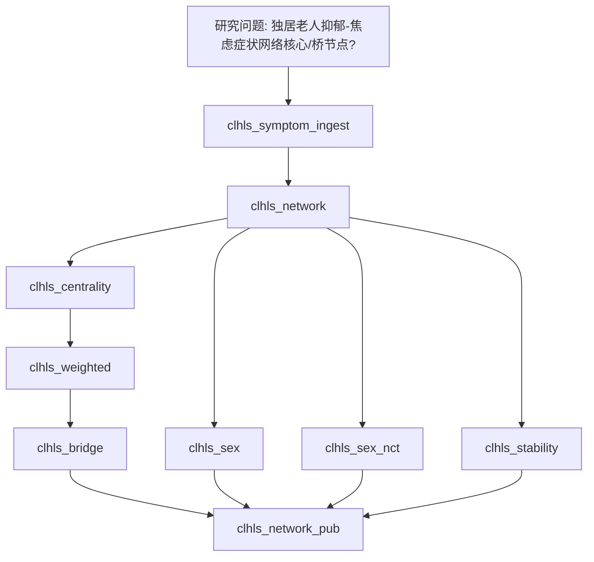

# 分析决策树 — CLHLS 抑郁×焦虑症状网络

> 配置：`configs/config_clhls_symptom_network.R`  
> 入口：`run/clhls_symptom_network/run_clhls_symptom_network.R`  
> 文献：Chang 2025 *BMC Psychiatry* — CLHLS 独居老人 CESD-10 × GAD-7（N=2028）  
> Block：`Blocks/81_clhls_symptom_network_full/`  
> 算法：对齐既往网络脚本（Pearson → nearPD → EBICglasso γ=0.5；Barrat/Onnela；bridge；性别；NCT；bootnet）

## 地基判定

- **不是**发病 Logistic，也**不是**预后 Cox。
- 不作插补：分析集已是作者 2028 人完整节点矩阵。
- 方法后缀挂在症状网络 Block 上；社区 = Depression（CESD1–10）↔ Anxiety（GAD1–7）。

## 流水线

## Block 映射

| Step | Block | 产物 |
|------|-------|------|
| 1 | `clhls_symptom_ingest` | 读入 2028 队列 |
| 2 | `clhls_network` | Fig 1（EBIC）+ 补充 pcor；边权；节点 R² |
| 3 | `clhls_centrality` | Fig 2；Table 2 前四列 |
| 4 | `clhls_weighted` | Table 2 Barrat/Onnela |
| 5 | `clhls_bridge` | Fig 3；桥表 |
| 6 | `clhls_sex` | Fig 4；Table 3；补充分性别中心性 |
| 7 | `clhls_sex_nct` | NCT 边/中心性显著表 |
| 8 | `clhls_stability` | Fig 5A/5B；补充边/强度差异；CS 表 |
| 9 | `clhls_network_pub` | Table 1；四目录图 |

## 飞书

- 工作计划编号：**B14**
- `workplan_code = "B14"`
