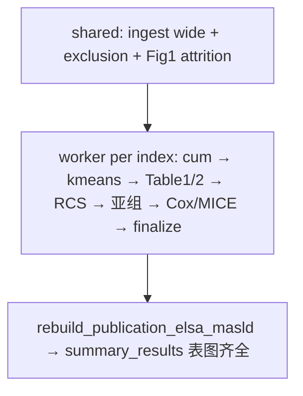

# 分析决策树 — ELSA 累积暴露 k-means × 新发 MASLD（单库全指标）

> 方法对抗阅读：复用 `paper_022` Q1–Q8（Wang 2026 cum-eGDR×k-means）  
> 课题：客户园&园；疾病 MASLD（LAP→SLD + ≥1 CMRF）；数据库 ELSA 2004/2008/2012  
> 地基：**发病 incidence** + 后缀 **cum_egdr_kmeans**（3A 复用 Blocks/76）  
> 数据：`.../62_MASLD/cum_egdr_kmeans_41654871/data/elsa_masld_cum_kmeans_analysis_wide.csv`  
> 波次：W2(2004)=T0 · W4(2008)=T1 风险起点 · W6(2012)=T2 结局；cum×**4**  
> **状态：按项目说明纳排后开跑（对齐骨质疏松 ePWV 交付套件）**

---

## 0. 纳排（项目说明）

| 步 | 规则 |
|----|------|
| n0 | ELSA W2(2004) Age≥50 |
| e1 | 出现在 W4(2008) 与 W6(2012) |
| e2 | W4 **严格可判**且 MASLD=0（风险起点） |
| e3 | W6 **严格可判**（结局可得） |
| e4 | 双波 BMI 完整（流程图分母；各指标 complete-case 在 worker） |

疾病定义：LAP 判 SLD（男≥30.5 / 女≥23.0）+ ≥1 项代谢异常 → MASLD。  
严格可判=组分齐全（2004 波降脂药项波级未问→9 项口径）。

实测分析集约 **N=202（事件≈46）**——SLD/MASLD 在血检子样本中高患病率，无病风险集天然偏小。

---

## 1. 指标池

与骨质疏松 ELSA 成功池一致（人体测量 / 血脂 / TyG 族 / ePWV / CRI_II…METS_VF）。

---

## 2. Pipeline

成败闸门：Table1 暴露组间或 Crude Model1 不显著 → `【failed】`（与 OP 同）。

---

## 3. 发表对齐（对标 【success】ePWV）

每成功指标 `summary_results/`：

- Tables 1–3 + S1–S4  
- Figures 1–3 + S1–S3（pdf + image_information）  
- Methods md + 软件版本 txt + 中期 PDF  
