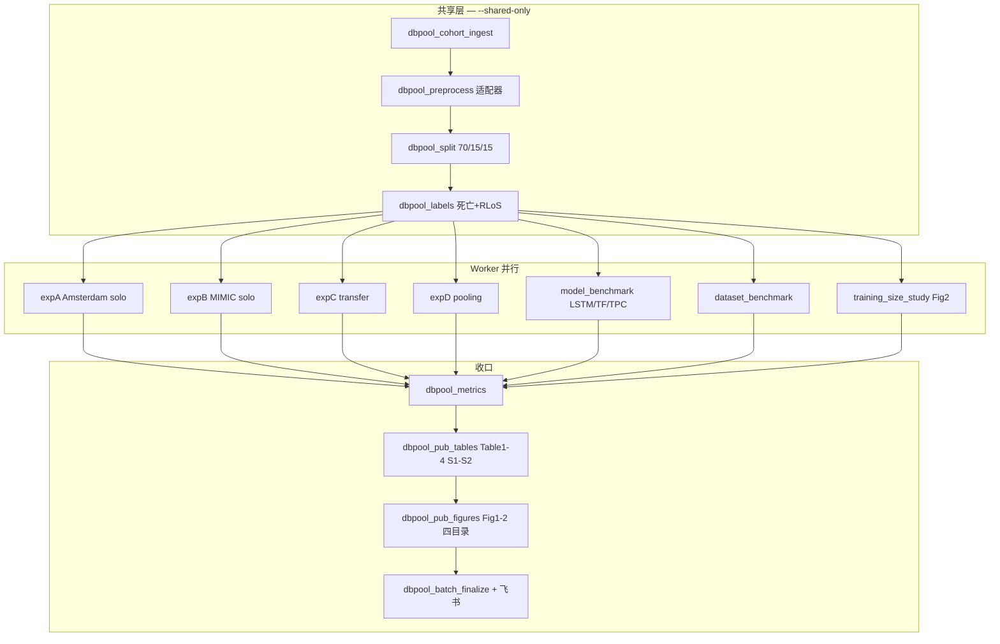

# 分析决策树 — 多数据库融合 / 数据库池化（BlendedLoS）

> 文献：Allyn et al. *Critical Care* 2026;30:364（DOI `10.1186/s13054-026-06034-5`）  
> 对抗阅读：`adversarial_lit_reading` · `paper_025`（Q1 PASS；Q2–Q8 进行中）  
> 公开代码：https://github.com/CIC-1410/BlendedLoS → **`Blocks/78_database_pooling_full/upstream/BlendedLoS/`**  
> 适配脚本：`Blocks/78_database_pooling_full/scripts/`  

> 数据：`/mnt/g/02block_result/48_ICU/database_pooled_42151996/data/RealExtraction_4DB_20261009/`  
> 配置：`configs/templates/config_database_pooling_batch.template.R`  
> 入口：`run/database_pooling/run_database_pooling_batch.R`  
> Blocks：`Blocks/78_database_pooling_full/`  
> 飞书 base：`RBjfb2iwmamW14s4WhKcS7kwnie` · protocol `database_pooling`  
> Rscript：`/mnt/c/Program Files/R/R-4.5.1/bin/x64/Rscript.exe`

## 地基判定

| 项 | 结论 |
|---|---|
| 研究问题 | ICU **预后预测**（院内 ICU 死亡 + 剩余住院日 RLoS） |
| 地基 | **预后 `survival`** |
| 方法后缀 | 多源 **数据池化 / 迁移学习** + **TPC** 时序深度多任务 |
| 路径 | **3B**：地基有、后缀新建 `78_*`（不挖第三块地基） |
| 代码策略 | **优先公开 BlendedLoS**；RealExtraction → 适配层 → 上游训练 |

## 总览



## Block 映射（78）

| Step | Block | 职责 |
|------|-------|------|
| 01 | `dbpool_cohort_ingest` | RealExtraction delivery 纳排/清单 |
| 02 | `dbpool_preprocess` | 适配为 BlendedLoS 布局 |
| 03 | `dbpool_split` | 患者级 70/15/15（seed=974） |
| 04 | `dbpool_labels` | 死亡 + RLoS（cap=10；死亡 mask） |
| 05 | `dbpool_train_eval` | 封装公开 BlendedLoS 单单元训练 |
| 06 | `dbpool_metrics` | AUROC/AUPRC/MAPE/Mcomposite 产物 |
| 07 | `dbpool_pub_tables` | Table1–4 + S1–S2 |
| 08 | `dbpool_pub_figures` | Fig.1–2 + 四目录 |
| 09 | `dbpool_batch_finalize` | 清单/飞书 |

## 必须复现的图/表

| 编号 | 对应单元/块 |
|------|-------------|
| Fig.1 | `dbpool_pub_figures` |
| Table 1 | delivery 静态 + finalize |
| Table 2 | `dataset_benchmark` |
| Table 3 | expA–D |
| Fig.2 | `training_size_study` |
| Table 4 | 文献对照 scaffold |
| Table S1 | MOESM1 / preprocess |
| Table S2 | `model_benchmark` |

## 跑法

```bash
# 共享层
"/mnt/c/Program Files/R/R-4.5.1/bin/x64/Rscript.exe" \
  run/database_pooling/run_database_pooling_batch.R --shared-only

# 全量并行
"/mnt/c/Program Files/R/R-4.5.1/bin/x64/Rscript.exe" \
  run/database_pooling/run_database_pooling_batch.R --workers auto

# 单单元
"/mnt/c/Program Files/R/R-4.5.1/bin/x64/Rscript.exe" \
  run/database_pooling/run_database_pooling_batch.R --only-unit expD_pooled_mimic_amumc
```

## 对抗阅读结论（Q1–Q8 chosen，摘要）

- 无临床亚型聚类；设计层分组=四库分区 + 四训练策略 + 死亡/存活（RLoS 条件存活）。  
- **损失**：条件性 `BCE + α·MSLE`（α=20）；**评估**：死亡 AUROC/AUPRC、RLoS **MAPE**（勿与损失混淆）。  
- 池化改善未见库泛化，但 **MIMIC 专化上池化可能劣于单源**（Table 3 反例须保留）。  
- 严格复现：公开 BlendedLoS + RealExtraction 适配 + 78 batch/飞书；偏离须论证。
