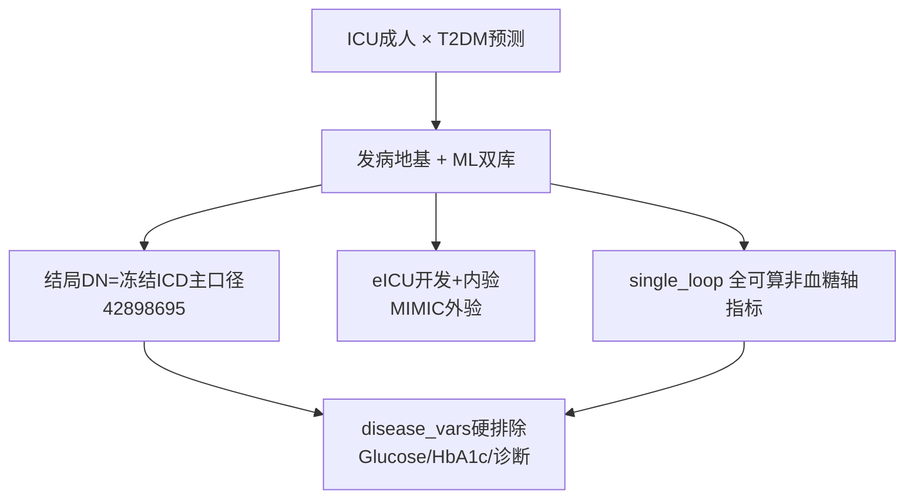

# 分析决策树 — 万学思 · II型糖尿病 · MIMIC×eICU 双库 ML 发病预测（全指标）

> 套路母版：`Decisiontree/decision_tree_ml_dual_batch.md` + 成功样例 `55_COPD/ml_40395549`  
> 疾病定义母本：PMID **42898695**（Metabol Open 2026；冻结件 `/home/ps/.../II型糖尿病/冻结定义.md`）  
> 课题目录：`//192.168.68.133/02block_result/24_diabetes/ml_40395549/`  
> 用户已确认（2026-11-12）；`config.R` + shared-only + workers 已启动。  
> 对抗阅读：`paper_42898695` Q4/Q5/Q8（validate PASS；train 桶；图表 docx 已出）。

---

## 0a. 对抗阅读 chosen 摘要（喂本树）

| 问 | score | 对本课题的约束 |
|---|---|---|
| **Q4** | 10 | 原文变量进入=库内 PSM 固定协变量 + 双重稳健，**非** UV/LASSO；本课题 ML 主链仍走铁律 A（Age+Gender → VIF final），不照搬原文 PSM |
| **Q5** | 9 | 原文条件 MAR + 规格备选；Cox 仅单库且未见 PH。本课题：MICE m=5 + `fit_on=train` + Rubin；无调查加权 |
| **Q8** | 9 | **强迁移**：T2DM 编码/纳排（与冻结 DN 对齐、去脓毒症）。**不迁移**：PSM+LMM 作主流水线。强制：时间零点/横断面防泄漏、single_loop 双库可算、eICU vs MIMIC 标签口径差异写入 Methods |

产物：`adversarial_lit_reading/labels/paper_42898695_Q{4,5,8}_training.jsonl`；  
图表：`adversarial_lit_reading/papers/paper_42898695_t2dm_mimic_eicu_图表.docx`

---

## 0. 地基判定

| 项 | 判定 |
|---|---|
| 研究问题 | 复合指标 → 是否 **T2DM**（二分类预测） |
| 地基 | **发病** `incidence` + **ML 双库**后缀 |
| 设计 | 横断面一人一行（非预后、无 futime） |
| 划分 | `split_mode = dev_internal_ext`（主库 train/内验 → 次库整库外验） |

---

## 1. 数据与结局

| 库 | 角色 | N | T2DM(DN=1) | 来源 |
|---|---|---|---|---|
| **eICU** | primary（人多） | 95,823 | 12,795 (13.35%) | 冻结样本 ∪ 实验室 stay=`rep_stayid` |
| **MIMIC_IV** | secondary 外验 | 65,366 | 17,685 (27.06%) | 冻结样本 ∪ 实验室 `subject_id` |

- 结局列：`Disease_Group`（T2DM / Non-T2DM）；底层 `DN` 0/1  
- **不用** dabiao 原 `T2DM` 列（eICU 严重低估；MIMIC 少 782 例）  
- 年龄：池内 ≥18；森林图 `age_cutoff=65`（ICU 成人常用界；注释写入 config）

---

## 2. 指标策略（「全指标」）

- `index_mode = single_loop`  
- `index_group = dual_safe` 精神 + **显式名单 44 个**（双库可算且不含 Glucose/HbA1c 成分）  
- `fail_policy = continue`  
- **不是** `combo_loop` 双复合组合（用户点名全指标单暴露循环）

血糖轴指标（TyG / SHR / SOSM / GLR…）一律剔除：预测 T2DM 时属结局泄漏。

---

## 3. 流水线要点（对齐 COPD / Cataract）

1. `prep_ml_data.R` → `Data/{eicu,mimic}/D04_dabiao.RData`（已完成）  
2. `--shared-only`：清洗 → 列对齐 → 指标计算  
3. workers：划分 → MICE(`fit_on=train`, m=5, Rubin) → Table1 → UV→VIF → LASSO FS → logistic 关联 → 多模型 ML → SHAP → 亚组 → Fig1  
4. 发表：`by_index/【success】*/summary_results/` 五件套 + Nature QC + 中期  

协变量铁律 A：Model1=Age+Gender；Model2=终末 VIF 池。  
亚组：`Age, Gender, Hypertension, Heart_Failure, CKD, Ventilation`（**禁止** Diabetes 分层）。

---

## 4. 与原文差异（Q8 迁移）

| 42898695 原文 | 本研究 |
|---|---|
| 脓毒症 ∩ T2DM 队列 + DPP4i 暴露 | **全 ICU 成人**预测 T2DM 有无 |
| 肝指标轨迹 / 死亡 | 复合指标 ML 分类 |
| 三库含 NWICU | **三选二：MIMIC + eICU** |
| eICU 码路含 1 型张力 | 主口径照冻结 DN；`DN_strict` 仅保留列不进主分析 |

可复用：**T2DM ICD/文本定义与人级分析单位**。不可复用：脓毒症绑定、DPP4i 暴露、死亡结局。

---

## 5. 请用户确认的检查点

请回复「确认」或逐条改：

1. **库对**：eICU 主库 + MIMIC 外验（因 eICU N 更大）  
2. **结局**：冻结 DN 主口径（eICU 宽松并集；不用 DN_strict 作主结局）  
3. **指标**：上表 44 个 single_loop 全跑（非双复合 combo）  
4. **硬排除**：Glucose/HbA1c/尿糖尿白蛋白/Diabetes 诊断列  
5. **年龄切点**：亚组 65 岁二分类  
6. **并行**：workers≈2（COPD 同配，防 LASSO×1000 OOM）

确认后立即写 `config.R` → `--shared-only` → `--workers`。
