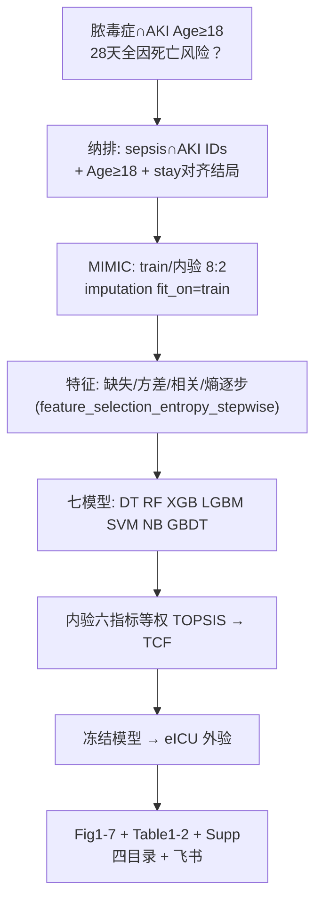

# 分析决策树 — 多算法融合 TCF（脓毒症∩AKI · MIMIC+eICU）

> 文献：Wang et al. *npj Digit Med* 2025;8:228（PMID **40295871**）TOPSIS-based Classification Fusion  
> 客户：枫叶 | 人群：Age≥18，脓毒症∩AKI | 双库：MIMIC-IV 开发 + eICU 外验  
> 地基：**预后** + **ML/TCF 方法后缀（3B）**  
> 对抗阅读：`adversarial_lit_reading` paper_40295871（Q1/Q4 PASS；其余续跑）  
> 门控：`.../multi-algorithm fusion_40295871/reports/foundation_gate_2026-10-27.md`  
> 入口：`run/ml_tcf_sepsis_aki/run_ml_tcf_sa_aki_batch.R`  
> 公开代码进库：`Blocks/22_ml_models/_extract_npj_tcf/` + `python/ml_tcf/`

---

## 0. 地基与拍板（已确认）

| 项 | 锁定 |
|---|---|
| 地基 | 预后 + TCF 后缀（非发病地基） |
| 结局 | ICU 入院起 **28 天全因死亡**：MIMIC `death_within_hosp_28days`；eICU `Expired & hosplosday≤28` |
| 划分 | MIMIC 80/20 train/内验（对齐 Table1；脚注 Fig.1 70/30 矛盾）+ eICU 整库外验 |
| stay | 仅 **SA-AKI ∩ 结局表 stay**；每 subject 最早合格 stay |

---

## 1. 总览

---

## 2. Blocks 复用 / 新建

| 能力 | 位置 | 状态 |
|---|---|---|
| 清洗/插补/Table1/UV/VIF | `02–08` + dual harmonize | 复用 |
| DT/RF/XGB/LGBM/SVM | `22_ml_models/01–09` | 复用 |
| **Naive Bayes** | `22_ml_models/22block_ml_naive_bayes.R` | **新建** |
| **GBDT** | `22_ml_models/23block_ml_gbdt.R` | **新建** |
| **TOPSIS 融合** | `22_ml_models/24block_ml_topsis_fusion.R` + `python/ml_tcf/` | **新建** |
| **熵逐步特征** | `19_feature_selection/11block_feature_selection_entropy_stepwise.R` | **新建** |
| 双库 batch / 外验 | `24_ml_dual` + `dev_internal_ext` | 复用 |
| SHAP / 校准 / DCA | `17_shap` + `23_ml_performance` | 复用 |
| 公开 notebook | `_extract_npj_tcf/` | 已入库 |

---

## 3. 发表图/表对照（文献一个不漏）

主文 Fig1–7、Table1–2；补充 Fig S1–S7、Table S1–S13 → 见 `reports/foundation_gate_2026-10-27.md` §4。

---

## 4. 跑批顺序

1. `Rscript run/ml_tcf_sepsis_aki/01_prepare_analytic_dabiao.R`  
2. `Rscript run/ml_tcf_sepsis_aki/run_ml_tcf_sa_aki_batch.R --shared-only`  
3. 同命令 `--workers`（可并行）  
4. 发表收口 + `run/pub/run_pub_qc_after_project.R`  
5. 飞书：`run/feishu/run_feishu_mark_ml_tcf_sepsis_aki.R`

---

## 5. 铁律（对抗结论）

- 插补 / MinMax / 特征逐步 **仅 train 拟合** 再应用到内验与 eICU  
- TOPSIS 权重在 **内验** 上计算，禁止用外验调权  
- 阈值默认 **0.5**（原文未 Youden 优化）  
- 34 特征为熵路径 **局部最优**；双库取可算交集后可在 MIMIC train 重跑逐步  
- disease_vars：`Acute_Renal_Failure` 等疾病泄漏列不进 Model（列审阅后写入 config）
