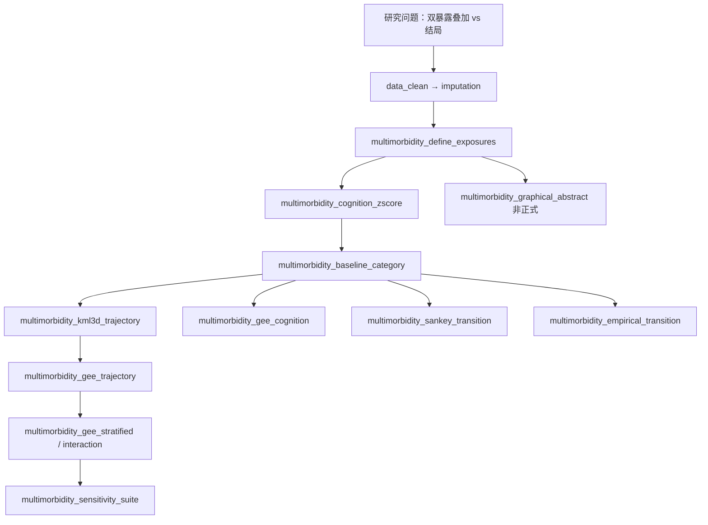

# 分析决策树 — 多病叠加（Wang 2025 BMC Medicine 04298）

> 配置模板：`configs/templates/config_multimorbidity_additive.template.R`  
> Batch：`configs/templates/config_multimorbidity_additive_batch.template.R`  
> Frailty 示例：`configs/templates/config_multimorbidity_frailty_depression.template.R`  
> 入口：`run/multimorbidity/run_multimorbidity_additive.R`  
> 设计：`docs/superpowers/specs/2026-11-04-multimorbidity-additive-blocks-design.md`

## 研究设定（默认可配置）

| 项 | 默认（文献） | 可替换示例（hrs） |
|---|---|---|
| 暴露 A（连续+二分） | BMI / 肥胖 | Frailty_Score / Frailty |
| 暴露 B | 抑郁得分 / 抑郁 | Depression_Score / Depression |
| 肥胖指标循环 | BMI → WHtR（有 WC）→ 可选 WWI | 同壳 |
| 结局 | Cognition_z（越高越好） | Sarcopenia / DN |
| 主方法 | 四分类 GEE + Kml3D 联合轨迹 GEE | 同 |

## 完整流水线

## Block 落盘与状态

| Step | Block | 路径 | 状态 |
|------|-------|------|------|
| 1 | `multimorbidity_define_exposures` | `Blocks/44_multimorbidity/05block_...` | 新建 |
| 2 | `multimorbidity_cognition_zscore` | `06block_...` | 新建 |
| 3 | `multimorbidity_baseline_category` | `01block_...` | 增强 |
| 4 | `multimorbidity_kml3d_trajectory` | `Blocks/26_trajectory/27block_...` | 重写 |
| 5 | `multimorbidity_gee_cognition` | `02block_gee_cognition` | 增强 |
| 6 | `multimorbidity_gee_trajectory` | `07block_...` | 新建 |
| 7 | `multimorbidity_sankey_transition` | `08block_...` | 新建 |
| 8 | `multimorbidity_empirical_transition` | `09block_...` | 新建 |
| 9 | `multimorbidity_gee_stratified` / `interaction` | `02`/`03` | 增强 |
| 10 | `multimorbidity_sensitivity_suite` | `04block_...` | 改写：去低体重 + 20% jackknife |
| 11 | `multimorbidity_graphical_abstract` | `10block_...` | 新建；非正式图 |

## 正式图 vs 非正式图

- **正式 Fig**：1 基线特征 → 2 四分类 GEE → 3 轨迹均值 → 4 轨迹 GEE；S=纳排 / Sankey / 经验转移 / 敏感性  
- **非正式**：`Figures/graphical_abstract/` 研究过程四栏（Cohorts / Variables / Process / Results），**不**占 Figure N

## 与原文差距（诚实口径）

| 模块 | 实现 | 说明 |
|------|------|------|
| Kml3D | R `kmeans` + Calinski–Harabasz 选 k（可选 Python 钩子） | 非必须装 R `kml3d` 包；逻辑对齐 hrs |
| Sankey | ggplot 近似冲积/转移矩阵热力+边表 | 不依赖 bioinformatics.com.cn |
| 四队列原始拼波 | 不在本套路 | 入口为已对齐表 / AfterMI |
