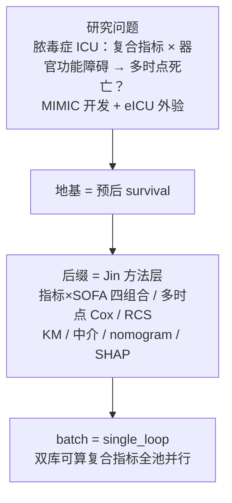
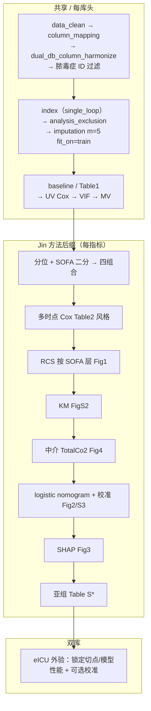

# 分析决策树 — 脓毒症 · Jin2025 方法迁移 · 双库全复合指标并行

> 对抗阅读：`paper_40295872`（Jin et al. Cardiovasc Diabetol 2025;24:422，DOI 10.1186/s12933-025-02969-1）  
> 对抗产物：`adversarial_lit_reading/rounds/A_tree_round2_revised_paper_40295872_Q1–Q8.md` + `labels/paper_40295872_Q*_training.jsonl`（Q1–Q8 validate PASS；train 桶）  
> 图表 Word：`adversarial_lit_reading/papers/paper_41194138_jin2025_shr_sofa_af_mortality_图表.docx`  
> 数据：`\\192.168.68.133\02block_result\36_spesis\prediction_41194138\data`  
> 用户确认口径（2026-11-03）：**方案 1** = 方法迁脓毒症双库；暴露 = **双库可算全部复合指标并行**（不只 SHR）

**状态：用户已确认（2026-11-03）；D1–D7 用推荐默认；41 指标全跑。工程已落盘，待确认试跑。**

---

## 0. 地基判定（Phase 2）

| 项 | 结论 |
|---|---|
| **地基** | **预后 `survival`**（死亡 / HR / KM / Cox） |
| **非地基** | 不是发病 logistic 主闸门 |
| **路径** | **3B**：地基已有；Jin 方法层作后缀；双库编排对齐 `ml_dual` / 预后 dual-batch |
| **母版参考** | `decision_tree_ml_dual_prognosis_aki_dev_ext.md`（双库外验编排）+ Jin 文方法菜谱（指标×SOFA、多时点、RCS、中介、nomogram、SHAP） |
| **对抗 Q8 chosen** | 迁统计菜谱；改编病种/双库/指标池；AF×SHR 实体与发病地基不适用 |

---

## 1. 研究设定（已与用户确认）

| 项 | 值 |
|---|---|
| 疾病 | **脓毒症**（ICD 名单见 `data/_cohort_ids/*_sepsis3_icd_codes.csv`；ID 见 `*_sepsis_ids.csv`） |
| 主库 | **MIMIC**（开发 + 内验） |
| 外验 | **eICU** 整库外验、冻结主库规则/模型 |
| 划分 | 推荐 `dev_internal_ext`（主库 7:3；eICU 外验） |
| 结局 | 对齐 Jin：**院内 / 30 天 / 365 天（或数据可得的等价时点）全因死亡**；以 survival CSV 的 `is_hosp_dead` / `death_within_*` / `hosp_survival_day` 等映射，写进 config 注释 |
| 暴露模式 | **`index_mode = single_loop`**：每个双库可算复合指标独立 job，**并行 workers** |
| 器官分层 | **SOFA**（与原文一致作调节/分层轴；切点默认 5，敏感性：中位数 — 对抗 Q1/Q5 已标原文 Methods=5 vs Results=median 冲突） |

### 1.1 双库可算复合指标池（主分析）

来源探测：`data/_docs/_dual_index_pool_curated.txt`（2026-11-03）

- **纳入 n=41**（已剔 HDL/LDL 透传；已剔 eICU 缺成分者）  
  `NLR, PLR, SII, NLPR, ANLR, PHR, HALP, GLR, WPR, CRI_II, GPR, De_Ritis, FIB4, APRI, ALBI, AGR, BAR, LAR, log2LAR, CAR, UA_CR, BUN_Cr, RAR, HRR, PNI, EASIX, SOSM, BMI, MCH, MCV, MCHC, RDW_CV, HHR, LHR, UHR, ALI, ACAG, AFR, ALT_HDL_C, HSI, NFS`
- **主分析禁止 HbA1c 轴**（eICU 无 HbA1c）：`SHR, HGI, HbA1c_HDL_C, eGDR`  
  → 仅可作 **MIMIC 单库敏感性**（可选 job，默认关）
- **双库缺脂类成分已自然剔除**：TyG / AIP / NHHR / TG_HDL 等（无 Triglycerides / Total_Cholesterol）
- **碳酸氢盐**：D01 无 `Bicarbonate`，有 `TotalCo2` → 中介代理须 Methods 写实，禁止 silently 当 bicarbonate

> PubMed 双组合查新：本课题是 **单指标 loop** 非双复合 combo；查新规则对 combo_loop 强制。若用户改为「双复合配对」再开查新门控。

---

## 2. 对抗阅读 → 工程约束（摘 chosen）

| 来源 | 约束写入本树 |
|---|---|
| Q1 | 暴露分位 + SOFA 二分先验；**四组 High/Low 暴露映射须在本课题 config 显式写清**（推荐：最高三分位=High，最低=Low，中间并入 Middle 或剔除 — **待确认 D1**） |
| Q2 | 三时点并行；须预先定义主终点 + 多重比较策略（推荐：主终点=院内死亡；30/365 探索；或分层 FDR — **待确认 D2**） |
| Q3 | 主推断 = Cox；预测支路 = logistic nomogram + SHAP；换法敏感性可选 |
| Q4 | UV→MV；预测后退逐步；RCS；**本引擎默认补 VIF**（优于原文未报） |
| Q5 | MI：**m=5 + Rubin**（覆盖原文 MissForest 不可核）；PH：`cox.zph` 出表 |
| Q6 | 必须有 **eICU 外验**（补原文无外验缺口）；校准/C-index 内+外 |
| Q7 | 局限写：回顾性、治疗策略、中介时序、双库异质性 |
| Q8 | 见上迁移三类 |

---

## 3. 关键决策点（写 config 前请拍板）

| ID | 问题 | **推荐默认** | 备选 |
|---|---|---|---|
| **D1** | 指标×SOFA 四组中「高/低暴露」如何从三分位映射？ | **T3=High，T1=Low，T2 并入分析作 Middle 但四组对比只用 T3 vs T1 × SOFA**（与引擎 `highest_vs_lowest` 精神一致；脚注写清） | 剔除 T2 后做 2×2；或中位数二分 |
| **D2** | 主终点？ | **院内死亡**；30 天 / 365 天次要（同模型族重复，Methods 声明不作多重强校正或 FDR） | 三时点同等主终点 + FDR |
| **D3** | SOFA 切点？ | **主分析 = 5**（对齐 Methods）；敏感性 = 中位数 | 只中位数 |
| **D4** | 中介物？ | **TotalCo2 代理 bicarbonate**（脚注）；门控同 `mediation_gate` | 若 TotalCo2 缺失过高则跳过中介导出 |
| **D5** | nomogram 特征？ | 暴露 + SOFA + UV/后退选入临床实验室（对齐原文精神）；**Shiny 可选** | 仅报表不网页 |
| **D6** | ML 五模型是否要？ | **默认否**（Jin 主文是 nomogram+SHAP，不是五分类竞赛）；若要可加后缀对齐 AKI 预后 ML | 开五模型作补充 |
| **D7** | 指标池最终名单？ | 上表 **41**；确认后锁进 config `index_vars` | 用户删减 |

---

## 4. 流水线骨架（确认后落 config）

### Blocks：按方法文件夹挂（禁止 `82_*` / `78_*` 套路整包）

| 能力 | 动作 | 入口 |
|---|---|---|
| 清洗/指标/插补/Table1/UV/VIF/分位 Cox/RCS/KM/亚组/中介 | **复用已有** | `02_data_clean`…`15_rcs` / `18_subgroup` / `20_mediation` / `27_KM` |
| 三分位 Cox / 连续×SOFA 交互 | **复用已有** | `10_cox/cox_tertile`、`cox_interaction` |
| 四组 KM | **复用已有** | `27_KM/km_strata` |
| ML 树模型 SHAP / Shiny 动态列线图 | **复用已有**（本课题 D6 默认不开五模型） | `17_shap/shap`、`25_shiny` |
| 暴露×SOFA → Q1–Q4 | **方法目录补块** | `02_data_clean/derived_grouping` |
| 院内/30d/365d 多时点 Cox | **方法目录补块** | `10_cox/cox_multi_horizon` |
| 静态 rms nomogram + 校准 | **方法目录补块** | `11_logistic/logistic_nomogram` |
| 解释 glm/lrm 的 SHAP | **方法目录补块** | `17_shap/shap_glm` |
| 双库 batch / workers / code 包 / 发表收口 | **复用** | `run/survival` dual-batch + `run/sepsis_jin_prognosis` 薄封装 |

**禁止**：`Blocks/82_jin_index_sofa_prognosis_full` 一类套路整包；改历史 【success】；在 `02block_result/.../scripts/` 堆长期 hotfix。

---

## 5. 发表图/表对照（文献一个不漏 → 本课题键）

| 原文 | 本课题产出键（每指标 / 汇总） | 备注 |
|---|---|---|
| Figure S1 Flowchart | Figure 1 双栏 CONSORT | 脓毒症纳排 + 库角色 |
| Table 1 基线（暴露三分位） | Table 1-MIMIC / Table 1-eICU | Gate A 对齐 |
| Table 2 多时点 Cox | Table 2（院内/30d/365d） | Rubin 脚注 |
| Figure 1 RCS×SOFA | Figure 2 RCS | 面板标库 |
| Figure 2 Nomogram×3 | Figure 3 Nomogram | 时点 a/b/c |
| Figure 3 SHAP | Figure 4 SHAP | 解释验证集/外验规则写清 |
| Figure 4 中介 | Figure 5 路径图 + Table S 中介 | TotalCo2 代理 |
| Figure S2 KM | Figure S1 KM | 四组合 |
| Figure S3 校准 | Figure S2 校准 | bootstrap |
| Table S1–S3 亚组 | Table S* 亚组×时点 | 双库一致亚组名单 |

---

## 6. 工程交付清单（确认本树后）

1. `configs/templates/config_sepsis_jin_prognosis_index_sofa_dual_batch.template.R`
2. 项目 config：`02block_result/36_spesis/prediction_41194138/config_*.R`（或仓库 `configs/study_...` 惯例路径）
3. `run/sepsis_jin_prognosis/`（或挂现有 `run/ml`/`run/survival` 薄封装）batch + worker；`--shared-only` → `--workers`
4. Blocks：复用优先；缺口只进对应方法目录（`02_data_clean` / `10_cox` / `11_logistic` / `17_shap`）
5. 飞书：`run/feishu/` + base `RBjfb2iwmamW14s4WhKcS7kwnie`
6. Rscript：`"/mnt/c/Program Files/R/R-4.5.1/bin/x64/Rscript.exe"`
7. 跑完：pub-qc → Nature P0 → 中期 PDF

---

## 7. 请用户确认

回复请直接：

1. **确认本决策树？**（是 / 改 D1–D7 哪几条）  
2. **D1–D7** 是否接受推荐默认？  
3. **41 指标池**是否全跑，还是要删减名单？  

确认后才写 config / run / Blocks（标准路径双确认门）。
