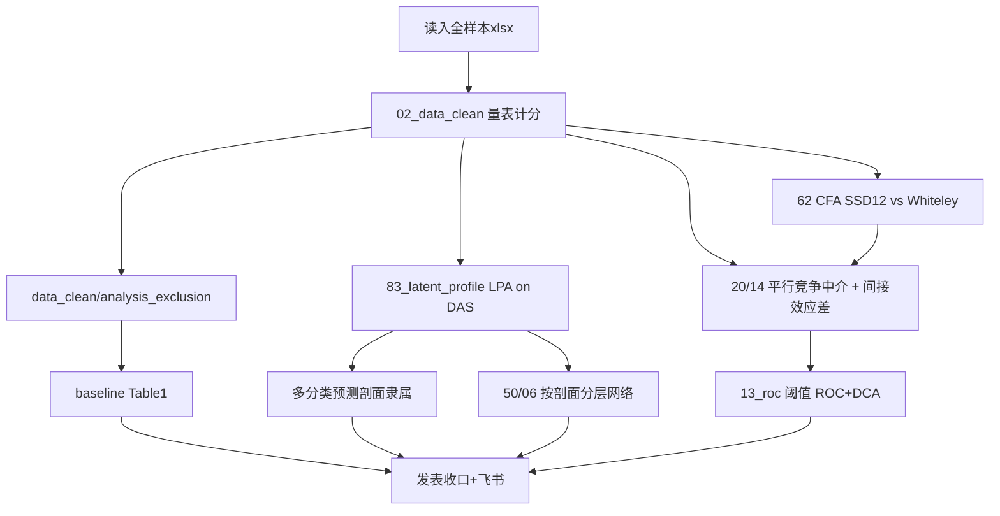

# 分析决策树 — SSD 功能残疾 LPA × 网络 × 平行竞争中介

> 客户：王玉贤  
> 文献方法源：Ma 2026 *Acta Psychologica*（PMID 42214160）— 对抗阅读 `paper_060`（Q1–Q8 PASS）  
> 数据：`/mnt/g/02block_result/63_SSD/LPA_Network_Mediaton_42214160/data/`（N≈699，尽量用满量表）  
> 核心问题：躯体症状对 WHO-DAS 功能残疾，是直接效应还是经「过度关注/恐惧」中介？  
> **已确认（用户 确认）**：方法 Block / template / config / run / 飞书挂接已落地；试跑前再口头确认一次

## 地基判定

- **地基**：发病前缀（清洗 → 计分 → Table1 → 单/多因素 → VIF）  
- **方法后缀**：LPA + 心理网络 + 平行竞争中介 + CFA + 临床阈值  
- **禁止**：再建 `83_ssd_*_full` 大杂烩；方法进对应目录

## 对抗阅读 chosen 要点（喂入本树）

| Q | chosen 摘要 |
|---|---|
| Q1 | K* 为拟合+极小类+可解释性**复合选择**；方向先验、形状未声明；勿照搬 K=3 |
| Q2 | 网络≠传统多暴露解法；未见 FDR 勿从沉默定罪；预验证合成分≠PCA |
| Q3 | 三件套互补；网络补充相关；有内部稳健性、无方法替换敏感性 |
| Q4 | 三类入模逻辑不同；中介协变量须**明示名单**；无预注册 |
| Q5 | glasso（非误标 EBICglasso）；完整病例 vs 另做 MI；非加权 |
| Q6 | 类数比较=选模≠验证；报告 CS 并标低 CS；bootstrap=推断 |
| Q7 | 横断面打击强因果；弱描述/异质结论可立 |
| Q8 | **管道迁移+实质重设**；平行竞争中介=**新模块**；剖面 n/CS 门控；R vs Mplus 注明 |

## 变量角色（本课题）

| 角色 | 变量（尽量用满） |
|---|---|
| 暴露 X | PHQ-15 总分/条目、SSS-8（症状负荷） |
| 平行中介 M1/M2 | SSD-12、Whiteley-8（过度关注/恐惧） |
| 结局 Y | WHO-DAS 12 总分 + 维度；扩展 SF-12 / 就诊次数 N12AA |
| LPA 靶 | **DAS1–12 条目** → 功能亚型 |
| 协变量 | 人口学（age/sex/education/marriage/income/livingsite/occupation 等）+ 病程/科室等；**名单预声明** |
| 网络节点（控制规模） | 分块：症状块 / 认知恐惧块 / 功能块；禁无节点无门控硬上 |
| 情绪共变 | PHQ-9、GAD-7（调整/敏感性，防过度调整需脚注） |
| 其他可用 | BDS、治疗满意度/效果、SSD 诊断标记（分层/敏感性） |

## 流水线（方法块落点）

| 步骤 | Block 落点 | 产物对齐文献 |
|---|---|---|
| 计分 | `02_data_clean/` 新号 | 各量表总分/维度 |
| LPA | `Blocks/83_latent_profile/` | ≈Fig1, Table2 |
| 基线按剖面 | `04_baseline` 复用 | ≈Table1 |
| 剖面预测 | `06` 多分类 + VIF | ≈Table3 |
| 网络分层 | `50_complex_network/06…` | ≈Fig2–3, Table4 |
| 相关 | 复用相关表逻辑 | ≈Table5 |
| 平行竞争中介 | `20_mediation/14…` | ≈Table6/Fig4 + **扩展**双中介差 |
| CFA | `62_sem_…` 新号 | 反馈扩展 |
| ROC/DCA | `13_roc/` | 反馈扩展 |
| 发表/飞书 | `run/ssd_lpa_network_mediation/` + `run/feishu/` | 图一个不漏 |

## 门控铁律

1. LPA：**重扫 K**，复合选模规则预声明；小类比例阈值写入 config  
2. 剖面 **n 过小** → 该层网络降级/不报强结论；中介以全样本+可估层为准  
3. 中介：Bootstrap；**预声明调整集**；报告间接效应差（SSD-12 vs Whiteley）  
4. 横断面：Methods/Limitations **禁止**写成已证因果  
5. 全样本用满：主分析全 N；SSD=yes / 高 SSD-12 作分层或敏感性  

## 工程

- Rscript: `"/mnt/c/Program Files/R/R-4.5.1/bin/x64/Rscript.exe"`  
- 可并行 batch：`--shared-only` → `--workers`  
- 飞书 base：用户提供链接  

## 确认状态

- [x] 本决策树（变量角色 + 块落点 + 门控）  
- [x] template/config/run 与方法 Block 已写入  
- [x] 试跑（冒烟 EXIT=0；正式 sims=5000 待跑）（建议冒烟：`SSD_MED_SIMS=50 SSD_NET_BOOTS=20 SMOKE_NO_FEISHU=1`）
