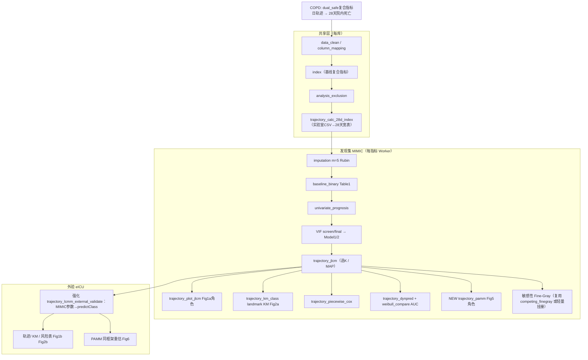

# 分析决策树 — COPD 复合指标轨迹预后（对齐 fcimb-16-1871653）

> 状态：**已确认，开始写 Block / config / run**（2026-11-18）  
> 对抗阅读 id：`paper_1871653`（勿与旧 ELSA `paper_013` 混淆）  
> 文献：Wang 2026 *Body temperature as a dynamic host-response biomarker in sepsis*（方法迁移）  
> 数据：`G:/02block_result/55_COPD/Prognosis_Trajectory_v2_42558177/data`  
> 飞书：https://lcn1in9jd6ie.feishu.cn/base/RBjfb2iwmamW14s4WhKcS7kwnie  
> config：`configs/templates/config_trajectory_prognosis_copd_jlcm_batch.template.R`  
> run：`run/trajectory_prognosis/run_trajectory_prognosis_copd_jlcm_batch.R`  
> prepare：`run/trajectory_prognosis/prepare_copd_trajectory_data.R`

## 用户已锁定

| 项 | 决定 |
|----|------|
| 地基 | **预后** + 轨迹后缀（非发病） |
| 暴露 | 引擎 `dual_safe` 双库可算**全部复合指标**（`analysis_exclusion` 疾病成分硬排除后） |
| 结局 | `death_within_hosp_28days`（28 天院内死亡） |
| 验证 | **A** MIMIC 发现 → eICU **固定参数**外验 |
| PAMM | **要**，`30block_trajectory_pamm.R`；阈值三套做满 |
| 阈值口径 | **MIMIC 发现集锁定 P5/P95**，eICU 套同一绝对切点；若「异常」人天过稀 → 该指标自动降级 **P10/P90**（仍发现集锁定） |
| 类数 K | **K1** 每指标在 2–6 中按 BIC/entropy/≥5%/可解释自选最优 |
| 时间粒度 | 日级实验室（原文 6h 体温 → 改编） |
| Block | A 复用同意；B 强化 `13` 同意；C 新建 PAMM 同意 |

## 完整流程

## 发表图/表对照（一个都不能少）

| 文献 | 角色 | 引擎产出键 / Block |
|------|------|-------------------|
| Fig1a/b | 发现/外验轨迹曲线 | `trajectory_plot_jlcm` |
| Fig2a/b | landmark KM by class | `trajectory_km_class` |
| Fig3/4 | landmark 动态预测风险 | `trajectory_dynpred` (+ individual 可选) |
| Fig5 | PAMM 非线性/时变（发现） | **NEW `trajectory_pamm`** |
| Fig6 | 外验时变关联 | `trajectory_pamm` validation |
| Table1 | 发现 vs 外验基线 | `baseline_binary` |
| Supp T3–T6 | 选K / AvePP | JLCM fit 导出 |
| Supp T7–T8 | 分段 Cox HR | `trajectory_piecewise_cox` |
| Supp T9–T10 | 四套暴露度量 HR | PAMM + Cox 负担度量 |
| Supp 敏感性 | FG / 结局重跑 | competing / sensitivity |
| AUC 对照 | 动态 vs 静态 | `trajectory_weibull_compare` |

原文 image 1–6.tif / data sheet 1.docx 作为版式与表结构参照。

## Block 确认清单（写代码前请回复同意/修改）

### A. 复用（不新建）

- `trajectory_calc_28d_index`, `trajectory_jlcm`, `trajectory_plot_jlcm`, `trajectory_km_class`
- `trajectory_piecewise_cox`, `trajectory_dynpred`, `trajectory_dynpred_individual`
- `trajectory_weibull_compare`, `trajectory_baseline_by_class`, `trajectory_subgroup_class`
- 预后地基：`data_clean` → `imputation` → `baseline_binary` → UV/VIF/MV

### B. 强化现有（不新增序号，改 `13` 行为；**不改旧成功课题默认**）

- `Blocks/26_trajectory/13block_trajectory_lcmm_external_validate.R`  
  - 现状含 smoke/随机回退 → 改为：**仅** `lcmm::predictClass` 真迁移；失败即停  
  - config：`discovery_cohort="MIMIC"`, `validate_cohort="eICU"`

### C. 新建（请确认）

| 文件 | register_block | 依赖 | 作用 |
|------|----------------|------|------|
| `Blocks/26_trajectory/30block_trajectory_pamm.R` | `trajectory_pamm` | R `pammtools` + `mgcv`（无公开作者代码；用包官方接口） | Fig5/6：连续指标时变非线性；可选门槛/占比/累积负担 |

**公开代码**：未找到 Wang 2026 作者仓库；PAMM 实现依据 [pammtools](https://github.com/adibender/pammtools)。

### D. 待你拍板的两点

1. **PAMM 阈值三套**（原文 ≤36/≥39）：  
   - D1 只做连续主面板（Fig5a–d 连续部分）  
   - D2 用双库合并分布的 P5/P95（或你指定）定义「过低/过高」后做满占比/累积  
2. **类数 K**：  
   - K1 每指标 2–6 自选（BIC+≥5%+可解释）  
   - K2 优先展示 5 类（对齐文献），不收敛再降级  

## 交付路径（确认后）

- `configs/templates/config_trajectory_prognosis_copd_jlcm_batch.template.R`
- `configs/...` 课题 config（新目录，不覆盖旧 success）
- `run/trajectory_prognosis/run_trajectory_prognosis_copd_jlcm_batch.R` + worker（可并行）
- `run/feishu/` 三表同步接给定 base
- Rscript：`"/mnt/c/Program Files/R/R-4.5.1/bin/x64/Rscript.exe"`

## 对抗阅读进度

- Phase 0 chunk：`chunks/paper_1871653_fcimb_temperature_jlcm.md` ✅  
- Q1–Q8 Round1 A 树：已落盘；GLM 攻击进行中 → 修正/Judge 随后补齐  
