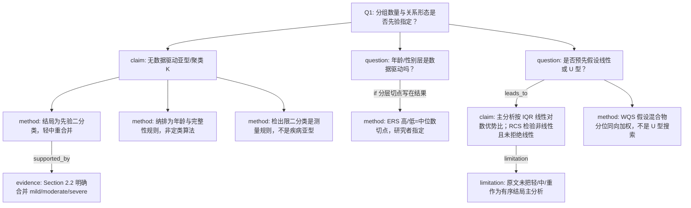

# AI-A Decision Tree Round 1

paper_id: paper_004
question_id: Q1
task_type: literature_decision_tree_reasoning
question: 本研究预设了几个分组/亚型/类别？该数量是数据驱动还是研究者主观指定？是否假设了暴露-结局关系的方向（线性、单调、U型）？
source_file: adversarial_lit_reading/chunks/paper_004_ewas_new.md；补充材料 Methods（docx 抽取）

## 1. Evidence Map

| evidence_id | location | evidence_summary | used_by_node |
|---|---|---|---|
| E1 | Methods 2.2 | 牙周状态按 CDC/AAP：重/中/轻定义后，分析时合并为「有牙周炎 vs 无牙周炎」二分类 | N2, N3 |
| E2 | Methods 2.1 / Fig.1 | 分析样本为年龄≥20 且牙周检查与毒物测量完整、毒物缺失不超过三分之一，n=1210；非聚类定类 | N4 |
| E3 | Results 3.4 / Fig.3 | 分层为年龄（<60 vs 其余）与性别；切点在结果中给出，非轮廓系数/BIC 选出 | N5 |
| E4 | Methods 2.5 | ERS 按中位数分为高/低两组；连续 ERS 另报每 IQR | N6 |
| E5 | Methods 2.5 / Results 3.5 | 主关联报每 IQR 的 OR；RCS 3 结点检验 ERS 非线性，P for nonlinear=0.348 | N7, N8 |
| E6 | Methods 2.5 | WQS：分位数=4，bootstrap 1000；作为混合物互补分析 | N9 |
| E7 | Results 3.2 / Supp Methods | 89 种毒物经 LOD/缺失规则留 73；16 个因 >30% 低于检出限而二分类，57 个取自然对数 | N10 |

## 2. Decision Tree - Mermaid

## 3. Node Table

| node_id | node_type | claim | evidence_location | evidence_summary | confidence | risk_tag |
|---|---|---|---|---|---|---|
| N0 | question | 分组来源与剂量-反应形状？ | Q1 | 本问 | high | 证据不足 |
| N1 | claim | 类别数不是聚类/LCA 选出 | Methods 全文无 K/BIC/轮廓系数 | 无数据驱动定类 | high | 证据不足 |
| N2 | method | 结局二分类由 CDC/AAP 定义后合并 | Section 2.2 | 有牙周炎 vs 无 | high | 证据不足 |
| N3 | evidence | 合并规则写明 | Section 2.2 | mild+moderate+severe vs none | high | 证据不足 |
| N4 | method | n=1210 来自纳排 | Section 2.1 Fig.1 | 年龄≥20、缺失规则 | high | 证据不足 |
| N5 | question | 年龄性别分层是否算法定切点 | Results 3.4 | <60 与男性层毒物数更多 | high | 证据不足 |
| N6 | method | ERS 二分=中位数 | Methods 2.5 | high/low by median | high | 证据不足 |
| N7 | question | 关系形态是否预先声明 | Methods 2.5 | IQR OR + RCS | high | 证据不足 |
| N8 | claim | 主效应按线性 IQR；RCS 未显示非线性 | Results 3.5 | P-nonlinear=0.348 | high | 证据不足 |
| N9 | method | WQS 分位=4 | Methods 2.5 | gWQS | high | 证据不足 |
| N10 | method | 16 个毒物二分类来自 LOD>30% | Supp Methods / Results 3.2 | 非亚型 | high | 证据不足 |
| N11 | limitation | 有序牙周严重度未作主结局 | Section 2.2 vs Results | 只二分 | medium | 逻辑跳跃 |

## 4. Provisional Answer

分组是研究者先验指定，不是数据驱动定类。结局为二分类；年龄分层切点 60 岁与性别分层、ERS 中位数二分也是指定规则。主分析假设每 IQR 的对数优势比可线性解释，并用 3 结点 RCS 检验非线性，结果未拒绝线性。WQS 是同向混合物权重，不是 U 型搜索。

## 5. Uncertainty List

- U1: 年龄 <60 的切点在 Results 出现，Methods 未单独论证为何不是 65。
- U2: 原文未明确说明是否预先登记「只检验线性、非线性仅作诊断」。
- U3: 轻/中/重是否在补充材料做过有序模型，正文未给出。

## 6. Follow-up Questions

1. 补充表是否报告牙周严重度有序 logistic？
2. WQS 是否约束全部权重同号，还是做了正负双向？
