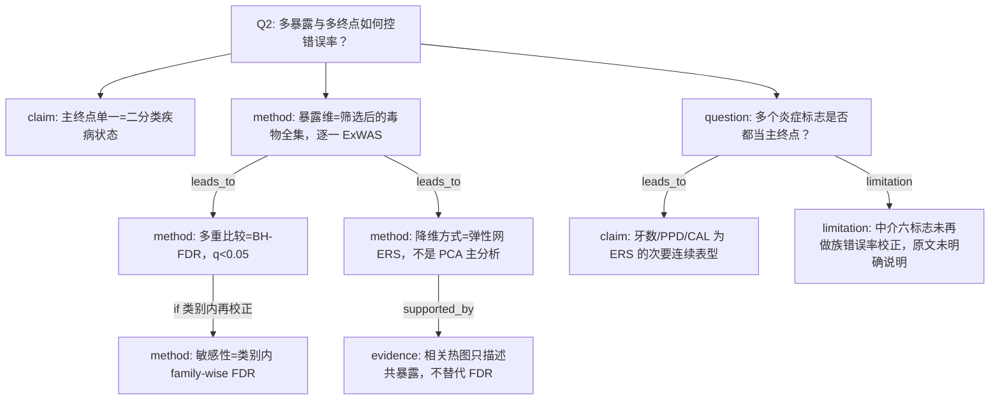

# AI-A Decision Tree Round 1

paper_id: paper_004
question_id: Q2
task_type: literature_decision_tree_reasoning
question: 如何处理多亚型/多终点/多层暴露？是否多重比较校正？是否对相关终点做主成分或复合终点？
source_file: adversarial_lit_reading/chunks/paper_004_ewas_new.md；补充材料 ExWAS/ERS 段

## 1. Evidence Map

| evidence_id | location | evidence_summary | used_by_node |
|---|---|---|---|
| E1 | Abstract / Methods 2.3 | 初筛 89 种、13 类，主分析保留 73 种、12 类 | N2 |
| E2 | Methods 2.5 | ExWAS 对每个毒物单独回归，BH-FDR | N3 |
| E3 | Results 3.3 / Supp Table 2 | 另做化学类别内 family-wise FDR 作为敏感性 | N4 |
| E4 | Methods 2.5 / Fig.4 | 弹性网把多毒物收成一个 ERS，再与结局关联 | N5 |
| E5 | Results 3.6 / Fig.5 | 中介物 6 个（白细胞、中性粒、单核、SII、NLR、SIRI），标明探索性 | N6 |
| E6 | Fig.4F | ERS 还关联牙数、探诊深度、附着丧失，为连续次要表型 | N7 |
| E7 | Supp Fig.2 / Fig.4A | 展示 73 毒物相关，主分析未先做 PCA 降维再回归 | N8 |

## 2. Decision Tree - Mermaid

## 3. Node Table

| node_id | node_type | claim | evidence_location | evidence_summary | confidence | risk_tag |
|---|---|---|---|---|---|---|
| N0 | question | 多暴露多终点策略 | Q2 | 本问 | high | 证据不足 |
| N1 | claim | 主终点一个二分类 | Section 2.2 Results 3.3 | 牙周炎有/无 | high | 证据不足 |
| N2 | method | 73 个独立回归 | Methods 2.5 | rexposome ExWAS | high | 证据不足 |
| N3 | method | BH-FDR | Methods 2.5 Results 3.3 | q<0.05 得 29 个 | high | 证据不足 |
| N4 | method | 类别内 FDR 敏感性 | Results 3.3 Supp Table 2 | family-wise within class | high | 证据不足 |
| N5 | method | ERS 聚合优先毒物 | Methods 2.5 Fig.4 | 17 个入选 | high | 证据不足 |
| N6 | question | 六个中介是否主终点 | Results 3.6 | 标明 exploratory | high | 因果过度 |
| N7 | claim | 连续口腔表型是次要 | Fig.4F | 牙数、PPD、CAL | high | 证据不足 |
| N8 | evidence | 相关结构单独展示 | Supp Fig.2 Fig.4A | 未写 PCA 为主模型 | high | 证据不足 |
| N9 | limitation | 中介多重性校正原文未写 | Results 3.6 | 六个都报显著 | medium | 证据不足 |

## 4. Provisional Answer

多层暴露用「逐一回归 + BH-FDR」，并用类别内 FDR 做敏感性。复合不是主成分，而是弹性网环境风险评分。主终点是一个二分类；牙数、探诊深度和附着丧失是 ERS 的次要连续结局。六个炎症指标是探索性中介，不是复合终点。原文未写中介族的再次多重校正。

## 5. Uncertainty List

- U1: family-wise FDR 的精确算法（按类 BH 还是 Bonferroni）补充表未在正文展开公式。
- U2: 次要连续结局是否加权线性回归，Fig.4 注写 linear regression，是否 survey 加权需对照补充。
- U3: 原文未说明 ExWAS 的 73 次检验是否把二分类毒物与连续毒物放在同一 FDR 族。

## 6. Follow-up Questions

1. Supp Table 2 的 family-wise 是类内 BH 还是类间再校正？
2. Fig.4F 三个连续结局是否做了多重比较？
