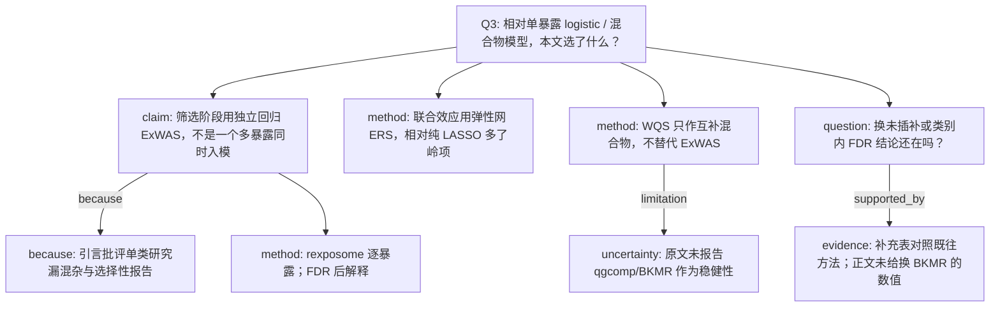

# AI-A Decision Tree Round 1

paper_id: paper_004
question_id: Q3
task_type: literature_decision_tree_reasoning
question: 该方法与既有方法的区别？为何选此法？换方法结论会变吗？
source_file: adversarial_lit_reading/chunks/paper_004_ewas_new.md；补充 Methods 第4–5节与软件表

## 1. Evidence Map

| evidence_id | location | evidence_summary | used_by_node |
|---|---|---|---|
| E1 | Introduction | 既往多为单毒物或单类；本文用 exposome 减少选择性报告 | N2 |
| E2 | Methods 2.5 | ExWAS 用 rexposome，每个暴露独立回归 | N3 |
| E3 | Supp Methods 5 | 自适应弹性网：同时有 L1/L2，处理共线并筛选；gcdnet | N4 |
| E4 | Methods 2.5 | WQS（gWQS，q=4，B=1000）作为混合物互补，不是主筛选 | N5 |
| E5 | Results 3.7 | 敏感性含未插补 ExWAS、影响点、E-value | N6 |
| E6 | Supp Table 12 标题 | 补充有「与既往研究的方法对照」表 | N7 |
| E7 | 全文检索 | 正文未把 BKMR 或 qgcomp 作为主分析 | N8 |

## 2. Decision Tree - Mermaid

## 3. Node Table

| node_id | node_type | claim | evidence_location | evidence_summary | confidence | risk_tag |
|---|---|---|---|---|---|---|
| N0 | question | 方法相对替代法的差异 | Q3 | 本问 | high | 证据不足 |
| N1 | claim | 筛选=独立回归而非全暴露互调 | Methods 2.5 | 独立模型 | high | 方法误读 |
| N2 | claim | 动机是避免单类选择性报告 | Introduction | exposome 框架 | medium | 逻辑跳跃 |
| N3 | method | 软件 rexposome | Methods 2.5 | Hernandez-Ferrer 2019 | high | 证据不足 |
| N4 | method | 弹性网相对 LASSO/岭 | Supp Methods 5 | alpha 网格 0–1 | high | 证据不足 |
| N5 | method | WQS 为互补 | Methods 2.5 | 非主筛选 | high | 证据不足 |
| N6 | question | 替换数据/校正后方向是否保持 | Results 3.3 3.7 | 类别内 FDR、未插补 | medium | 证据不足 |
| N7 | evidence | 有方法对照补充表 | Supp Table 12 标题 | 对照既往研究 | medium | 证据不足 |
| N8 | uncertainty | 未做 BKMR/qgcomp | 正文方法清单 | 软件表有 gWQS 无 bkmr | high | 方法误读 |

## 4. Provisional Answer

相对单毒物 logistic，本文先做全暴露独立回归并用 FDR 控制选择性报告。联合效应不靠把 73 个毒物同时放进一个普通 logistic，而用弹性网做成 ERS，再用加权 logistic 估计 ERS。WQS 是混合物互补。未插补与类别内 FDR 被用作稳健性。原文未把 BKMR 或分位 g-computation 当作主分析或替换实验，因此不能说「换混合物模型结论不变」已被证明。

## 5. Uncertainty List

- U1: 「adaptive」弹性网的自适应权重是否在 gcdnet 里单独估计，正文只给 alpha/lambda 网格。
- U2: Supp Table 12 的具体对照行未在本次正文抽取中逐格核对。
- U3: 换方法是否改变 29 个毒物名单，正文只说类别内 FDR「corroborated」。

## 6. Follow-up Questions

1. 弹性网是否先做了初值权重（adaptive）再 gcdnet？
2. WQS 的验证集划分比例原文是否写明？
