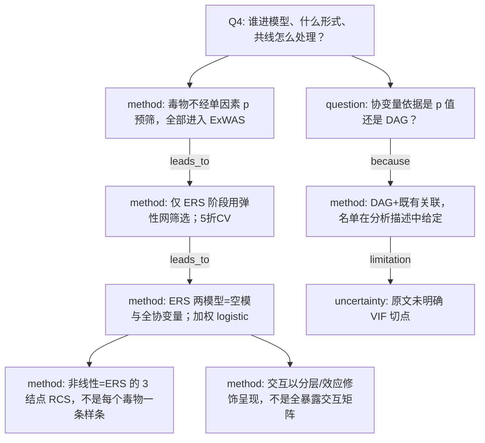

# AI-A Decision Tree Round 1

paper_id: paper_004
question_id: Q4
task_type: literature_decision_tree_reasoning
question: 变量/协变量筛选与建模逻辑是什么？是否分析前确定？是否含交互、非线性、VIF、LASSO？
source_file: adversarial_lit_reading/chunks/paper_004_ewas_new.md；补充 DAG 与弹性网段

## 1. Evidence Map

| evidence_id | location | evidence_summary | used_by_node |
|---|---|---|---|
| E1 | Methods 2.4 / Supp Fig.1 | 协变量按已知关联与 DAG：年龄、性别、种族、教育、婚姻、收入比、BMI、饮酒、距上次牙科就诊、漱口水、牙线、eGFR | N2 |
| E2 | Methods 2.5 | ExWAS 为全调整模型；未写先按单因素 p 删毒物 | N3 |
| E3 | Supp Methods 5 | ERS：连续暴露 Z 标准化，二分类 0/1；11 个 alpha、50 个 lambda，5 折 CV | N4 |
| E4 | Methods 2.5 | ERS–结局：Model1 不调整，Model2 调整全部上述协变量；加权 logistic | N5 |
| E5 | Methods 2.5 Results 3.5 | 非线性只明确做在 ERS 上，RCS 3 结点 | N6 |
| E6 | Results 3.5 | 亚组看效应修饰，结论写无显著 effect modification | N7 |
| E7 | 正文 | 未写 VIF 阈值或逐步回归删协变量 | N8 |

## 2. Decision Tree - Mermaid

## 3. Node Table

| node_id | node_type | claim | evidence_location | evidence_summary | confidence | risk_tag |
|---|---|---|---|---|---|---|
| N0 | question | 入模逻辑 | Q4 | 本问 | high | 证据不足 |
| N1 | question | 协变量来源 | Methods 2.4 | DAG | high | 证据不足 |
| N2 | method | 12 类协变量先验列入 | Section 2.4 Supp Fig.1 | 人口学行为肾功能口腔行为 | high | 证据不足 |
| N3 | method | ExWAS 不做 p 预筛 | Methods 2.5 | 独立全调整 | high | 证据不足 |
| N4 | method | 弹性网只服务于 ERS | Supp Methods 5 | alpha/lambda/CV | high | 证据不足 |
| N5 | method | Model1/2 定义 | Methods 2.5 Fig.4 | 未调整 vs 全调整 | high | 证据不足 |
| N6 | method | RCS 对象是 ERS | Results 3.5 | 3 knots | high | 方法误读 |
| N7 | method | 效应修饰用分层 | Results 3.4–3.5 Supp Fig.3 | 年龄性别及 ERS 亚组 | high | 证据不足 |
| N8 | uncertainty | 无 VIF 数值规则 | 正文未出现 VIF | 共线交给弹性网 | medium | 证据不足 |

## 4. Provisional Answer

协变量在 DAG 与既往关联上事先点名，不是单因素 p 值筛出来的。毒物侧不做单因素预筛，全部进入 ExWAS。变量选择只发生在 ERS 的弹性网。模型形式：ExWAS 与 ERS 的 Model 2 为协变量调整 logistic；非线性用 ERS 的三结点样条；交互以分层检验效应修饰。共线性没有 VIF 切点，原文把它交给弹性网的 L1/L2。

## 5. Uncertainty List

- U1: ExWAS「fully adjusted」是否与 Model 2 协变量完全同一套，分层时是否去掉分层变量本身，正文注写调整名单含 age 与 sex，分层分析是否仍调整该变量未逐句拆开。
- U2: 每 IQR 与原始单位两套系数的换算是否在插补后尺度上做，补充材料写主文报 IQR。
- U3: 弹性网是否把协变量也放进惩罚项，原文写的是暴露标准化后建 ERS。

## 6. Follow-up Questions

1. 分层模型是否从调整集中删除年龄或性别？
2. 二分类毒物（检出/未检出）是否也进入弹性网？
