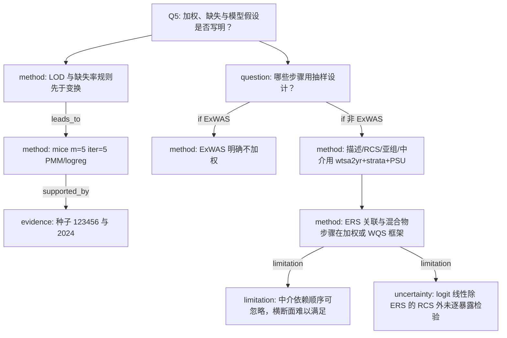

# AI-A Decision Tree Round 1

paper_id: paper_004
question_id: Q5
task_type: literature_decision_tree_reasoning
question: 分析依赖哪些参数假设？复杂抽样是否使用权重、PSU、分层？缺失如何处理？
source_file: adversarial_lit_reading/chunks/paper_004_ewas_new.md；补充 Missing/ExWAS/权重段落与种子

## 1. Evidence Map

| evidence_id | location | evidence_summary | used_by_node |
|---|---|---|---|
| E1 | Methods 2.5 | 描述统计、RCS、亚组、中介使用 2013–2014 复杂抽样：权重 wtsa2yr、分层、PSU | N2 |
| E2 | Methods 2.5 + Supp 权重段 | ExWAS 独立回归报告不加权，理由是与既往一致并避免权重与协变量过调整 | N3 |
| E3 | Supp Missing | 剔除：>90% 低于检出限或缺失>40%。>30% 低于检出限则二分类且未检出记 0。其余 ln | N4 |
| E4 | Supp Missing | rexposome::imputation 调用 mice：m=5，迭代 5，连续 PMM，二分类 logreg | N5 |
| E5 | Supp 种子 | 插补 set.seed(123456)；bootstrap set.seed(2024) | N6 |
| E6 | Methods 2.5 | ERS–结局为加权 logistic；WQS q=4、B=1000 | N7 |
| E7 | Supp 中介假设 | 顺序可忽略性；medsens 看未测量混杂 | N8 |
| E8 | Results 3.5 | RCS 未拒绝非线性；正文未写 Box-Tidwell 或 PH 检验（非 Cox） | N9 |

## 2. Decision Tree - Mermaid

## 3. Node Table

| node_id | node_type | claim | evidence_location | evidence_summary | confidence | risk_tag |
|---|---|---|---|---|---|---|
| N0 | question | 假设与设计效应 | Q5 | 本问 | high | 证据不足 |
| N1 | question | 权重用在哪一步 | Methods 2.5 | unless otherwise specified | high | 证据不足 |
| N2 | method | 四类分析加权 | Methods 2.5 | wtsa2yr | high | 证据不足 |
| N3 | method | ExWAS 不加权 | Methods 2.5 Supp | 防过调整 | high | 证据不足 |
| N4 | method | LOD/缺失剔除与二分 | Supp Methods | 90/40/30 规则 | high | 证据不足 |
| N5 | method | 多重插补默认 mice | Supp Methods | m=5, it=5 | high | 证据不足 |
| N6 | evidence | 随机种子 | Supp | 123456 / 2024 | high | 证据不足 |
| N7 | method | 加权 logistic + WQS | Methods 2.5 | Model1/2；q=4 | high | 证据不足 |
| N8 | limitation | 中介因果假设强 | Supp section 7 | sequential ignorability | high | 因果过度 |
| N9 | uncertainty | 未逐毒物检验 logit 线性 | 正文 | 仅 ERS RCS | medium | 证据不足 |

## 4. Provisional Answer

设计假设拆成两支：ExWAS 不加权；描述、RCS、亚组、中介以及 ERS 的 logistic 使用复杂抽样权重、分层和 PSU。缺失在 LOD 规则之后用 mice（5 套、5 次迭代、PMM/logreg）。随机种子在补充材料给出。中介额外假设顺序可忽略，并用 medsens 做敏感性。本文不是生存模型，没有比例风险假设。logit 线性没有对每个毒物做检验，只对 ERS 做了 RCS。

## 5. Uncertainty List

- U1: Table 1 的 P 值是 survey 设计下的检验还是未加权，正文说描述统计加权，但未点名 svyTable 函数。
- U2: 多套插补如何合并 ExWAS 的系数（Rubin 还是只取一套）原文写 imputation()，未写 pool 规则。
- U3: lambda 网格「10³ 到 10-²」在 PDF 排版中上下标断裂，数值范围需以补充公式为准。
- U4: 权重变量名写 wtsa2yr；亚样本毒物常用子样本权重，原文未逐类列出权重列。

## 6. Follow-up Questions

1. 尿检毒物是否改用子样本权重而非统一 wtsa2yr？
2. 五套插补是 Rubin 合并还是 rexposome 内部默认？
