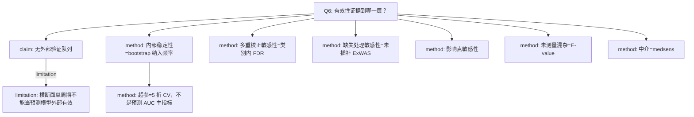

# AI-A Decision Tree Round 1

paper_id: paper_004
question_id: Q6
task_type: literature_decision_tree_reasoning
question: 论文如何证明分析有效？内部/外部验证、敏感性、E-value？
source_file: adversarial_lit_reading/chunks/paper_004_ewas_new.md

## 1. Evidence Map

| evidence_id | location | evidence_summary | used_by_node |
|---|---|---|---|
| E1 | Methods 2.5 / Supp Table 5 | ERS 变量选择用 1000 次 bootstrap 纳入频率 | N2 |
| E2 | Methods 2.5 | 弹性网 5 折交叉验证选 alpha/lambda | N3 |
| E3 | Results 3.3 | 类别内 FDR 与主 FDR 相互印证 | N4 |
| E4 | Results 3.7 | 未插补数据重做 ExWAS（Supp Fig.5、Table 7） | N5 |
| E5 | Results 3.7 | 影响点检查，结论写不是个别观测驱动（指向 Supp Table 1 的表述需谨慎） | N6 |
| E6 | Methods 2.5 / Supp Table 11 | E-value 量化未测量混杂要多强才能解释掉关联 | N7 |
| E7 | Results 3.6 Supp Fig.4 | medsens：rho 增大时 ACME 仍讨论方向 | N8 |
| E8 | Discussion | 无外部队列；单周期横断面 | N9 |

## 2. Decision Tree - Mermaid

## 3. Node Table

| node_id | node_type | claim | evidence_location | evidence_summary | confidence | risk_tag |
|---|---|---|---|---|---|---|
| N0 | question | 有效性证据层级 | Q6 | 本问 | high | 证据不足 |
| N1 | claim | 没有第二队列 | Discussion | 外推限制 | high | 证据不足 |
| N2 | method | 1000 bootstrap 选变量稳定性 | Methods 2.5 Supp Table 5 | 纳入频率>80% 的核心毒物 | high | 证据不足 |
| N3 | method | 5 折 CV 只调惩罚参数 | Methods 2.5 Fig.4B-C | 不是 AUC 竞赛 | high | 方法误读 |
| N4 | method | 类别内 FDR | Results 3.3 | Supp Table 2 | high | 证据不足 |
| N5 | method | 完整病例/未插补 ExWAS | Results 3.7 | Supp Fig.5 Table 7 | high | 证据不足 |
| N6 | method | 影响点 | Results 3.7 | 原文称非个别点驱动 | medium | 证据不足 |
| N7 | method | E-value | Methods 2.5 Supp Table 11 | 连续与分类 ERS | high | 证据不足 |
| N8 | method | medsens | Results 3.6 | Supp Fig.4 | high | 因果过度 |
| N9 | limitation | 不能声称预测外部有效 | Discussion | 无时间/外部验证 | high | 证据不足 |

## 4. Provisional Answer

有效性证据是内部的：交叉验证调弹性网、bootstrap 看变量是否反复入选、更换 FDR 族、去掉插补、检查影响点、用 E-value 和 medsens 看未测量混杂。没有区分度/校准度作为主结论，也没有外部队列。因此本文证明的是关联估计对若干分析选择的稳健，不是临床预测模型已验证。

## 5. Uncertainty List

- U1: 影响点段落把「Supplementary Table 1」当作证据位置，该表在补充里是毒物特征表，位置可能是笔误，证据强度降为 medium。
- U2: 未见 Hosmer-Lemeshow 或校准图。
- U3: bootstrap 是只计纳入频率，还是也给 OR 的百分位区间，正文强调频率。

## 6. Follow-up Questions

1. Supp Fig.5 未插补后显著毒物数是否仍为 29？
2. E-value 是针对 ERS 还是也针对每个 ExWAS 毒物？
