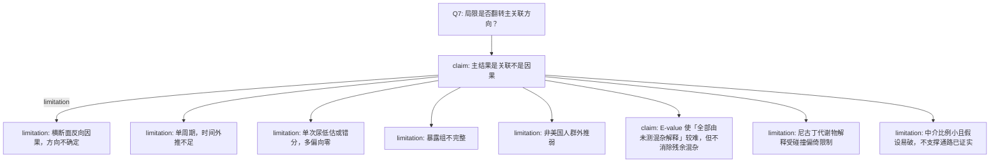

# AI-A Decision Tree Round 1

paper_id: paper_004
question_id: Q7
task_type: literature_decision_tree_reasoning
question: 局限有哪些？是否影响主要结论方向？
source_file: adversarial_lit_reading/chunks/paper_004_ewas_new.md Discussion 与 Results 3.6–3.7

## 1. Evidence Map

| evidence_id | location | evidence_summary | used_by_node |
|---|---|---|---|
| E1 | Discussion | 横断面不能定因果，不能排除反向因果 | N2 |
| E2 | Discussion | 单周期 2013–2014，不能看长期趋势与个体内变异 | N3 |
| E3 | Discussion | 多数毒物单次尿，短半衰期会错分 | N4 |
| E4 | Discussion | 73 种只是暴露组的一部分 | N5 |
| E5 | Discussion | 美国代表性不等于其他国家法规与遗传背景 | N6 |
| E6 | Discussion | 残余混杂仍在；作者用 E-value 认为难以完全解释掉 | N7 |
| E7 | Discussion | 尼古丁代谢物与共因可能碰撞偏倚 | N8 |
| E8 | Results 3.6 | 中介比例约 5%–11%，且依赖未测量混杂敏感性 | N9 |

## 2. Decision Tree - Mermaid

## 3. Node Table

| node_id | node_type | claim | evidence_location | evidence_summary | confidence | risk_tag |
|---|---|---|---|---|---|---|
| N0 | question | 局限对结论方向的影响 | Q7 | 本问 | high | 证据不足 |
| N1 | claim | 结论应停在关联 | Discussion / Conclusions | 预防含义是外推 | high | 因果过度 |
| N2 | limitation | 反向因果 | Discussion 第一点 | 牙周病也可能改变行为/检测 | high | 因果过度 |
| N3 | limitation | 单周期 | Discussion | 2013–2014 | high | 证据不足 |
| N4 | limitation | 暴露错分 | Discussion | 短半衰期 | high | 证据不足 |
| N5 | limitation | 暴露组不全 | Discussion | 非靶向未做 | high | 证据不足 |
| N6 | limitation | 地域外推 | Discussion | 法规与遗传 | medium | 可迁移性不足 |
| N7 | limitation | 残余混杂未消失 | Discussion + Supp Table 11 | E-value 只是强度 | high | 因果过度 |
| N8 | limitation | 碰撞偏倚 | Discussion 尼古丁段 | 共因 | high | 因果过度 |
| N9 | limitation | 中介不可当机制定论 | Results 3.6 Discussion | 比例小、需纵向验证 | high | 因果过度 |

## 4. Provisional Answer

作者承认的局限里，横断面与反向因果使方向不能升为因果；单次尿错分多半使关联偏向零，而不是制造一个假的强正向。残余混杂被 E-value 削弱但未排除。尼古丁代谢物单独解释受碰撞偏倚限制。中介不能支撑「炎症通路已证实」。这些局限动摇因果措辞，原文未显示它们把 FDR 显著毒物的关联符号整体反转。

## 5. Uncertainty List

- U1: 错分「偏向零」是流行病学常规推断，原文写 misclassification，未做定量偏倚分析证明方向。
- U2: 牙线、就诊等协变量可能是中介而非混杂，DAG 是否把它们只当混杂，正文未讨论过度调整。
- U3: 碰撞偏倚段落只点名尼古丁代谢物，未量化。

## 6. Follow-up Questions

1. DAG 中口腔行为变量是混杂还是中介？
2. E-value 下限是否仍大于作者认定的合理混杂强度？
