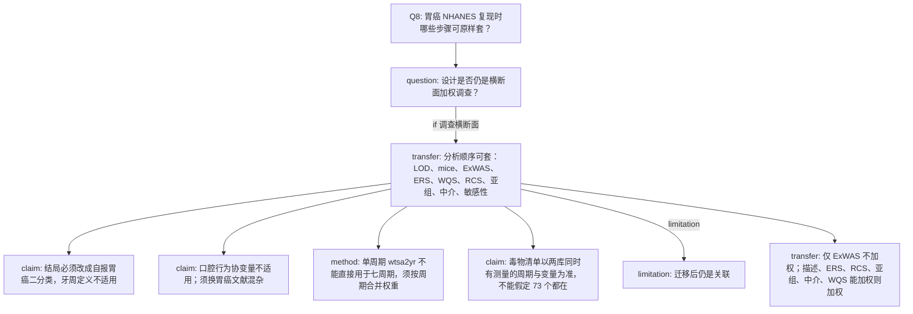

# AI-A Decision Tree Round 1

paper_id: paper_004
question_id: Q8
task_type: literature_decision_tree_reasoning
question: 哪些方法可迁移到「用本人 NHANES 胃癌数据复现该 ExWAS 全流程」？哪些必须改写？
source_file: adversarial_lit_reading/chunks/paper_004_ewas_new.md；用户数据说明（NHANES 胃癌 2003–2016，结局为自报胃癌；营养提取目录含部分实验室原始表）

## 1. Evidence Map

| evidence_id | location | evidence_summary | used_by_node |
|---|---|---|---|
| E1 | Methods 2.1–2.5 | 可迁移骨架：纳排→LOD→插补→不加权 ExWAS+FDR→弹性网 ERS→加权 logistic→RCS→WQS→分层→炎症中介→E-value/medsens/未插补 | N2 |
| E2 | Methods 2.2 | 结局定义是牙周 CDC/AAP，不能迁到胃癌 | N3 |
| E3 | Methods 2.4 | 协变量含牙线、漱口水、距上次牙科就诊，属于该病特异混杂 | N4 |
| E4 | Methods 2.5 | 权重名 wtsa2yr，且仅 2013–2014 单周期 | N5 |
| E5 | 用户数据说明 | 胃癌结局表为 2003–2016 七周期、年龄≥20、变量为癌症部位码与 DN；不是 1210 人的 2013–2014 牙周样本 | N6 |
| E6 | Discussion | 横断面关联不可写成因果；迁移后同样限制 | N7 |
| E7 | 用户要求 | ExWAS 保持不加权；其余能加权则加权 | N8 |

## 2. Decision Tree - Mermaid

## 3. Node Table

| node_id | node_type | claim | evidence_location | evidence_summary | confidence | risk_tag |
|---|---|---|---|---|---|---|
| N0 | question | 迁移边界 | Q8 | 用户胃癌复现 | high | 可迁移性不足 |
| N1 | question | 设计是否同类 | Methods 2.1 vs 用户说明 | 都是 NHANES 横断面 | high | 可迁移性不足 |
| N2 | transfer | 统计步骤顺序可复用 | Methods 2.5 Results 3.1–3.7 | 图1–5与补充表角色可对齐 | high | 可迁移性不足 |
| N3 | claim | 结局算法不可复用 | Section 2.2 | 牙周 CAL/PPD | high | 可迁移性不足 |
| N4 | claim | 牙科协变量不可复用 | Section 2.4 | 牙线等 | high | 可迁移性不足 |
| N5 | method | 权重要按多周期重算 | Methods 2.5 | 原文单周期 | high | 可迁移性不足 |
| N6 | claim | 暴露列取决于数据交集 | 用户 CSV 仅 14 列结局；毒物在营养提取原始表 | 须先对齐周期 | high | 可迁移性不足 |
| N7 | limitation | 不升级为因果 | Discussion | 反向因果仍在 | high | 因果过度 |
| N8 | transfer | 加权范围按用户指定 | 用户指令 + Methods 2.5 | ExWAS 不加权是原文+用户共同要求 | high | 可迁移性不足 |

## 4. Provisional Answer

可原样套的是分析套路：检出限规则、多重插补、不加权 ExWAS 加 BH-FDR、弹性网环境风险评分、加权两模型 logistic、三结点 RCS、WQS、年龄与性别分层、炎症中介、未插补敏感性、E-value 与 medsens。必须改的是结局（胃癌自报部位）、协变量（去掉口腔行为，改胃癌混杂）、周期与权重（七周期不能沿用单周期 wtsa2yr）、以及毒物名单（只分析数据里真实存在且与胃癌样本能合并的测量）。用户指定除 ExWAS 外尽量加权，与原文对描述、RCS、亚组、中介的加权范围一致，并扩展到 ERS 与 WQS。

## 5. Uncertainty List

- U1: 营养提取原始表是否覆盖原文 12 类毒物，尚未在决策树阶段逐列核对，不能假定 73 个都能复现。
- U2: 胃癌自报病例数可能很少，FDR 与弹性网稳定性会变，原文 n=1210、病例 533 的功效不能外推。
- U3: 炎症血常规是否与毒物子样本、胃癌周期三者同时非缺失，原文未提供该交集。

## 6. Follow-up Questions

1. 七周期里哪些环境子样本与 MCQ 胃癌同时有权重列？
2. 胃癌模型的最小协变量集是否仍含 eGFR、BMI、吸烟（尼古丁代谢物若已是暴露则不能再当协变量）？
