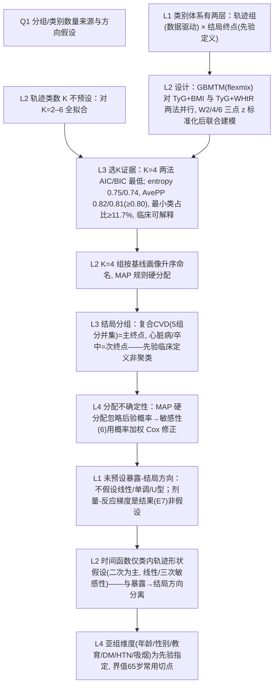

# AI-A Decision Tree Round 1

paper_id: paper_013
question_id: Q1
task_type: literature_decision_tree_reasoning
question: Q1 本研究预设了几个分组/亚型/类别？该数量是数据驱动还是主观指定？是否假设了暴露-结局关系的方向（线性、单调、U 型）？
source_file: adversarial_lit_reading/chunks/paper_013_joint_traj_tyg_cvd_elsa.md

## 1. Evidence Map

| evidence_id | location | evidence_summary | used_by_node |
|---|---|---|---|
| E1 | Methods "Group-based multi-trajectory modeling"（chunk L283–315） | GBMTM 用 R flexmix 对 Waves 2/4/6 三次重复测量联合识别潜在轨迹类；模型拟合 K=2 至 K=6 | N1, N2 |
| E2 | Methods（L296–304） | 最优组数由 BIC、AIC、entropy、AvePP（阈值≥0.80）、OCC、最小类占比与临床可解释性共同决定 | N3 |
| E3 | Results "Identification of joint trajectory groups"（L443–470） | BMI+TyG：K=4 的 AIC 24235.7 / BIC 24466.7 最低；WHtR+TyG：K=4 AIC 25612.5 / BIC 25843.4 最优；AvePP 0.82/0.81，entropy 0.75/0.74 | N3, N4 |
| E4 | Results（L455–468） | 两法各分 4 组并按基线代谢-体型画像升序命名（normal weight–low TyG … severely obese–high TyG；non-abdominal obesity–low TyG … severe abdominal obesity–high TyG），类占比 18.8/34.6/30.7/15.9% 与 11.7/30.0/38.4/20.0% | N4, N5 |
| E5 | Methods（L308–310） | 个体按最高后验概率分配到轨迹组；最低风险组为所有模型参照 | N5 |
| E6 | Methods 结局（Outcome ascertainment，L211–227） | 主要结局=复合 CVD 发病（心梗/心衰/心绞痛/心律异常/卒中五组分新诊断并集），另报心脏病与卒中两个次终点；事件时间在报告区间中点 | N6 |
| E7 | Results Cox 段（L755–810） | 两法复合 CVD 均呈逐级升高的剂量-反应（HR 2.31→2.72→5.06；2.22→2.75→5.12），未预设线性或阈值形态，梯度由数据显现 | N7 |
| E8 | Statistical analysis（L343–350） | 亚组分层：年龄<65/≥65、性别、教育、糖尿病、高血压、吸烟（先验选定的分层维度，非数据驱动聚类） | N8 |
| E9 | Methods GBMTM（L291–295） | 轨迹类内时间为二次多项式；线性与三次为敏感性替代（不假设单调暴露-结局方向，类间关系不预设形状） | N7 |

## 2. Decision Tree - Mermaid

## 3. Node Table

| node_id | node_type | claim | evidence_location | evidence_summary | confidence | risk_tag |
|---|---|---|---|---|---|---|
| N0 | question | K 是数据驱动还是指定？方向是否预设？ | — | — | high | |
| N1 | claim | 两层分类体系：轨迹类数据驱动、结局类别先验 | Methods L211–227, L283–315 | 五组分并集定义结局；GBMTM 定轨迹类 | high | |
| N2 | method | flexmix GBMTM 双变量联合，K=2–6 全拟合 | Methods L283–300 | 两法并行、z 标准化、二次多项式 | high | |
| N3 | evidence | K=4 由 AIC/BIC/entropy/AvePP/OCC/最小占比/可解释性六准则选定 | Results L443–455; Supp Table 4; Fig 3A,B | 数值齐全且 AvePP 达标 | high | |
| N4 | method | 组命名按基线画像升序；MAP 分配；最低组为参照 | Methods L308–310; Results L455–468 | 命名与分配规则明确 | high | |
| N5 | claim | 主/次终点先验临床定义（非数据驱动） | Methods Outcome L211–227 | 复合 CVD 并集+两亚型 | high | |
| N6 | limitation | 硬分配丢不确定性 | Methods L308; Sensitivity(6) | 作者以概率加权 Cox 补救 | medium | 逻辑跳跃 |
| N7 | claim | 不预设方向；单调梯度为实证结果 | Results L755–810 | HR 逐级升高、P for trend<0.001 | high | |
| N8 | method | 类内时间函数二次；线性/三次仅敏感性 | Methods L291–300; Sensitivity(8) | 形状假设限于时间维度 | high | |
| N9 | uncertainty | 亚组维度与 65 岁切点为先验指定，依据未引具体文献 | Methods L343–350 | 原文未说明切点出处 | low | 证据不足 |

## 4. Provisional Answer

本研究有三套"分组"：**轨迹组 K=4 是数据驱动的**——对 K=2–6 全部拟合 GBMTM（flexmix，双变量 z 标准化、类内二次多项式），由 AIC/BIC 最低+entropy/AvePP/OCC/最小类占比/临床可解释性六项共同选定 K=4，组名按基线代谢-体型画像升序人工命名，个体按最高后验概率硬分配。**结局分组（复合 CVD / 心脏病 / 卒中）是先验临床定义**（五组分新诊断并集），不是聚类产物。**暴露-结局方向未预设**（无线性/单调/U 型假设）——剂量-反应梯度完全由数据显现；所设的多项式只约束类内时间轨迹形状，敏感性(8)换线性/三次复核。亚组分层维度（年龄 65 切点等）是先验指定的。

## 5. Uncertainty List

- U1: Fig 3 选 K 面板图未给出 AvePP/OCC 逐 K 数值全表，需查 Supp Table 4（本次未在手）。
- U2: 组命名的"临床升序"依赖人工判读均值轨迹，主观性未被量化。
- U3: 65 岁亚组切点与复合结局五组分界均未引先验文献依据（原文未明确说明）。

## 6. Follow-up Questions

1. K=4 在两个方法（BMI+TyG vs WHtR+TyG）之间类占比结构不同（11.7% 最小类 vs 15.9%），选 K 判据权重如何排序？
2. 五组分"复合 CVD"的并集是否掩盖各组分的异质风险（S7 敏感性是否分组分报告）？
