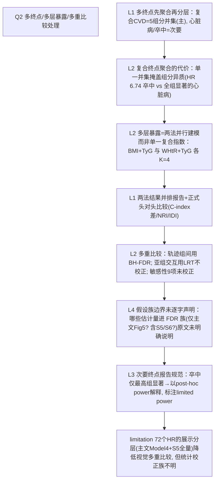

# AI-A Decision Tree Round 1

paper_id: paper_013
question_id: Q2
task_type: literature_decision_tree_reasoning
question: Q2 如何处理多亚型/多终点/多层暴露？是否会因多重比较膨胀 I 类错误？是否对相关终点做聚合？
source_file: adversarial_lit_reading/chunks/paper_013_joint_traj_tyg_cvd_elsa.md

## 1. Evidence Map

| evidence_id | location | evidence_summary | used_by_node |
|---|---|---|---|
| E1 | Methods Outcome（L211–227） | 主终点=复合 CVD（心梗/心衰/心绞痛/心律异常/卒中五组分**并集聚合**）；次终点=心脏病、卒中 | N1 |
| E2 | Methods GBMTM（L286–290） | 多层暴露=两法并行：TyG×BMI 与 TyG×WHtR 各建一套联合轨迹 | N2 |
| E3 | Results KM（L473–482） | 两法 × 三结局共 6 张 KM（Fig 4A–F），log-rank 全部 P<0.001 | N3 |
| E4 | Statistical analysis（L368–370） | Benjamini–Hochberg FDR 用于**轨迹组间多重比较**校正；Fig 5 注明所有关联经 BH 后仍存活 | N4 |
| E5 | Results Cox（L786–793） | 卒中次终点仅最高组显著，作者以事后检验功效（65.2%/81.3%）解释而非加做校正 | N5 |
| E6 | Statistical analysis（L343–350） | 亚组交互用乘法交互项 + 似然比检验，未对亚组维度做多重校正 | N6 |
| E7 | Supp Table 5 与 Fig 5 | 两法 × 三结局 × Model1–4 × 3 暴露组=72 个 HR；主文只报 Model 4，S5 全量 | N7 |
| E8 | Methods L308–315 | "Because trajectory group assignment is uncertain…"→ 敏感性(6) 后验概率加权 Cox | N8 |

## 2. Decision Tree - Mermaid

## 3. Node Table

| node_id | node_type | claim | evidence_location | evidence_summary | confidence | risk_tag |
|---|---|---|---|---|---|---|
| N0 | question | 多终点/多暴露/多重比较？ | — | — | high | |
| N1 | method | 复合 CVD=五组分并集聚合为主终点 | Methods L211–227 | 先验临床聚合 | high | |
| N2 | claim | 并集聚合掩盖组分异质性 | Results L786–793 | 卒中仅最高组显著，心衰组内事件少 | medium | 逻辑跳跃 |
| N3 | method | 多层暴露用双法并行（非合并成单一指数） | Methods L286–290 | 两 K=4 体系 | high | |
| N4 | method | 两法头对头：ΔC、NRI、IDI（Supp Table 8） | Results L1275–1287 | 差异不显著 | high | |
| N5 | method | BH-FDR 校正轨迹组间比较 | Statistical L368–370; Fig 5 | 显式声明 | high | |
| N6 | uncertainty | FDR 假设族范围未声明 | 原文未明确说明 | S5/S6/敏感性是否入族不明 | low | 证据不足 |
| N7 | evidence | 次终点不显著用 post-hoc power 说明 | Results L786–793 | 65.2%/81.3% 功效 | medium | 因果过度 |
| N8 | limitation | 交互检验与 9 项敏感性无族校正 | Methods L343–366 | 敏感性定位为稳健性非推断 | medium | |

## 4. Provisional Answer

研究同时面对**三种乘法维度**：(a) 3 个结局（复合 CVD + 心脏病 + 卒中）——通过**先验并集聚合**为复合主终点、其余降为次终点处理，卒中仅最高轨迹组显著并被明示为功效不足；(b) 2 套多层暴露轨迹（BMI×TyG、WHtR×TyG）——不合并成单一指数，而是**并行建模 + 正式头对头比较**（ΔC-index/NRI/IDI）；(c) 4 个嵌套调整模型 × 3 个暴露组 × 6 个体系 × 3 结局≈72 个 HR。多重比较仅对**轨迹组间比较**做了 Benjamini–Hochberg FDR（Fig 5 声明全部存活）；亚组交互 LRT、9 项敏感性、判别力比较均未见族校正声明，FDR 假设族的精确边界原文未明确说明。

## 5. Uncertainty List

- U1: BH-FDR 校正的对象集合（主文 vs 含 S5/S6/S7）无法从文本确定。
- U2: 复合终点各组分的分别发病风险未单独建模报告（仅并集事件数）。
- U3: post-hoc power 以锁定估计 HR 计算，本身依赖观察效应量，循环性未讨论。

## 6. Follow-up Questions

1. 若五组分拆成 5 个竞争/独立结局分别 Cox，K=4 梯度是否仍单调？
2. 两法结果高度一致（HR 5.06 vs 5.12）是否说明暴露维度冗余（共线）？GVIF 是否报告？
