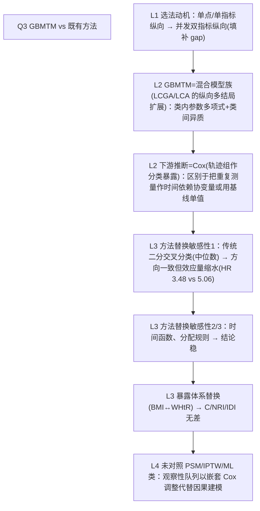

# AI-A Decision Tree Round 1

paper_id: paper_013
question_id: Q3
task_type: literature_decision_tree_reasoning
question: Q3 该方法/模型与既有方法的区别在哪？对照 logistic/Cox/PSM/LCA/传统聚类/其他 ML。为何选 GBMTM 而非彼法？换方法结论会变吗？
source_file: adversarial_lit_reading/chunks/paper_013_joint_traj_tyg_cvd_elsa.md

## 1. Evidence Map

| evidence_id | location | evidence_summary | used_by_node |
|---|---|---|---|
| E1 | Introduction/Abstract（L32–47, L137–153） | 既有研究多为基线单点测量或单一指标纵向轨迹；GBMTM 同时捕捉代谢+体型两指标的并发纵向变化——这是选法动机 | N1 |
| E2 | Methods GBMTM（L283–315） | GBMTM=半参数有限混合（flexmix，Gauss 双结局、类内多项式），本质是联合纵向 LCGA/LCA 的扩展 | N2 |
| E3 | Statistical analysis（L328–333） | 暴露→结局推断用 Cox PH 以轨迹组为分类自变量，而非时间依赖协变量或单点指数 Cox | N3 |
| E4 | Sensitivity(9)（Methods L364–366; Results L1265–1273） | 换"传统分类法"（中位数切分 BMI×TyG 交叉分类）复核——高-高组 HR 3.48/3.62 仍显著，但弱于轨迹法最高组（5.06/5.12） | N4 |
| E5 | Sensitivity(8) | 换时间函数（线性/三次）结论不变（HR 4.88/4.94） | N5 |
| E6 | Sensitivity(6) | 换分配规则（MAP→概率加权）结论不变（4.78/4.84） | N5 |
| E7 | Supp Table 8 / Results L1275–1287 | 换暴露体系（BMI→WHtR）结论不变：C 差异 0.003（P=0.723） | N6 |
| E8 | 原文无 PSM/IPTW、无 ML（RF/XGB）、无 RCS | 对照法清单中未出现倾向评分或机器学习替代 | N7 |

## 2. Decision Tree - Mermaid

## 3. Node Table

| node_id | node_type | claim | evidence_location | evidence_summary | confidence | risk_tag |
|---|---|---|---|---|---|---|
| N0 | question | 为何 GBMTM？换法会变吗？ | — | — | high | |
| N1 | method | 既有法=基线单点/单指标纵向；本法=双指标并发轨迹 | Intro L137–153 | 定位差异明示 | high | |
| N2 | method | GBMTM 属于半参数有限混合模型（纵向 LCA 扩展） | Methods L283–300 | flexmix、Gauss、多项式 | high | |
| N3 | method | 组标签作 Cox 分类自变量（一次性基线赋值） | Methods L328–333 | 非时变协变量建模 | medium | 方法误读 |
| N4 | evidence | 换传统中位数交叉分类：仍显著但 HR 缩至 ~3.5 | Sens(9); Results L1265–1273 | 轨迹信息有增量 | high | |
| N5 | evidence | 时间函数/分配规则替换结论不变 | Sens(6)(8) | HR 4.78–4.94 | high | |
| N6 | evidence | 暴露体系替换无判别差异 | Supp Table 8 | ΔC=0.003 P=0.723 | high | |
| N7 | limitation | 无 PSM/IPTW/ML 对照；混杂靠嵌套调整 | 全文 | 原文未采用（非缺陷但限因果解释） | medium | 可迁移性不足 |

## 4. Provisional Answer

GBMTM 相对既有方法的核心差异：既往文献用**基线单点**或**单一指标纵向**，本法把 TyG 与 BMI/WHtR **两条纵向曲线在同一个有限混合模型里联合聚类**（flexmix，类内二次多项式、双结局高斯），从而输出"代谢-体型并发画像"。下游推断仍回到经典 Cox（组标签=分类暴露），不是新的因果机器。换方法结论会怎样？作者用三层替换回答：(1) **退成传统分类**（中位数切分交叉）→ 方向一致但最高风险从 5.06 缩水到 ~3.5，说明轨迹捕捉到单点分类丢失的信息；(2) **换模型细节**（线性/三次时间函数、概率加权分配）→ HR 4.78–4.94 稳定；(3) **换暴露体系**（BMI↔WHtR）→ C-index/NRI/IDI 无显著差异。未对照 PSM/IPTW 或 ML 方法——观察性定位，混杂控制全靠嵌套 Cox 调整。

## 5. Uncertainty List

- U1: 轨迹组标签在 Cox 里是固定基线赋值，忽略"组身份随时间演化"的可能（原文未讨论）。
- U2: "传统分类"敏感性只测了中位数切分一种，未测三分位/临床切点。
- U3: HR 缩水可能部分源于交叉分类组内异质，而非轨迹法真有增量，两种解释未区分。

## 6. Follow-up Questions

1. 若把轨迹组换成时变协变量（时间依赖 Cox），HR 梯度是否更强？
2. 为何不直接用联合轨迹 RMDSTM/Nagin 经典 traj 包而选 flexmix？（软件选择未给理由）
