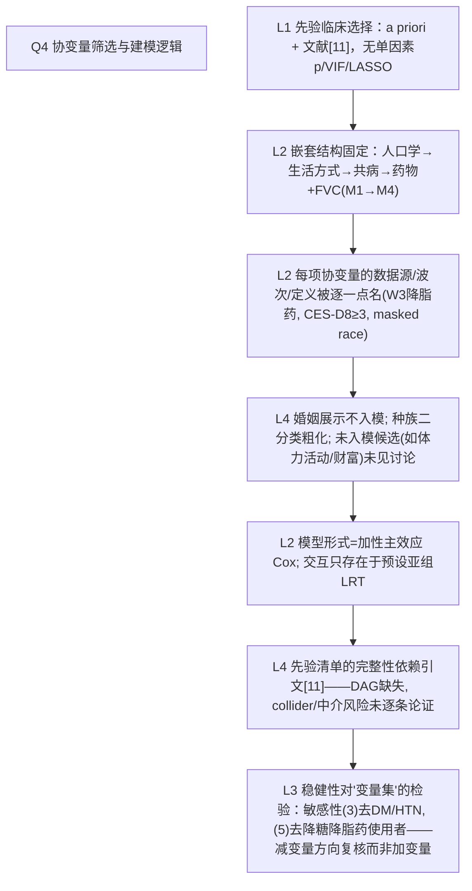

# AI-A Decision Tree Round 1

paper_id: paper_013
question_id: Q4
task_type: literature_decision_tree_reasoning
question: Q4 变量/协变量筛选与建模逻辑是什么？入模依据（临床/单因素p/文献/DAG/VIF）？模型形式（加性/交互/非线性）？是否预先确定？
source_file: adversarial_lit_reading/chunks/paper_013_joint_traj_tyg_cvd_elsa.md

## 1. Evidence Map

| evidence_id | location | evidence_summary | used_by_node |
|---|---|---|---|
| E1 | Methods Covariates（L229–231） | "Covariates were selected **a priori** based on clinical relevance and existing literature [11]"——先验选择，无数据驱动筛选 | N1 |
| E2 | Statistical analysis（L333–342） | 四层嵌套：M1 人口学（年龄连续/性别/种族/教育）；M2 +生活方式（吸烟/饮酒）；M3 +共病（HTN/DM/高胆固醇/肺病/关节炎/骨质疏松/**抑郁 CES-D8≥3**）；M4 +药物（降压/降糖/降脂）+FVC | N2 |
| E3 | Methods L234–245 | 特殊数据源规则：降脂药 W2 不可得→取 **Wave 3**；药物来自护士访药箱清单；FVC=护士访实测（心肺适能代理） | N3 |
| E4 | Methods L246–251 + Covariates | 种族=ELSA harmonized masked race（White vs non-White 二分类）；婚姻在 Table1 展示但**不入 Cox** | N4 |
| E5 | Statistical analysis（L330–343） | Cox 全部为加性主效应模型；交互仅在预设亚组维度做乘法交互 LRT（年龄/性别/教育/DM/HTN/吸烟） | N5 |
| E6 | Methods L251–257 + Covariates 段 | 无 VIF/单因素p/LASSO 等数据驱动共线性或筛选程序；嵌套顺序本身控共线 | N6 |
| E7 | 复合结局组分 | 结局组分的判定基于自报医生诊断（hedim* 标签），不经模型筛选 | N7 |

## 2. Decision Tree - Mermaid

## 3. Node Table

| node_id | node_type | claim | evidence_location | evidence_summary | confidence | risk_tag |
|---|---|---|---|---|---|---|
| N0 | question | 入模依据与模型形式？ | — | — | high | |
| N1 | method | a priori 临床+文献选择，分析前确定 | Methods L229–231 | 明示 | high | |
| N2 | method | M1–M4 嵌套加性 Cox | L333–342 | 顺序固定、逐步调整 | high | |
| N3 | method | 数据源细则：W3 降脂药、药箱清单、FVC 实测 | L234–246 | 逐变量出处 | high | |
| N4 | uncertainty | 婚姻未入模；候选未入模项未列理由 | Table 1 vs L333 | 原文未说明取舍 | low | 证据不足 |
| N5 | method | 无 RCS/非线性项于主模型；交互限预设亚组 | L330–350 | 加性假设 | high | |
| N6 | limitation | 无 DAG，先验集完备性不可证 | L229 | 残余混杂风险 | medium | 逻辑跳跃 |
| N7 | evidence | 敏感性从"减协变量"方向稳健复核 | Sens(3)(5) | HR 不变 | high | |

## 4. Provisional Answer

协变量逻辑是**纯先验**：作者声明 a priori 基于临床相关性与既有文献[11]选定，全文无单因素 p 阈值、无 VIF、无 LASSO/逐步回归等数据驱动筛选。建模形式为四层嵌套加性 Cox（M1 人口学 → M2 生活方式 → M3 共病含 CES-D8≥3 抑郁 → M4 药物+FVC），交互只允许出现在预设亚组（年龄<65/≥65、性别、教育、DM、HTN、吸烟）的乘法交互 LRT 中；主模型不含非线性项。每个协变量的**波次来源与定义被逐一指定**（降脂药因 W2 缺失改取 W3、药物来自护士药箱清单、种族用 harmonized masked 二分类）。婚姻等变量只在 Table 1 展示不入模；先验清单外的候选未给排除理由，且无 DAG 论证——先验集完备性依赖引文背书。敏感性(3)(5) 从"去掉某类协变量/用药人群"方向做稳健复核。

## 5. Uncertainty List

- U1: 引文[11]是否即协变量清单直接来源，正文未逐条映射。
- U2: FVC 作心肺适能代理、抑郁作共病，是否介于暴露与结局因果路径上（中介/碰撞）未讨论。
- U3: 种族二分类丢弃混血/其他族裔细节（ELSA 98.7% White，实际影响小，但原文未量化）。

## 6. Follow-up Questions

1. M4 药物+FVC 后 HR 几乎无衰减（"minimal attenuation"），加这层的目的是稳健性展示还是理论必需？
2. CES-D8 与教育、婚姻相关性高，是否考虑互作或共线（无 VIF 报告）？
