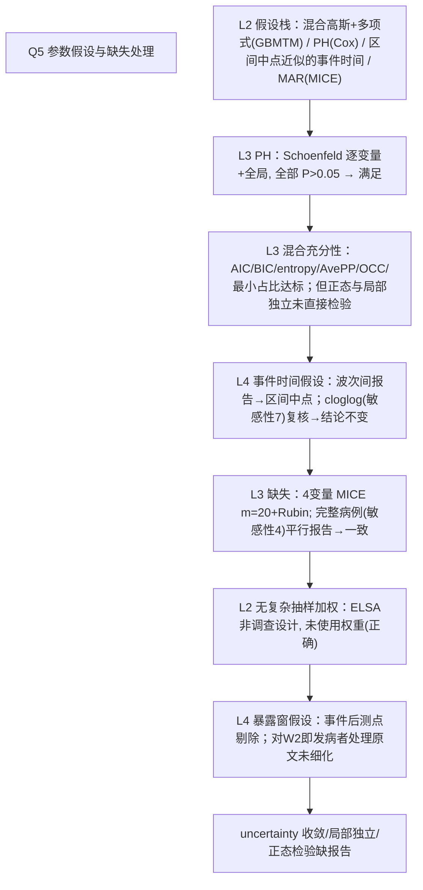

# AI-A Decision Tree Round 1

paper_id: paper_013
question_id: Q5
task_type: literature_decision_tree_reasoning
question: Q5 分析依赖哪些参数假设？是否满足？（Cox PH、logit 线性、正态、K、LCA 局部独立、混合分布）。缺失如何处理（MICE vs 完整病例）？是否复杂抽样加权？
source_file: adversarial_lit_reading/chunks/paper_013_joint_traj_tyg_cvd_elsa.md

## 1. Evidence Map

| evidence_id | location | evidence_summary | used_by_node |
|---|---|---|---|
| E1 | Methods GBMTM（L293–295） | 双结局均假设**高斯分布**；z 标准化入模；类内时间多项式 | N1 |
| E2 | Methods（L300–304） | 混合模型充分性用 BIC/AIC/entropy/AvePP≥0.80/OCC/最小类占比核查（局部独立与正态未显式检验） | N2 |
| E3 | Statistical analysis（L342–345） | Cox PH 假设用 Schoenfeld 残差检验（逐协变量+全局）；Results：所有模型全局 P>0.05 | N3 |
| E4 | Methods L226–228 | ELSA 事件按波次报告、无精确日期→时间取**两次访视区间中点**（区间删失的近似处理） | N4 |
| E5 | Methods L251–257 | 缺失：教育 8.68%、饮酒 4.81%、FVC 18.53%、抑郁 0.17%→**MICE m=20 + Rubin 合并**；完整病例作敏感性(4) | N5 |
| E6 | 全文 | ELSA 为一般人群队列，无 survey 权重/PSU/分层变量使用 | N6 |
| E7 | Sensitivity(7)（L361–362） | cloglog 回归补"区间删失"假设缺口——HR 5.14/5.20 与主模型一致 | N7 |
| E8 | Methods L259–263 | 轨迹用事件前测点，事件后测量剔除（暴露窗假设） | N8 |
| E9 | 全文未提 | 混合模型收敛准则、随机起始、空类检查均未描述 | N9 |

## 2. Decision Tree - Mermaid

## 3. Node Table

| node_id | node_type | claim | evidence_location | evidence_summary | confidence | risk_tag |
|---|---|---|---|---|---|---|
| N0 | question | 假设是否满足？缺失？加权？ | — | — | high | |
| N1 | method | GBMTM 双高斯+类内多项式 | L293–295 | 明示 | high | |
| N2 | method | PH 用 Schoenfeld（个体+全局） | L342–345; Results L767–770 | 全部通过 | high | |
| N3 | limitation | 混合模型分布/局部独立未直接检验 | L300–304 | 拟合指标≠正态检验 | medium | 方法误读 |
| N4 | method | 区间中点近似事件时间+cloglog 复核 | L226–228; Sens(7) | HR 5.14/5.20 一致 | high | |
| N5 | method | MICE m=20+Rubin（教育/饮酒/FVC/抑郁）；CC 敏感性(4) | L251–257 | 双轨一致 | high | |
| N6 | claim | 无抽样加权（ELSA 非 survey 设计） | 全文 | 正确不使用权重 | high | |
| N7 | limitation | 暴露窗规则（事件后剔除）对早发者未细化 | L259–263 | 原文未明确说明 | low | 证据不足 |
| N8 | uncertainty | 收敛准则/随机起始/空类检查未报告 | 全文缺失 | 复现风险 | medium | 方法误读 |

## 4. Provisional Answer

假设栈有四层：**(1) GBMTM**：双结局高斯+类内多项式，充分性靠 AIC/BIC/entropy/AvePP(0.82/0.81≥0.80)/OCC/最小类占比间接保证，正态性与局部独立未直接检验、收敛设置未报告；**(2) Cox PH**：Schoenfeld 逐协变量+全局检验，全部 P>0.05 满足；**(3) 事件时间**：波次报告→区间中点近似，作者自觉这是近似，用 cloglog（敏感性 7）复核且结论不变；**(4) 缺失**：仅 4 个协变量有缺失（FVC 最高 18.53%），MICE m=20 + Rubin 合并，完整病例分析作敏感性(4)，两轨一致。ELSA 非复杂抽样设计，未用任何 survey 权重（正确）。暴露窗采用"事件后测点剔除"，但对基线早期发病个体的处理细节原文未明确说明。

## 5. Uncertainty List

- U1: MICE 插补模型是否纳入结局（CVD）与轨迹类信息未说明——若未纳入可能低估暴露-结局关联（as-observed 偏倚方向：衰减）。
- U2: z 标准化基于全分析池还是分波？影响跨波可比性。
- U3: 混合模型未报告迭代上限/随机起始次数——EM 局部极值风险不可评估。

## 6. Follow-up Questions

1. 插补是否用 m=20 套分别重跑 Cox？（Rubin 措辞暗示是，但主结果表未标注插补来源行）
2. Schoenfeld 全局通过时是否有个别协变量违例？（"both individual and global tests reported"但正文只给全局结论）
