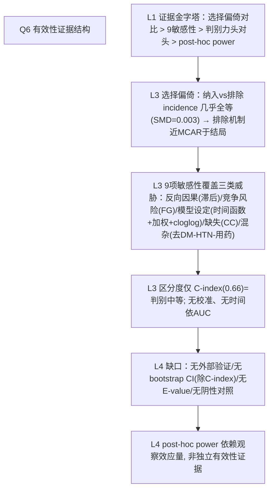

# AI-A Decision Tree Round 1

paper_id: paper_013
question_id: Q6
task_type: literature_decision_tree_reasoning
question: Q6 论文如何证明分析有效？（内部验证 C-index/bootstrap/CV；外部验证；敏感性分析；阴性对照；E-value）
source_file: adversarial_lit_reading/chunks/paper_013_joint_traj_tyg_cvd_elsa.md

## 1. Evidence Map

| evidence_id | location | evidence_summary | used_by_node |
|---|---|---|---|
| E1 | Supp Table 1 / Results L385–400 | 纳入 vs 排除（n=1808 vs 7624）基线对比：CVD  incidence 14.7% vs 14.8%（P=0.933, SMD=0.003）→选择偏倚方向性证据 | N1 |
| E2 | Results L1249–1273 + Supp Table 7 | **9 项敏感性分析**全部支持主结论：2年滞后、Fine-Gray、去DM/HTN、CC、去降糖降脂药、概率加权、cloglog、线/三次函数、中位数交叉分类 | N2 |
| E3 | Supp Table 8 / L1275–1287 | 区分度：C-index 0.663/0.660（复 CVD），头对头 ΔC=0.003 P=0.723；NRI/IDI 均不显著 | N3 |
| E4 | Results L786–793 | post-hoc power（卒中 65.2%/81.3%）量化次终点阴性 | N4 |
| E5 | Methods/Results | 无外部验证队列（单一 ELSA）；无 bootstrap/CV 内部验证；无校准曲线；无 E-value；无阴性对照 | N5 |
| E6 | Fig 4 log-rank 全部 P<0.001; Fig 5 BH-FDR 存活 | 内部一致性证据 | N6 |

## 2. Decision Tree - Mermaid

## 3. Node Table

| node_id | node_type | claim | evidence_location | evidence_summary | confidence | risk_tag |
|---|---|---|---|---|---|---|
| N0 | question | 如何证明有效？ | — | — | high | |
| N1 | method | 纳入 vs 排除全基线对比+结局率对比 | Supp Table 1; L385–400 | SMD=0.003 | high | |
| N2 | evidence | 9 敏感性全支持、方向量级不变 | Supp Table 7; L1249–1273 | 最高组 HR 4.62–5.52 | high | |
| N3 | evidence | C-index≈0.66 中等判别；两法无差异 | Supp Table 8 | ΔC P=0.723 | high | |
| N4 | method | post-hoc power 解释卒中阴性 | L786–793 | 65.2%/81.3% | medium | 逻辑跳跃 |
| N5 | limitation | 无外部验证/bootstrap/E-value/阴性对照 | 全文 | 单队列推断上限 | high | 可迁移性不足 |
| N6 | evidence | log-rank+BH-FDR 内部一致 | Fig 4/5 | 全存活 | high | |

## 4. Provisional Answer

有效性论证是"**稳健性重型、验证轻型**"：作者用 (a) 纳入 vs 排除人群全基线对比（结局率几乎相同，SMD=0.003）堵住选择偏倚质疑；(b) **9 项敏感性**系统覆盖反向因果（2 年滞后）、竞争风险（Fine–Gray）、模型设定（概率加权 Cox、cloglog、线/三次时间函数）、缺失（完整病例）、药物混杂（去降糖降脂使用者）、分类替代（中位数交叉）——全部方向与量级一致（最高组 HR 4.62–5.52）；(c) 两法头对头 ΔC/NRI/IDI 无差异。但缺外部验证队列（单 ELSA）、无 bootstrap/CV、无校准证据（C≈0.66 只讲判别）、无 E-value 量化未测混杂、无阴性对照。post-hoc power 用观察效应量反算，属自我循环，不算独立证据。

## 5. Uncertainty List

- U1: C-index 的 95%CI 来自何种方法（DeLong/bootstrap）未注明。
- U2: 9 项敏感性均只报"最高组 HR"，非单调或翻转的次级组风险未被披露。
- U3: NRI/IDI 参照模型（base model 含哪些变量）未定义，重分类指标解释力打折。

## 6. Follow-up Questions

1. 若加 E-value，HR≈5 对未测混杂的稳健阈值大约多少？（可复现时补算）
2. 时间依赖 AUC/IDI（Uno's）比全期 C-index 更贴合同伴随访设计，作者未做——复现时是否补充？
