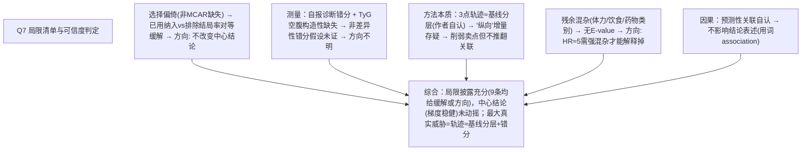

# AI-A Decision Tree Round 1

paper_id: paper_013
question_id: Q7
task_type: literature_decision_tree_reasoning
question: Q7 局限有哪些？（残余混杂/选择偏倚/因果倒置/外推性/测量误差/时序假设）是否被合理讨论？是否动摇主要结论？
source_file: adversarial_lit_reading/chunks/paper_013_joint_traj_tyg_cvd_elsa.md

## 1. Evidence Map

| evidence_id | location | evidence_summary | used_by_node |
|---|---|---|---|
| E1 | Limitations L2038–2050 | 样本仅初始队列 19%；最大剔除=缺空腹血检（n=4125，护士访才采集，**不太可能 MCAR**）；但纳入vs排除结局率几乎相同（14.7% vs 14.8%） | N1 |
| E2 | L2050–2053 | 卒中功效不足（中间组 post-hoc power 65–85%），仅最高组显著 | N2 |
| E3 | L2053–2056 | 结局=自报医生诊断，非病历/登记链接→**结局错分** | N3 |
| E4 | L2056–2060 | 无精确事件日期→区间删失；cloglog 复核一致 | N4 |
| E5 | L2060–2073 | 仅 3 个时间点是偶数波→难检测复杂非线性；轨迹**跨波相当稳定**→组可能主要反映基线风险分层而非纵向演变；作者自认这是该年龄段 8 年变化本小的结果，且交叉分类一致 | N5 |
| E6 | L2073–2082 | 残余混杂：体力活动、饮食、FVC 之外的心肺适能、降压药物类别异质 | N6 |
| E7 | L2082–2084 | 观察性+潜类别→**关联为预测性而非因果** | N7 |
| E8 | L2087–2100 临床意义段 | 轨迹成员身份只能**回顾性**确定（需多年重复测量），临床落地需前瞻性预测算法+外部验证 | N8 |
| E9 | Discussion 老化段 L1945–1965 | BMI 在老年受肌少症误分类影响，WHtR 更稳健→两法判别力趋同的可能解释 | N9 |

## 2. Decision Tree - Mermaid

## 3. Node Table

| node_id | node_type | claim | evidence_location | evidence_summary | confidence | risk_tag |
|---|---|---|---|---|---|---|
| N0 | question | 局限是否动摇结论？ | — | — | high | |
| N1 | limitation | 缺失非 MCAR 但结局率对等 | L2038–2050 | 作者已量化 | high | |
| N2 | limitation | 自报诊断错分 | L2053 | 未量化错分率 | medium | 证据不足 |
| N3 | limitation | 轨迹稳定→疑为基线分层 | L2060–2073 | **作者主动披露**并给交叉分类佐证 | high | |
| N4 | limitation | 残余混杂无 E-value | L2073–2082 | 定性列举 | high | |
| N5 | limitation | 预测非因果自认 | L2082–2084 | 措辞谨慎 | high | |
| N6 | limitation | 临床需回顾性定组 | L2087–2100 | 落地边界清晰 | high | |
| N7 | uncertainty | BMI 肌少症 vs WHtR 稳健的讨论在 Discussion | L1945–1965 | 解释两法趋同 | medium | |
| NA | claim | 综合判断：结论不被动摇 | L2035–2110 | 9 条局限均给缓解/方向 | high | |

## 4. Provisional Answer

作者列了 7+2 条局限，且**每条都自带缓解证据或影响方向**，披露质量高：选择偏倚（承认空腹血检缺失不太可能 MCAR，但用纳入/排除结局率 14.7% vs 14.8% 对等化解释）；卒中功效不足（post-hoc 65–85%）；结局自报错分（**未量化**，是残留硬伤）；区间删失（cloglog 已复核）；**最要害的一条是作者自己点破：轨迹跨波稳定，三时间点可能只反映基线风险分层而非真正的纵向演变**——他们以"该年龄段 8 年本来变化小 + 交叉分类结果一致"自我辩护，但这实质上削弱了"纵向轨迹优于单点"的核心卖点；残余混杂（体力活动/饮食/降压药类别，无 E-value）；预测非因果、回顾性定组的临床落地边界。**综合：中心结论（高风险轨迹组 CVD 梯度升高）不被动摇；被削弱的是"方法学增量"叙事而非效应量本身。**

## 5. Uncertainty List

- U1: 自报诊断与 ELSA 死亡表未做交叉验证，错分方向未知。
- U2: "轨迹稳定"是否有第三种解释（天花板/测量频率不足）未讨论。
- U3: 局限未提多重插补对效应估计的影响（仅 CC 敏感性带过）。

## 6. Follow-up Questions

1. 复现时是否应把"轨迹 vs 基线单点"作为正式对比面板（而非仅在敏感性里用中位数切分）？
2. E-value 能否用现成公式（VanderWeele）在复现中补算？
