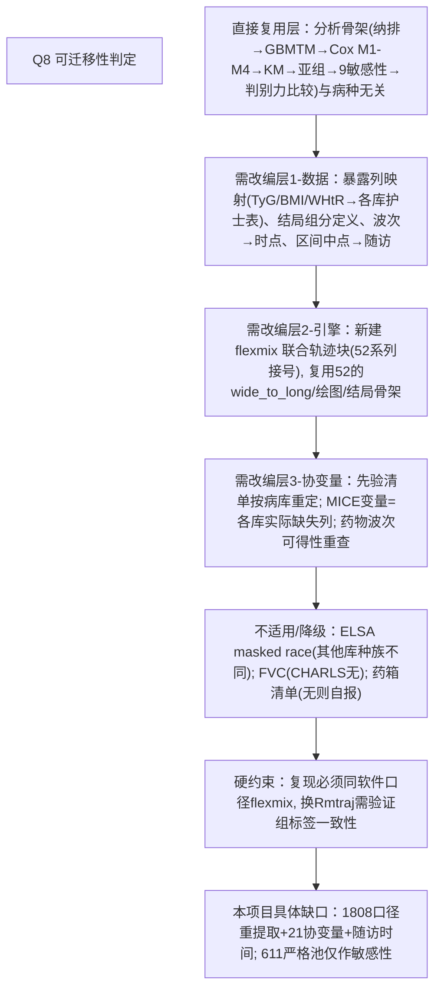

# AI-A Decision Tree Round 1

paper_id: paper_013
question_id: Q8
task_type: literature_decision_tree_reasoning
question: Q8 该文的哪些方法与套路可迁移到「我的研究」？我的研究=（用户已确认）以本地 ELSA 数据**全流程复现本文**（发病轨迹套路流水线，一图表不缺），并把 GBMTM-轨迹-发病做成可复用 Block/地基后缀，未来迁移到其他纵向队列（CHARLS 等）的其他发病结局。哪些原样套用，哪些必须改写？
source_file: adversarial_lit_reading/chunks/paper_013_joint_traj_tyg_cvd_elsa.md

## 1. Evidence Map

| evidence_id | location | evidence_summary | used_by_node |
|---|---|---|---|
| E1 | Methods 全流程 L156–380 | 可复用骨架：纳排减法链→三波暴露 z 标准化→GBMTM K=2–6 六指标选K→MAP 分组→基线表→KM→嵌套 Cox M1–M4→Schoenfeld→BH-FDR→亚组LRT→9 敏感性→C/NRI/IDI | N1 |
| E2 | Methods L283–288 | 软件：R flexmix（GBMTM 实现）；复现需同包或等价（traj/Rmtraj/nagatraj） | N2 |
| E3 | Methods 结局 L211–228 | ELSA 特定：5 组分 hedim/dhedim 逐波标签语义漂移（W2/W3 ever vs W4+ newly）；区间中点时间 | N3 |
| E4 | Methods 协变量 L229–257 | ELSA 特定变量地图（W3 降脂药、masked race、CES-D8、FVC、药箱清单）；MICE m=20 只补 4 个变量 | N4 |
| E5 | Sens 全套 L350–368 | 9 敏感性方法本身与病种无关，可整体平移；Fine-Gray 需死因分类字段 | N5 |
| E6 | 本引擎约束（用户库） | 已有 Blocks/52（lcmm 单指标轨迹发病）+26（gbmt/jlcm）；缺**双变量联合 flexmix GBMTM**块 | N6 |
| E7 | 数据现状（本项目核查） | 34 严格池 611≠文献1808；协变量/随访未提取；原始 dta 在 G:\FTP\database\ELSA英国 齐备 | N7 |

## 2. Decision Tree - Mermaid

## 3. Node Table

| node_id | node_type | claim | evidence_location | evidence_summary | confidence | risk_tag |
|---|---|---|---|---|---|---|
| N0 | question | 哪些可原样套用？ | — | — | high | |
| N1 | transfer | 分析骨架全套可复用（病种无关） | L156–380 | 十步结构 | high | |
| N2 | transfer | GBMTM 实现锁定 flexmix；替代包需交叉验证 | L283–288 | 复现口径 | high | |
| N3 | transfer | ELSA 语义细节（hedim* 漂移、中点时间）不可跨库照抄 | L211–228 | 每库重核 | high | |
| N4 | transfer | 协变量先验清单=模板但内容按库重定 | L229–257 | W3药/CES-D/FVC 库特异 | high | |
| N5 | transfer | 9 敏感性整体平移；Fine-Gray 视死因字段可用性 | L350–368 | 部分依赖字段 | medium | 可迁移性不足 |
| N6 | claim | 引擎落位=发病地基+GBMTM 后缀新块（52 系列接号） | 本项目 Blocks 盘点 | 52 现块不支持双变量联合 | high | |
| N7 | uncertainty | 611 严格池与 1808 文献口径差异→必须重提取对齐 | 数据核查 | 见决策树交付件 | high | |

## 4. Provisional Answer

分三档：**(A) 原样套用（方法骨架，病种无关）**——纳排减法链与 S1 对比、三波 z 标准化、GBMTM K=2–6 + 六指标选 K、MAP 分配、基线表（Table1/S3）、KM+log-rank、嵌套 Cox M1–M4 + Schoenfeld、BH-FDR、亚组 LRT（年龄 65 切点）、9 项敏感性、ΔC/NRI/IDI 头对头，全部进新套路 run 的 block 序列。**(B) 必须按库改写**——暴露原料列（ELSA 护士表 trig/fglu/estwt/estht/wstval → 其他库重映射）、结局组分逐波标签语义（ELSA W2/W3=ever、W4+=newly 的漂移陷阱）、事件时间近似（波次区间中点）、协变量先验清单内容（降脂药取 W3、FVC、CES-D、药箱清单都是 ELSA 可得性驱动）、MICE 变量集（各库按实际缺失列）。**(C) 本项目具体缺口**——分析池必须从 34 的 611 严格池回到文献 1808 口径（暴露允许部分波缺失、轨迹模型自处理不等长面板），并补 21 个协变量 + 随访时间；原始 dta 在 G:\FTP\database\ELSA英国 齐备可本地重提取；引擎侧新建 flexmix 双变量联合轨迹块（52 系列接号），单指标 wide_to_long/绘图/Cox/KM 骨架直接复用。

## 5. Uncertainty List

- U1: flexmix 复现的组数选择与文献 K=4 可能不一致（数据口径差异）——须以本地数据实测报告，不得硬凑。
- U2: Fine-Gray 需要的"非 CVD 死亡"竞争事件在 ELSA 死亡表中的分类可行性未核。
- U3: 65 岁切点、Model 分层顺序等先验设定按文献保留，即使本地数据下有更优做法（复现原则）。

## 6. Follow-up Questions

1. 复现是否同时输出"文献口径(≈1808)"与"严格池(611)"两套敏感性以对齐 34 提取件？
2. 换病种迁移时，GBMTM 块参数（波数 3、K 范围、z 标准化）应暴露为 config 的哪些键？
