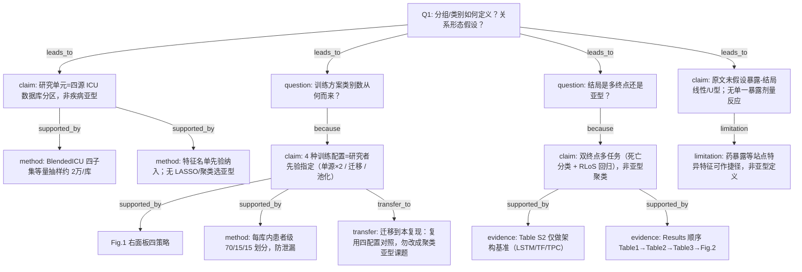

# AI-A Decision Tree Round 1

paper_id: paper_025
question_id: Q1
task_type: literature_decision_tree_reasoning
question: 本研究预设了几个分组/亚型/类别？该数量是数据驱动还是研究者主观指定？是否假设了暴露-结局关系的方向（线性、单调、U型）？
source_file: adversarial_lit_reading/chunks/paper_025_allyn_2026_blended_los_pooling.md (+ MOESM1/MOESM2)

## 1. Evidence Map

| evidence_id | location | evidence_summary | used_by_node |
|---|---|---|---|
| E1 | Abstract / Methods | 四库（eICU / MIMIC-IV / AmsterdamUMC / HiRID）harmonized BlendedICU；TPC 联合预测 ICU 死亡 + RLoS | N1, N2 |
| E2 | Fig.1 / Methods | 四种训练配置为先验指定：①Amsterdam 单源；②MIMIC 单源；③迁移学习（MIMIC→Amsterdam）；④数据池化（MIMIC+Amsterdam 联合） | N3, N4 |
| E3 | Methods / Fig.1 Step3 | 患者级划分 train/val/test = 70%/15%/15%，非聚类定类 | N5 |
| E4 | Methods（two-stage RLoS） | RLoS 假定存活出院；死亡者评估时不计入 RLoS；损失为 BCE(mort)+α·MAPE(RLoS)，α=20 | N6, N7 |
| E5 | Additional File2 Table S2 | 架构对照 LSTM / Transformer / TPC，为方法基准而非亚型发现 | N8 |
| E6 | Results Table1–3 / Fig.2 | Results 按：队列描述→内外验落差→四训练方案 specialization/generalization→样本量效应 | N9 |
| E7 | Methods Feature Selection / MOESM1 | 特征为先验临床变量集（人口学+生命体征+实验室+17药+GCS/尿量），非数据驱动亚型 | N10 |
| E8 | Discussion / Methods | 无 LCA/聚类定 K；无暴露-结局线性/U型假设；预测任务为深度多任务，非回归剂量反应 | N11 |

## 2. Decision Tree - Mermaid

## 3. Node Table

| node_id | node_type | claim | evidence_location | evidence_summary | confidence | risk_tag |
|---|---|---|---|---|---|---|
| N0 | question | 分组来源与关系形态？ | Q1 | 根问题 | high | — |
| N1 | claim | 分区单位是数据库来源，不是临床亚型 | Abstract; Data source | 四库对照 | high | — |
| N2 | method | 每库约 20,000 例等量抽取 | Methods | BlendedICU 子集 | high | — |
| N3 | question | 训练方案类别是否数据驱动？ | Fig.1 | 设计问题 | high | — |
| N4 | claim | 四训练方案为先验实验设计，非聚类定 K | Fig.1; Table3 | ①–④ 明确列出 | high | — |
| N5 | method | 患者级 70/15/15 | Methods | 防泄漏 | high | — |
| N6 | question | 是否做亚型/多终点？ | Methods | 设计问题 | high | — |
| N7 | claim | 双终点多任务预测，非亚型发现 | Methods; loss α=20 | 死亡+RLoS | high | — |
| N8 | evidence | LSTM/Transformer/TPC 基准 | Additional File2 Table S2 | 架构比较 | high | — |
| N9 | evidence | Results 展开顺序 | Results | Table1–3, Fig.2 | high | — |
| N10 | method | 特征先验清单 | MOESM1 Input features | 无数据驱动亚型 | high | — |
| N11 | claim | 无线性/U型暴露-结局假设声明 | Methods/全文 | 深度学习预测任务 | high | — |
| N12 | limitation | 站点特异特征可导致捷径学习 | Results/Discussion | 药暴露等 | medium | 可迁移性不足 |
| N13 | transfer | 本复现应对齐四训练配置与双终点，勿改成聚类 | Q8 预告 | 复现口径 | medium | — |

## 4. Provisional Answer

本研究**没有**做数据驱动的亚型/聚类定 K。核心「类别」是研究者**先验指定**的：（1）四个数据源分区；（2）四种训练策略（两单源 + 迁移学习 + 数据池化）；（3）两个预测终点（ICU 死亡、条件存活下的 RLoS）。患者划分是固定比例 70/15/15。原文**未**声明暴露-结局的线性/单调/U 型剂量反应假设——任务是时序深度多任务预测，而非回归暴露效应曲线。

## 5. Uncertainty List

- 原文未给出「为何恰好选 Amsterdam + MIMIC 做池化/迁移、而以 eICU/HiRID 作未见外验」的形式化准则以外的细节是否还有其他候选配对。【原文未明确说明备选配对】
- RLoS cap=10 天与 α=20 的敏感性：主文有 Fig.2 样本量效应，但对 α 敏感性原文未系统报告。
- 本数据交付包注明 PI-3：原文精确 N（3574/10915/14489）构造式未完全公开，复现用同规则重抽而非逐例同一队列。

## 6. Follow-up Questions

- Q2：双终点如何联合报告、是否多重比较校正？
- Q3：为何选 TPC 而非 LSTM/Transformer（Table S2）？
- Q5：MNAR、前向填充+缺失指示、clip/归一化假设是否满足？
- Q8：如何把公开 BlendedLoS 代码接到四库真实提取包与本引擎 batch？
