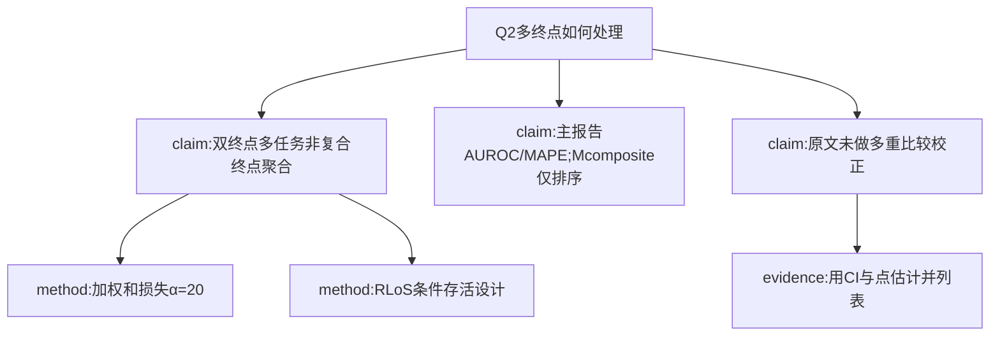

# AI-A Decision Tree Round 1
paper_id: paper_025
question_id: Q2
question: 如何处理多亚型/多终点/多层暴露？是否多重比较？是否复合终点聚合？
source_file: chunks/paper_025_allyn_2026_blended_los_pooling.md + MOESM1/2

## 1. Evidence Map
| id | location | summary | nodes |
|---|---|---|---|
| E1 | Methods/loss | 双终点：ICU死亡(BCE)+RLoS(MAPE)；α=20加权联合损失 | N1,N2 |
| E2 | Methods | RLoS条件于存活；死亡者不计入RLoS评估 | N3 |
| E3 | Methods metrics | AUROC/AUPRC/MAPE + Mcomposite（相对内验基线归一） | N4 |
| E4 | Results | 未声明Bonferroni/FDR；多配置比较用CI重叠解读 | N5 |
| E5 | Fig.1/Table3 | 四训练策略× specialization/generalization 分层报告 | N6 |

## 2. Mermaid

## 3. Node Table
| node_id | type | claim | evidence | conf |
|---|---|---|---|---|
| N1 | claim | 双终点联合训练，不是把终点合成单一临床复合终点 | E1 | high |
| N2 | method | L=BCE+α·MAPE，α=20 | E1 | high |
| N3 | method | 死亡者RLoS评估排除 | E2 | high |
| N4 | claim | Mcomposite用于跨配置排序，主指标仍是AUROC/MAPE | E3 | high |
| N5 | claim | 原文未明确多重比较校正 | E4 | high |
| N6 | evidence | Table3并列表+CI | E5 | high |

## 4. Provisional Answer
本研究处理**两个预测终点**（死亡分类 + RLoS回归），用加权联合损失训练；评估时RLoS条件于存活。**不是**把多终点聚合成单一临床复合终点；Mcomposite是归一化排序指标。原文**未**报告Bonferroni/FDR等多重比较校正，主要靠分层报告与CI解读。无临床亚型多重比较问题。

## 5. Uncertainty List
- α=20敏感性未系统报告。
- 多训练配置并行比较是否应校正：原文未说明。

## 6. Follow-up
Q3方法选择；Q6外验证据。
