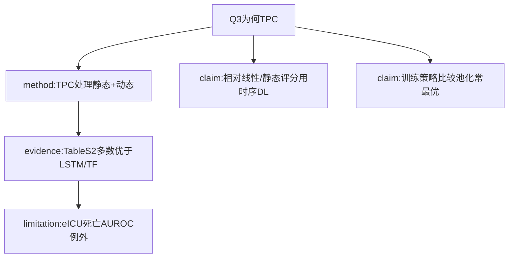

# AI-A Decision Tree Round 1
paper_id: paper_025
question_id: Q3
question: 该方法与既有方法（logistic/Cox/LSTM/Transformer等）区别？为何选TPC？换方法结论会变吗？
source_file: paper_025 + MOESM2

## 1. Evidence Map
| id | location | summary | nodes |
|---|---|---|---|
| E1 | Methods | 选用TPC（Rocheteau）；对照LSTM/Transformer | N1 |
| E2 | MOESM2 Table S2 | 多数库/任务TPC更优；eICU死亡AUROC例外非最优 | N2 |
| E3 | Intro/Methods | 相对静态评分/线性LOS模型：用时序小时更新 | N3 |
| E4 | Results Table3 | 池化优于/不劣于迁移与单源（视任务） | N4 |

## 2. Mermaid

## 3. Node Table
| node_id | type | claim | evidence | conf |
|---|---|---|---|---|
| N1 | method | TPC为参考架构 | E1 | high |
| N2 | evidence | Table S2总体支持TPC | E2 | high |
| N2b | limitation | eICU死亡TPC非最优 | E2 | high |
| N3 | claim | 相对既往线性LOS假设改用时序模型 | E3 | high |
| N4 | claim | 多源策略层面池化突出 | E4 | high |

## 4. Provisional Answer
相对LSTM/Transformer，作者以TPC作主架构，因适合静态+动态时序；MOESM2显示多数设置TPC更优，但**eICU死亡AUROC例外**。相对传统线性/静态评分，本文强调小时级动态预测。主文结论还依赖**训练策略**（池化/迁移）比较，不单是架构。

## 5. Uncertainty
换架构是否改变“池化优于迁移”：原文以TPC为主报告，未对每策略全架构网格。

## 6. Follow-up
Q6验证；Q8迁移到本复现仍用公开TPC。
