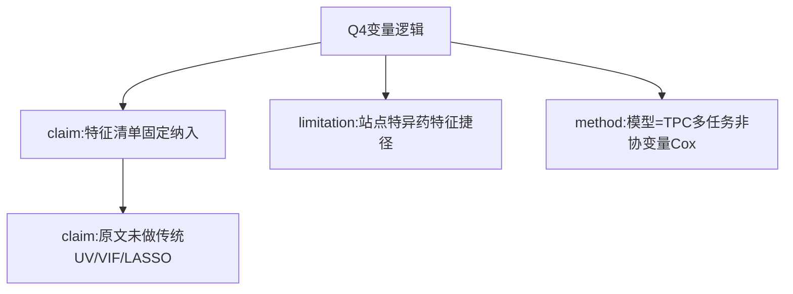

# AI-A Decision Tree Round 1
paper_id: paper_025
question_id: Q4
question: 变量/协变量筛选与建模逻辑？入模依据？模型形式？是否预先确定？
source_file: MOESM1 Feature Selection

## 1. Evidence Map
| id | location | summary | nodes |
|---|---|---|---|
| E1 | MOESM1 | 固定纳入人口学+生命体征+实验室+17药+GCS/尿量 | N1 |
| E2 | Methods | 无LASSO/逐步/VIF叙述；特征来自BlendedICU v0.3.2 | N2 |
| E3 | Results/Disc | 药暴露可成站点捷径 | N3 |
| E4 | Methods | 深度TPC多任务，非回归协变量调整模型 | N4 |

## 2. Mermaid

## 3. Node Table
| node_id | type | claim | evidence | conf |
|---|---|---|---|---|
| N1 | claim | 入模=固定临床变量集 | E1 | high |
| N2 | claim | 无传统协变量筛选管道叙述 | E2 | high |
| N3 | limitation | 药暴露端口捷径 | E3 | medium |
| N4 | method | DL多任务而非调整回归 | E4 | high |

## 4. Provisional Answer
变量逻辑是**预先固定的BlendedICU特征清单**（含17药），不是单因素p/LASSO管道。模型形式是TPC多任务深度学习，不是加性Cox/logistic协变量模型。药暴露等站点特征事后被讨论为捷径风险。

## 5. Uncertainty
17药如何从>100药中选定的细则：MOESM1称selection，完整规则需对照BlendedICU配置。

## 6. Follow-up
Q5预处理假设；Q8本复现用官方keep=62清单。
