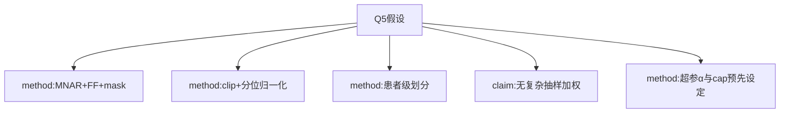

# AI-A Decision Tree Round 1
paper_id: paper_025
question_id: Q5
question: 依赖哪些参数假设？划分与超参？缺失MNAR如何处理？加权设计？
source_file: Methods + MOESM1

## 1. Evidence Map
| id | location | summary | nodes |
|---|---|---|---|
| E1 | Methods | 缺失定性MNAR；前向填充+缺失指示mask | N1 |
| E2 | Methods | clip生理合理范围；q5-q95归一到[-1,1]，后再clip[-4,4] | N2 |
| E3 | Methods | 患者级70/15/15防泄漏 | N3 |
| E4 | Methods | 非NHANES加权；无survey权重 | N4 |
| E5 | config/paper | α=20；RLoS cap 10天；min_los等超参 | N5 |

## 2. Mermaid

## 3. Node Table
| node_id | type | claim | evidence | conf |
|---|---|---|---|---|
| N1 | method | MNAR处理=FF+mask | E1 | high |
| N2 | method | 双阶段clip/归一化 | E2 | high |
| N3 | method | 70/15/15患者级 | E3 | high |
| N4 | claim | 非加权设计 | E4 | high |
| N5 | method | α=20,cap=10 | E5 | high |

## 4. Provisional Answer
关键假设：MNAR（机构采样+病情依赖）；用前向填充+缺失指示；极端值clip后分位归一化；患者级划分防泄漏；**无**NHANES式加权。超参α与RLoS上限为设计常量。若FF引入偏倚，外验落差可能放大——作者用外验量化该风险。

## 5. Uncertainty
前向填充时限BlendedICU上游未完全公开；本RealExtraction包亦标注P0未闭合项。

## 6. Follow-up
Q6外验；Q7局限。
