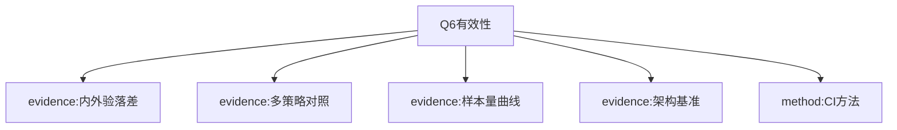

# AI-A Decision Tree Round 1
paper_id: paper_025
question_id: Q6
question: 如何证明分析有效？内/外验、敏感性、基线对照？证据强度？
source_file: Results Table2-3 Fig.2 MOESM2

## 1. Evidence Map
| id | location | summary | nodes |
|---|---|---|---|
| E1 | Table2 | 内验高估外验：MAPE↑至+51.8%，AUROC↓至-13.8% | N1 |
| E2 | Table3 | 四策略 specialization/generalization + Mcomposite | N2 |
| E3 | Fig.2 | 训练样本量效应 | N3 |
| E4 | MOESM2 | 架构基准 | N4 |
| E5 | Methods | DeLong AUROC CI；bootstrap MAPE/AUPRC | N5 |

## 2. Mermaid

## 3. Node Table
| node_id | type | claim | evidence | conf |
|---|---|---|---|---|
| N1 | evidence | 内验不能代替外验 | E1 | high |
| N2 | evidence | 池化改善泛化/专化权衡 | E2 | high |
| N3 | evidence | 更大数据有帮助 | E3 | high |
| N4 | evidence | TPC基准 | E4 | high |
| N5 | method | DeLong/bootstrap | E5 | high |

## 4. Provisional Answer
有效性证据层级：**(1)**四库外验量化内验乐观偏差；**(2)**四训练策略对照；**(3)**架构基准；**(4)**样本量曲线；**(5)**CI方法披露。无E-value/阴性对照（预测任务语境）。证据对“单源不够、池化有益”方向较强。

## 5. Uncertainty
无独立第五库前瞻验证；无前瞻床旁部署试验。

## 6. Follow-up
Q7局限。
