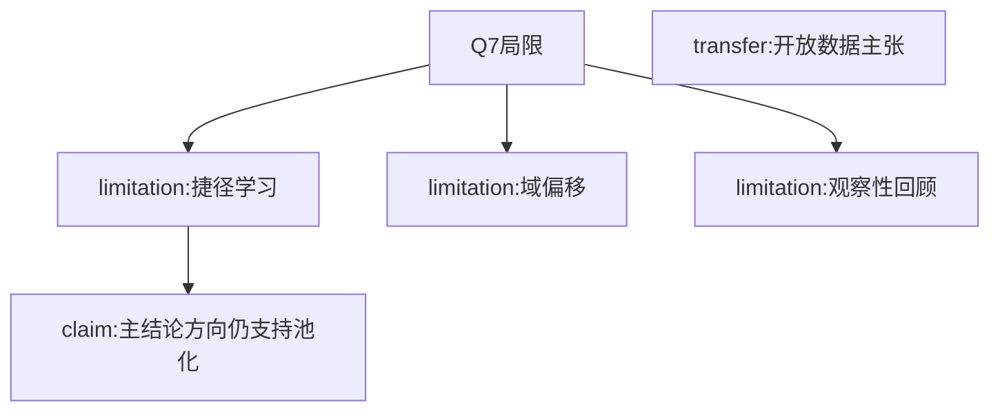

# AI-A Decision Tree Round 1
paper_id: paper_025
question_id: Q7
question: 局限有哪些？是否动摇主结论方向？
source_file: Discussion

## 1. Evidence Map
| id | location | summary | nodes |
|---|---|---|---|
| E1 | Disc | 站点捷径/药暴露损害可移植性 | N1 |
| E2 | Disc/Results | 域偏移导致外验下降 | N2 |
| E3 | Methods | 观察性数据库；既有伦理豁免 | N3 |
| E4 | Disc | 主张开放本地ICU数据与可定制开源模型 | N4 |

## 2. Mermaid

## 3. Node Table
| node_id | type | claim | evidence | conf |
|---|---|---|---|---|
| N1 | limitation | 站点特异特征捷径 | E1 | high |
| N2 | limitation | 外验性能下降 | E2 | high |
| N3 | limitation | 回顾观察性 | E3 | high |
| N5 | claim | 未推翻“池化优于单源”方向 | E2 | medium |

## 4. Provisional Answer
主要局限：捷径学习、域偏移、回顾性观察、RLoS定义/封顶简化。作者用外验与去捷径讨论缓解。这些局限**削弱绝对性能数字的可外推性**，但**不直接推翻**“单源内验高估、池化改善泛化”的方向性结论。

## 5. Uncertainty
前瞻部署与临床决策影响未测。

## 6. Follow-up
Q8迁移到本复现。
