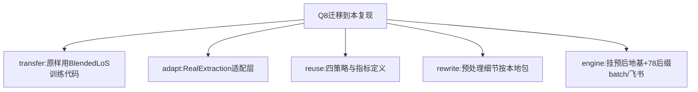

# AI-A Decision Tree Round 1
paper_id: paper_025
question_id: Q8
question: 方法可迁移到本研究（用RealExtraction四库真实数据复现BlendedLoS全流程）哪些可原样套用、哪些必须改写？
source_file: paper_025 + RealExtraction交付说明

## 1. Evidence Map
| id | location | summary | nodes |
|---|---|---|---|
| E1 | github BlendedLoS | 公开训练/出表脚本1-5 | N1 |
| E2 | RealExtraction README | 四库真实hourly+delivery；训练未跑；PI-3 N构造 | N2 |
| E3 | Methods | 四策略+TPC+指标定义可对齐 | N3 |
| E4 | delivery 07 yaml | 预处理部分P0未闭合（FF时限等） | N4 |

## 2. Mermaid

## 3. Node Table
| node_id | type | claim | evidence | conf |
|---|---|---|---|---|
| N1 | transfer | 训练/表图优先公开代码 | E1 | high |
| N2 | transfer | 数据用本地真实提取+适配 | E2 | high |
| N3 | transfer | 实验设计对齐原文 | E3 | high |
| N4 | transfer | 预处理按delivery配置改写 | E4 | medium |
| N5 | transfer | Medical Blocks 78 batch | 用户需求 | high |

## 4. Provisional Answer
**可原样套用**：BlendedLoS训练/评估/出表脚本；四训练策略；TPC多任务；AUROC/AUPRC/MAPE/Mcomposite定义。  
**必须改写**：数据路径（RealExtraction→适配BlendedICU布局）；部分预处理P0项；N与原文逐例一致不可证（PI-3同规则重抽）；引擎侧Decisiontree/config/run/飞书/Blocks78编排。  
**不适用**：把课题改成聚类亚型或发病logistic地基。

## 5. Uncertainty
上游BlendedICU完整OMOP是否还需重跑：本包已直接源库提取，可跳过。

## 6. Follow-up
实现78流水线并batch。
