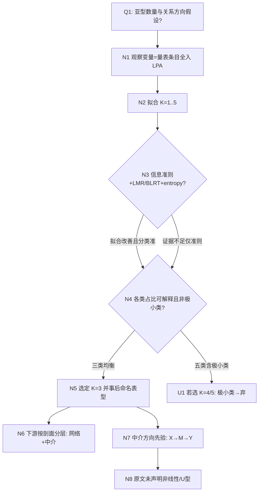

# AI-A Round1 Decision Tree — paper_060 / Q1

**Paper**: Ma et al., 2026, *Acta Psychologica* (PMID 42214160) — Psychological phenotypes of sense of coherence  
**Question (Q1)**: 本研究预设了几个分组/亚型/类别？该数量是数据驱动还是研究者主观指定？是否假设了暴露-结局关系的方向？

---

## 1. Evidence Map

| eid | claim | evidence_strength | evidence_location | quote/paraphrase |
|-----|-------|-------------------|-------------------|------------------|
| E1 | LPA 探索 1–5 类，结合拟合与可解释性选定 **3 类** | 论文明确证明 | Methods 2.3(2); Results 3.2; Table 2; Fig.1 | 「Models with one to five classes were explored… three-class solution… optimal」 |
| E2 | 类数判定依据：AIC/BIC/aBIC、entropy、LMR、BLRT + 临床可解释性/类占比 | 论文明确证明 | Methods 2.3(2) | 列出信息准则、entropy、LMR/BLRT；并强调 interpretability |
| E3 | 五类模型虽可拟合但出现极小类（0.14/0.16），限制解释，故弃 | 论文实验显示 | Results 3.2 | 「five-class model… very small classes… limited interpretability」 |
| E4 | 三类标签为事后命名（Low / Moderate / High SOC 表型），非先验临床分型 | 论文明确证明 | Results 3.2 | 基于条目均值模式命名三类 |
| E5 | 网络与中介在「全样本 + 各 SOC 剖面」上分层比较，剖面来自 LPA 而非先验二分类 | 论文明确证明 | Methods 2.3(3)(4); Results 3.3–3.4 | 分 Profile 建网与中介 |
| E6 | 中介路径方向先验设定为 SOC → illness perception → anxiety–depression（调节中介） | 论文明确证明 | Methods 2.3(4); Introduction 理论段 | IV=SOC(剖面或连续)，M=illness perception，DV=anxiety–depression |
| E7 | 暴露-结局关系未声明非线性/U 型；中介用 bootstrap 间接效应，未报 RCS | 原文未说明（非线性） / 论文明确证明（中介方向） | Methods 2.3 | 未见 RCS/阈值形态预先声明 |
| E8 | Soft class 占比约 0.27 / 0.42 / 0.31，要求每类 >80 人的样本量规划 | 论文明确证明 | Methods 2.4; Results 3.2 | 样本量论证 + 实际 n=130/205/151 |

---

## 2. First-pass Methods Notes（不绑定疾病专名到迁移结论）

- 设计：横断面；量表条目作 LPA 观察变量。  
- 统计清单：描述/χ² → **LPA(1–5)** → 多分类 Logistic 预测剖面隶属 → **分层心理网络（EBICglasso）** → **调节/分层中介（bootstrap）**。  
- 分组来源：**数据驱动类数**，事后标签。  
- 关系形态：中介路径方向先验；未见非线性形状假设。

---

## 3. Decision Tree（分析推理）

### Nodes

| node_id | claim | evidence | risk_tag |
|---------|-------|----------|----------|
| N1 | LPA 以完整量表条目为观察变量，非总分硬切 | E1, Methods 2.3(2) | |
| N2 | 预先扫描 1–5 类，非主观锁死 K | E1 | |
| N3 | 用 AIC/BIC/aBIC/entropy/LMR/BLRT 作参考 | E2 | |
| N4 | 最终以可解释性与类占比否决过高 K | E3,E8 | |
| N5 | 最优结构为 3 类；标签事后赋予 | E4,E8 | |
| N6 | 网络与中介以 LPA 剖面为分层/调节轴 | E5 | |
| N7 | 中介因果方向为理论先验的 X→M→Y | E6 | 横断面时序局限→Q7 |
| N8 | 未预设暴露-结局非线性形状 | E7 | 原文未说明 |

### Edges

- Q1 → N1 because 分组对象是潜剖面观察变量  
- N1 → N2 supported_by E1  
- N2 → N3 supported_by E2  
- N3 → N4 if 需在统计与实质间权衡  
- N4 → N5 leads_to 三类解  
- N4 → U1 if 过高 K 出现极小类  
- N5 → N6 leads_to 下游分层分析  
- N5 → N7 because 中介以剖面/SOC 为 X  
- N7 → N8 limitation 关系形态未做非线性声明  

---

## 4. Uncertainty List

1. LMR/BLRT 对四类仍显著时，三类优选多大程度上依赖「可解释性」主观权重 → 原文有叙述但无量化权重。  
2. 中介里 SOC 作连续总分 vs 剖面类别的主分析优先级 → Methods 写「either continuous or latent profile」；Results 以分层中介为主。  
3. 是否对剖面隶属做软分类不确定性传播 → 原文未说明。

---

## 5. Direct Answer to Q1

1) **分组/类别来源：数据驱动**（LPA 比较 K=1…5），最终 **K=3**；标签事后命名，不是先验暴露二分类。  
2) **关系形态**：中介路径方向 **先验指定**（X→M→Y）；**未**声明线性/U 型/阈值的暴露-结局形状。  
3) 先验方向依据为 Sense of Coherence / illness perception 理论框架（Introduction + Methods 2.3(4)），不是方便取样分组。

---

## 6. Transfer Hint（指向本课题，待 Q8 展开）

迁移时：应用本课题结局/中介量表条目做 LPA 的 K 扫描，**禁止照搬文献 K=3**；中介方向按研究问题先验为「躯体症状 → 过度关注/恐惧 → 功能残疾」。
