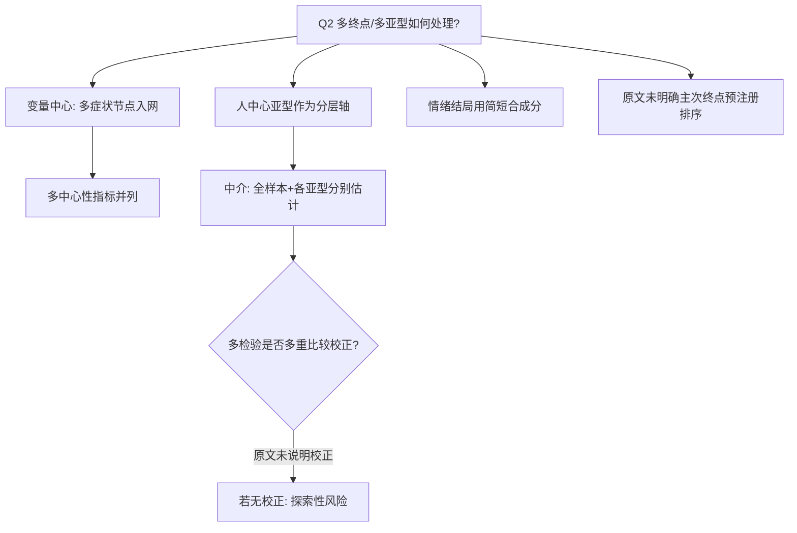

# AI-A Round1 Decision Tree — paper_060 / Q2

**Question (Q2)**: 如何处理多亚型/多终点/多层暴露？是否多重比较？是否聚合终点？

---

## 1. Evidence Map

| evidence_id | location | evidence_summary | used_by_node |
|---|---|---|---|
| E1 | Results 3.2–3.4 | 主线按 LPA 三类展开：基线比较→剖面预测→分层网络→分层中介 | N1 |
| E2 | Methods 2.3(3) | 网络节点为疾病感知多条目 + 焦虑抑郁多条目；分全样本与各剖面 | N2 |
| E3 | Methods 2.3(4); Table 6 | 中介在 All + 各剖面分别估计；报告间接/直接/总效应 | N3 |
| E4 | Table 1; Table 3 | 多人口学/临床因子比较与多分类 Logistic；未见 Bonferroni/FDR 声明 | N4 |
| E5 | Methods 2.3 | PHQ-4 作焦虑抑郁综合评分；未见主成分复合终点 | N5 |
| E6 | Methods/Results | 未见明确「主终点 vs 次要终点」预先排序声明 | N6 |
| E7 | Fig.2–3; Table 4 | 多中心性指标（strength/EI/bridge 等）并列报告 | N2b |

## 2. Decision Tree - Mermaid

## 3. Node Table

| node_id | node_type | claim | evidence_location | evidence_summary | confidence | risk_tag |
|---|---|---|---|---|---|---|
| N1 | method | 多亚型用人中心 LPA，下游分层 | Results 3.2+ | 三类分层 | high | |
| N2 | method | 多暴露/症状以网络节点处理，非全做终点 | Methods 2.3(3) | 条目网络 | high | |
| N2b | method | 多中心性指标并列 | Table 4; Fig.3 | strength/EI/bridge | high | |
| N3 | method | 中介在全样本与亚型重复估计 | Table 6 | All+profiles | high | |
| N4 | limitation | 多检验未见 Bonferroni/FDR | Methods | 原文未说明 | high | 证据不足 |
| N5 | method | 焦虑抑郁用合成分而非多终点 PCA | Methods 2.2.4 | PHQ-4 | high | |
| N6 | uncertainty | 未明确主次终点预声明 | Methods | 原文未说明 | medium | |
| U1 | limitation | 无多重比较时亚型×效应族膨胀 | — | 推断 | medium | |

## 4. Provisional Answer

1) **多亚型**：LPA 三类作为分层/调节轴，网络与中介在 All + 各亚型重复。  
2) **多症状/多层**：网络把多条目当节点；中介把疾病感知总分当单一中介。  
3) **多重比较**：原文**未明确说明** Bonferroni/FDR；Table1/3 多检验与多剖面中介存在探索性膨胀风险。  
4) **终点聚合**：情绪用 PHQ-4 合成分；未见主成分复合终点策略。

## 5. Uncertainty List

- U1: 剖面间网络比较是否做 NCT/置换检验 → 原文强调 CS 稳定性，未见组间 NCT 明确报告。  
- U2: 多中心性指标是否预先指定主指标（strength）→ 原文并列表述。

## 6. Follow-up Questions

1. 迁移课题对平行竞争中介是否预声明 FDR？  
2. 网络组间比较是否强制 NCT？
