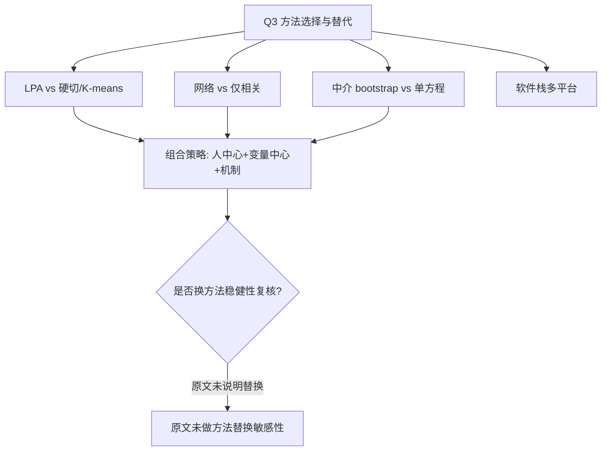

# AI-A Round1 — paper_060 / Q3

**Q3**: 该方法与既有方法区别？为何选此法？换方法结论会变吗？

## 1. Evidence Map

| eid | location | summary | node |
|---|---|---|---|
| E1 | Methods 2.3(2) | 用人中心 LPA（非整群硬切/仅总分三分位） | N1 |
| E2 | Methods 2.3(3) | 用 EBICglasso 心理网络 + 桥接/中心性，非仅相关矩阵叙述 | N2 |
| E3 | Methods 2.3(4) | 调节/分层中介 + bootstrap，非只做相关或单回归 | N3 |
| E4 | Discussion | 自称整合 LPA+网络+中介揭示异质性机制 | N4 |
| E5 | Methods/Results | 未见用 LCA/K-means/传统逐步回归/SEM 全模型作为敏感性替换 | N5 |
| E6 | Tools | SPSS/Mplus/PROCESS/JASP；网络在 R | N6 |

## 2. Mermaid

## 3. Node Table

| node_id | type | claim | conf | risk |
|---|---|---|---|---|
| N1 | method | LPA 捕捉条目模式异质性，优于单一总分切点 | high | |
| N2 | method | 网络识别中心/桥节点，优于只报相关 | high | |
| N3 | method | 中介量化间接路径 | high | 横断面因果 |
| N4 | claim | 三件套回答「谁异质+结构+机制」 | high | |
| N5 | limitation | 未见 LCA/SEM/K-means 替换复核 | high | 证据不足 |
| N6 | method | 多软件实现 | medium | |
| U1 | limitation | 换方法结论是否不变：原文未证明 | high | |

## 4. Provisional Answer

相对「总分三分位 + 相关 + 单回归」，本文用 **LPA + 心理网络 + 调节/分层中介**。动机是表型异质性与机制。**原文未做**系统方法替换敏感性，故「换方法结论是否不变」属【证据不足】。

## 5. Uncertainty List
- U1: Mplus LPA 与 tidyLPA/mclust 迁移等价性未讨论。
- U2: PROCESS 调节中介 vs lavaan SEM 竞争模型未做。

## 6. Follow-up
1. 本课题是否强制 LPA 算法敏感性（mclust vs tidyLPA）？
2. 平行竞争中介是否加反向/SEM 竞争模型？
