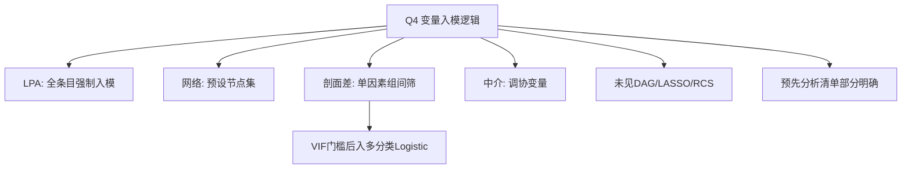

# AI-A Round1 — paper_060 / Q4

**Q4**: 变量/协变量筛选与建模逻辑？

## 1. Evidence Map

| eid | location | summary | node |
|---|---|---|---|
| E1 | Results 3.1–3.2; Table1 | 先组间比较筛显著人口学/临床变量 | N1 |
| E2 | Results 3.2; Table3 | 显著且 VIF&lt;5 入多分类 Logistic 预测剖面 | N2 |
| E3 | Methods 2.3(2) | LPA 观察变量=量表全部条目 | N3 |
| E4 | Methods 2.3(3) | 网络节点=预设条目集合（感知+情绪） | N4 |
| E5 | Methods 2.3(4) | 中介控制协变量（写 controlling for covariates） | N5 |
| E6 | Methods | 未见 DAG/LASSO/逐步；未见交互/RCS 入主模 | N6 |
| E7 | Methods 2.3 | 分析流程似按 Results 顺序预置，非完全 data peek 声明 | N7 |

## 2. Mermaid

## 3. Provisional Answer

入模分层：**(i)** LPA/网络节点由量表结构先验指定；**(ii)** 剖面预测因子来自单因素显著 + VIF&lt;5；**(iii)** 中介调整协变量有声明但名单细节需核 Table/脚注。未见 DAG/LASSO/RCS。逻辑大体事前方法清单，非完全预注册。

## 4. Uncertainty
- 中介具体协变量名单是否全文列出 → 需核。
- 单因素 p 阈值数值原文未写死。

## 5. Follow-up
迁移课题：症状→中介→残疾路径是否锁死暴露/中介集合（SSD-12∥Whiteley）并预声明调整集？
