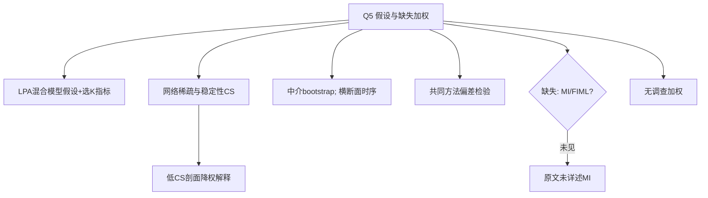

# AI-A Round1 — paper_060 / Q5

**Q5**: 参数假设？缺失？加权？

## 1. Evidence Map

| eid | location | summary | node |
|---|---|---|---|
| E1 | Methods 2.3(2) | LPA 依赖局部独立/正态条目等混合模型假设；用 LMR/BLRT/entropy 助选 | N1 |
| E2 | Methods 2.3(3) | 网络：稀疏 GGM/EBICglasso；CS case-dropping 评稳定性 | N2 |
| E3 | Methods 2.3(4) | 中介 bootstrap 5000；横断面 | N3 |
| E4 | Methods 2.3 | Harman 单因子共同方法偏差 | N4 |
| E5 | Methods/Results | 有效问卷完整分析；未见 MICE/FIML 详述 | N5 |
| E6 | Design | 非复杂抽样；无 survey 权重 | N6 |
| E7 | Results 3.3 | 某剖面 CS 偏低 | N7 |

## 2. Mermaid

## 3. Provisional Answer

关键假设：LPA 混合模型、网络稀疏/稳定性、中介路径与 bootstrap。做了 Harman。**非加权设计**。缺失处理细节【原文未明确说明】多重插补/FIML。低 CS 剖面解释需谨慎。

## 4. Follow-up
本课题：FIML/MI、完整病例敏感性是否强制（反馈已要求）？
