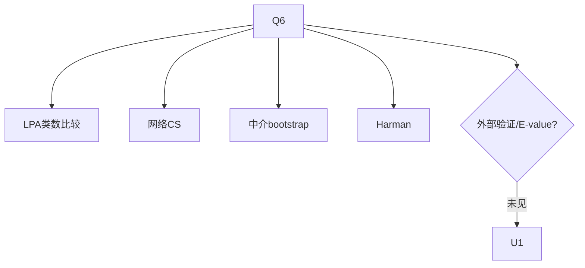

# AI-A Round1 — paper_060 / Q6

**Q6**: 如何证明分析有效？内外部验证？敏感性？

## Evidence Map
| eid | loc | summary |
|---|---|---|
| E1 | Table2 | LPA 多K比较选模 |
| E2 | Results3.3 | 网络 CS case-dropping |
| E3 | Methods2.3(4) | 中介 bootstrap 5000 |
| E4 | Methods2.3 | Harman CMB |
| E5 | Methods/Results | 未见外部队列验证、E-value、阴性对照 |
| E6 | Discussion | 承认横断面/样本局限 |

## Mermaid

## Answer
有效性证据主要是**内部**：类数比较、CS、bootstrap、Harman。无外部验证/E-value。【证据不足】方法替换敏感性。

## Uncertainty
区分度/校准类指标不适用于该描述-机制文。
