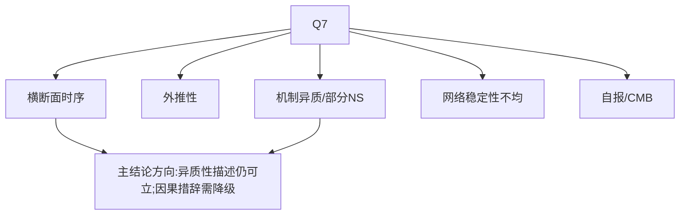

# AI-A Round1 — paper_060 / Q7

**Q7**: 局限？是否动摇主结论？

## Evidence Map
| eid | loc | summary |
|---|---|---|
| E1 | Discussion | 横断面无法确立时序/因果 |
| E2 | Discussion/Methods | 单中心/特定病种外推受限 |
| E3 | Results | 部分剖面中介不显著→机制非普遍 |
| E4 | Results | 低CS剖面网络不稳 |
| E5 | Discussion | 自我报告与共同方法 |
| E6 | Methods | 中介协变量名单不清（可重复性） |

## Mermaid

## Answer
主要局限：横断面因果、外推、机制非全亚型成立、网络稳定性不均、自报。作者有讨论。动摇的是**强因果/普遍机制**表述，不必然推翻「存在异质表型+网络结构可描述」的弱结论。

## Follow-up
迁移课题须在 Limitations 写清横断面中介与完整病例。
