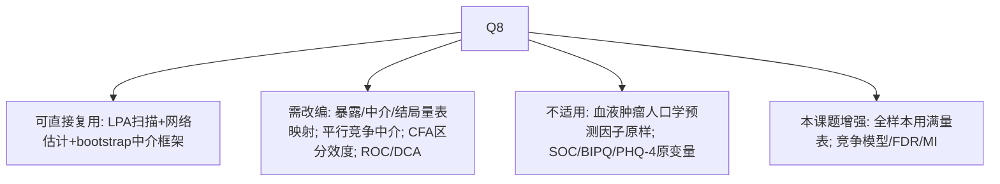

# AI-A Round1 — paper_060 / Q8

**Q8 我的研究（已确认）**：综合医院门诊数据（尽量用满全样本与量表），核心问题——躯体症状对 WHO-DAS 功能残疾是直接效应还是经过度关注/恐惧（SSD-12∥Whiteley）中介；并用 LPA 识别 DAS 功能亚型；按方法块落盘（83 LPA / 02 计分 / 62 CFA / 20 平行竞争中介 / 50 分层网络 / 13 ROC+DCA）。

## Evidence Map
| eid | loc | transferable |
|---|---|---|
| E1 | Methods LPA | 可迁移：条目LPA+复合选K*规则需重做 |
| E2 | Network | 可迁移：glasso+CS+桥接；节点改映射到 SSD/Whiteley/DAS/PHQ 等 |
| E3 | Mediation | 需改编：平行竞争中介+间接效应差；非单一 BIPQ |
| E4 | Design | 横断面同；人群/量表不同 |
| E5 | Tools | R/PROCESS → R mediation/lavaan；LPA 用 tidyLPA/mclust |

## Mermaid

## Answer
1) **可复用**：LPA K 扫描与复合选模逻辑、glasso 网络+CS/桥、bootstrap 中介、剖面分层比较框架。  
2) **必须改编**：X=躯体症状（PHQ-15/SSS-8），M=SSD-12∥Whiteley，Y=WHO-DAS；LPA 靶=DAS 条目；全样本尽量用满变量；Block 按方法目录分置。  
3) **不适用**：原文病种特异协变量与 SOC/BIPQ 原样照搬；勿照搬 K=3。  
4) **边界**：横断面中介仍不能证因果；需补 CFA、竞争模型、阈值分析（反馈要求）。

## Uncertainty
全样本含非 SSD 时，主分析是否分层/交互需在决策树确认。
