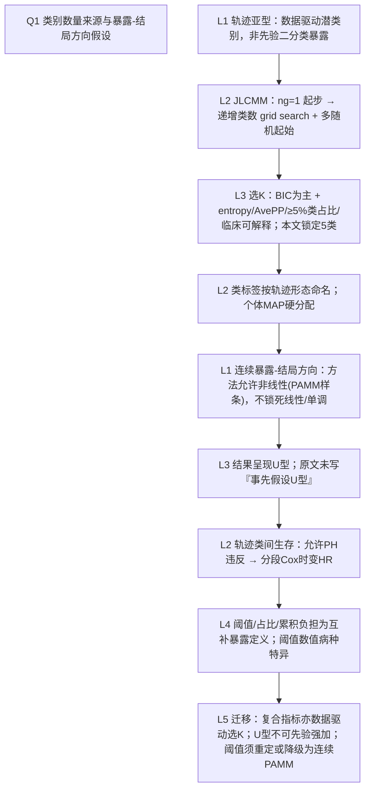

# AI-A Decision Tree Round 1

paper_id: paper_1871653
question_id: Q1
task_type: literature_decision_tree_reasoning
question: Q1 本研究预设了几个分组/亚型/类别？该数量是数据驱动还是主观指定？是否假设了暴露-结局关系的方向（线性、单调、U 型）？
source_file: adversarial_lit_reading/chunks/paper_1871653_fcimb_temperature_jlcm.md

## 1. Evidence Map

| evidence_id | location | evidence_summary | used_by_node |
|---|---|---|---|
| E1 | Methods 2.5.1（chunk L278–298） | JLCMM 识别纵向暴露轨迹潜类别；先拟合 ng=1 得初值，再 grid search + 多随机起始拟合递增类数 | N1, N2 |
| E2 | Methods 2.5.1（L294–298） | 最优类数依据 BIC、后验类别概率、entropy、临床可解释性；每类≥5% 人群；MAP 分配 | N3 |
| E3 | Results 3.2（L418–429） | BIC 在五类最低；四类 entropy 更高但五类仍可接受（各类>5%、mean PP>0.70）；五类死亡风险分离更清晰 → 主分析锁定 5 类 | N3, N4 |
| E4 | Results 3.2 / Fig1（L432–437） | 五类按轨迹形态命名（非先验暴露定义）；类规模与形状由模型估计给出 | N4 |
| E5 | Methods 2.5.3（L336–347） | PAMM 将连续暴露作时变协变量，惩罚样条灵活建模非线性及与入院后时间的交互 | N5, N6 |
| E6 | Results 3.4 / Fig5（正文） | PAMM 显示暴露–死亡呈非线性 U 型；风险最低靠近正常高限；低与过高均升高风险——**结果呈现**非事先锁死 U 型假设 | N6 |
| E7 | Methods 2.5.1（L311–313） | 因 KM 曲线交叉提示 PH 可能违反，用分段 Cox 估时变 HR，切点取最大 log-likelihood | N7 |
| E8 | Methods 2.5.3（L348–356） | 另报阈值异常、暴露时间占比、累积负担四套互补暴露度量（阈值在体温论文为 ≤36 / ≥39 °C） | N8 |

## 2. Decision Tree - Mermaid

## 3. Node Table

| node_id | node_type | claim | evidence_location | evidence_summary | confidence | risk_tag |
|---|---|---|---|---|---|---|
| N0 | question | 类别数来源与方向假设 | — | — | high | |
| N1 | claim | 轨迹类=数据驱动潜类别 | Methods 2.5.1 | JLCMM | high | |
| N2 | method | ng=1→递增类 + grid search | Methods 2.5.1 | 稳定性策略 | high | |
| N3 | evidence | 主文锁定5类（BIC+可解释） | Results 3.2 / Supp T3–T4 | BIC最低五类 | high | |
| N4 | method | 形态命名 + MAP | Results 3.2 / Fig1 | 非先验暴露组 | high | |
| N5 | method | PAMM 样条允许非线性 | Methods 2.5.3 | 不锁线性 | high | |
| N6 | evidence | 结果呈 U 型 | Results / Fig5 | 结果非预设 | high | |
| N7 | method | 分段 Cox 因 PH 可疑 | Methods 2.5.1 | 交叉KM | high | |
| N8 | method | 四套互补暴露度量 | Methods 2.5.3 | 阈值病种特异 | medium | 可迁移性不足 |
| N9 | transfer | 复合指标：重选K；勿抄体温阈值 | 迁移节点 | 用户研究方向 | high | |

## 4. Provisional Answer

轨迹亚型数量是**数据驱动**：JLCMM 比较多类解后，以 BIC、后验概率、entropy、≥5% 类占比与临床可解释性选定，本文主分析为 **5 类**（非研究者事先指定 5 个暴露组）。暴露–结局方向在方法层**允许非线性**（PAMM 惩罚样条 + 与时间交互），正文结果呈现 **U 型**，但原文**未明确写**「分析前假定 U 型」；轨迹类间则因 KM 交叉改用分段 Cox。阈值异常定义（≤36/≥39 °C）为体温特异，迁移到复合指标时不可照抄。

## 5. Uncertainty List

- U1: 五类是否对每个复合指标强制，还是每指标重选 K——原文未讨论多暴露指标批跑。
- U2: 复合指标「异常」阈值原文未给出；仅连续 PAMM 是否足够对齐 Fig5/6。
- U3: 体温 6 小时窗 vs 实验室日级分辨率对类数/形状的影响，原文未说明跨频率稳健性。

## 6. Follow-up Questions

1. 多指标批跑时：每指标独立选 K，还是统一尝试 2–6 后按同一规则锁 K？
2. PAMM 阈值/占比/累积负担三套：复合指标是重定百分位阈值，还是只保留连续时变暴露主分析？
