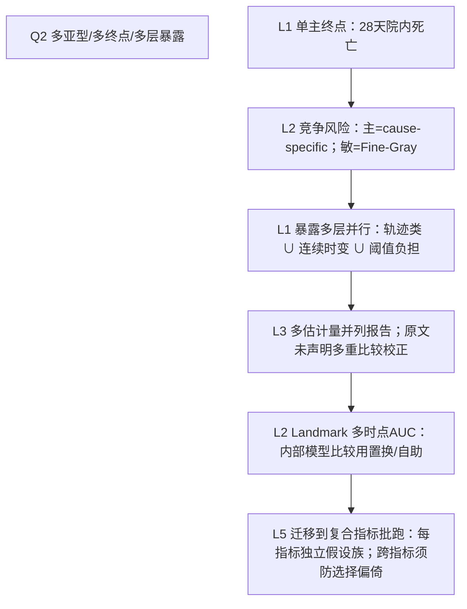

# AI-A Decision Tree Round 1

paper_id: paper_1871653
question_id: Q2
task_type: literature_decision_tree_reasoning
question: Q2 如何处理多亚型/多终点/多层暴露？是否多重比较？是否聚合？
source_file: adversarial_lit_reading/chunks/paper_1871653_fcimb_temperature_jlcm.md

## 1. Evidence Map

| evidence_id | location | evidence_summary | used_by_node |
|---|---|---|---|
| E1 | Methods 2.4 Outcomes | 主终点=28 天院内死亡；出院存活作竞争事件语境；院内口径保证跨库可比 | N1 |
| E2 | Methods 2.5.5 | 主分析 cause-specific（出院作删失）；敏感性 Fine-Gray（出院作竞争风险）；另在有完整随访库重复 28 天死亡 | N2 |
| E3 | Methods 2.5.1–2.5.3 | 多层暴露：①轨迹潜类别；②连续时变暴露(PAMM)；③阈值/占比/累积负担四套互补度量 | N3 |
| E4 | Results 全文结构 | 多轨迹类两两/相对参照报 HR；多 landmark AUC；多暴露度量表（Supp T9/T10）——原文**未写** Bonferroni/FDR | N4 |
| E5 | Methods 2.5.2 | Landmark 日 1–14 重复评估 discrimination；bootstrap/permutation 做模型比较 | N5 |

## 2. Decision Tree - Mermaid

## 3. Node Table

| node_id | node_type | claim | evidence_location | evidence_summary | confidence | risk_tag |
|---|---|---|---|---|---|---|
| N1 | claim | 单一主终点 | Methods 2.4 | 28d 院内死亡 | high | |
| N2 | method | 竞争风险主/敏分工 | Methods 2.5.5 | CS vs FG | high | |
| N3 | method | 暴露多层互补非主成分聚合 | Methods 2.5.x | 三类框架 | high | |
| N4 | evidence | 未报多重比较校正 | Results/Methods | 原文未明确说明 | medium | 证据不足 |
| N5 | method | Landmark 比较有置换检验 | Methods 2.5.2 | 2000 次 | high | |
| N6 | transfer | 多指标批跑需另定选择规则 | 迁移 | dual_safe 池 | high | 可迁移性不足 |

## 4. Provisional Answer

主终点单一（28 天院内死亡）；竞争风险用 cause-specific 为主、Fine-Gray 为敏感性。暴露不作 PCA 聚合，而是**轨迹亚型 + 连续时变 + 阈值负担**多层互补。多类 HR、多 landmark、多暴露度量并列报告，原文**未明确**多重比较校正。迁移到「双库可算全部复合指标」时，每指标可视为独立分析，但指标筛选/成功闸门须在引擎层另定，避免事后挑选。

## 5. Uncertainty List

- U1: 多指标成功/失败闸门原文无对应（体温单暴露）。
- U2: 未校正多重比较是否影响类间 HR 解读——原文未讨论。

## 6. Follow-up Questions

1. dual_safe 批跑是否沿用轨迹预后既有「显著性/可拟合」闸门？
2. Fine-Gray 敏感性是否每个成功指标都跑？
