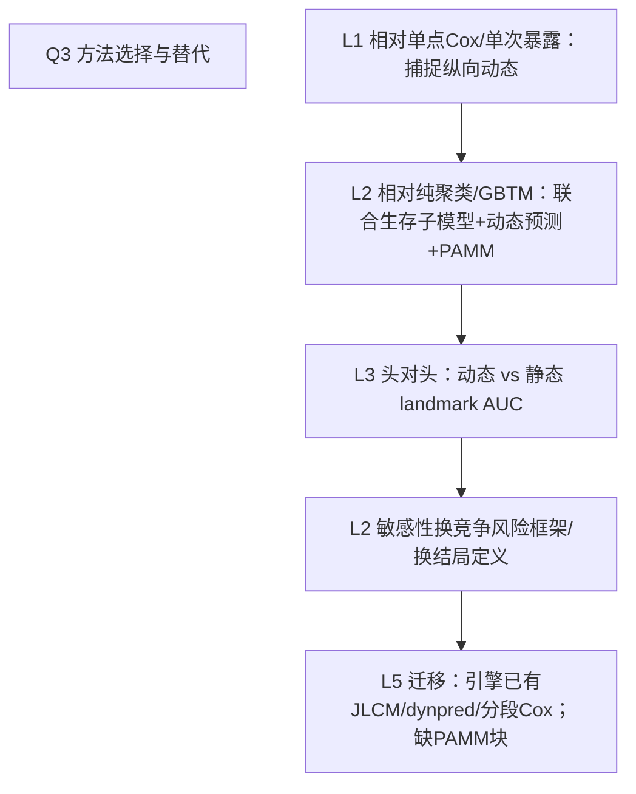

# AI-A Decision Tree Round 1

paper_id: paper_1871653
question_id: Q3
task_type: literature_decision_tree_reasoning
question: Q3 该方法与既有方法区别？为何选此法？换方法结论会变吗？
source_file: adversarial_lit_reading/chunks/paper_1871653_fcimb_temperature_jlcm.md

## 1. Evidence Map

| evidence_id | location | evidence_summary | used_by_node |
|---|---|---|---|
| E1 | Introduction | 批评单次/早期体温测量；既往轨迹研究偏分类，缺少时变连续关联与动态预测整合 | N1 |
| E2 | Methods 2.5.1–2.5.3 | 核心组合：JLCMM 亚型 + landmark 动态预测 + PAMM 连续时变非线性 + 分段 Cox | N2 |
| E3 | Methods 2.5.2 | 对照：静态模型= landmark 单点暴露值；动态模型= JLCMM 纵向信息 | N3 |
| E4 | Results 动态预测段 | 动态模型 discrimination 总体优于静态；非每个 landmark 均统计显著 | N3 |
| E5 | Methods 2.5.5 | 稳健性：Fine-Gray；在可随访库重复 28 天死亡结局下重跑轨迹+PAMM | N4 |

## 2. Decision Tree - Mermaid

## 3. Node Table

| node_id | node_type | claim | evidence_location | evidence_summary | confidence | risk_tag |
|---|---|---|---|---|---|---|
| N1 | claim | 针对单点测量局限 | Introduction | 动态不足 | high | |
| N2 | method | JLCMM+PAMM+分段Cox 组合 | Methods | 方法栈 | high | |
| N3 | evidence | 动态≥静态 AUC | Results | 非处处显著 | medium | |
| N4 | method | FG 与结局敏感性 | Methods 2.5.5 | 稳健性 | high | |
| N5 | transfer | 复用轨迹块+新建 PAMM | 引擎盘点 | 见 Block 计划 | high | |

## 4. Provisional Answer

相对传统单点 Cox/静态暴露，本文用 JLCMM 抓亚型与动态预测，用 PAMM 抓连续非线性时变关联，用分段 Cox 处理类间 PH 违反。与纯聚类的区别在于联合生存子模型与外验套参。换方法方面：与静态对照做过 discrimination；竞争风险框架与结局定义做过敏感性。原文未系统比较「仅 GBTM / 仅 k-means / 仅 RCS」全替代栈。

## 5. Uncertainty List

- U1: 若不用 PAMM 只保留 JLCM，是否算「方法完整对齐」——用户已要求 PAMM。
- U2: 外验不含南京单中心时，与原文验证集构成差异。

## 6. Follow-up Questions

1. 是否保留静态 vs 动态 AUC 对比作为必出图/表？
