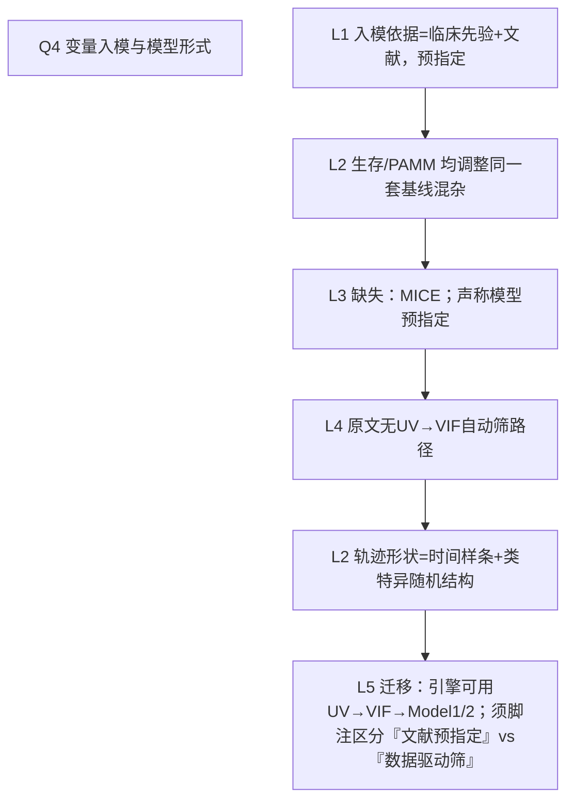

# AI-A Decision Tree Round 1

paper_id: paper_1871653
question_id: Q4
task_type: literature_decision_tree_reasoning
question: Q4 变量/协变量筛选与建模逻辑？是否预先确定？
source_file: adversarial_lit_reading/chunks/paper_1871653_fcimb_temperature_jlcm.md

## 1. Evidence Map

| evidence_id | location | evidence_summary | used_by_node |
|---|---|---|---|
| E1 | Methods 2.3 Covariates | 协变量临床相关+既往文献预指定；含人口学、合并症、实验室、生命体征、通气/CRRT 等 | N1 |
| E2 | Methods 2.5.1 | 生存子模型纳入预指定基线协变量；Weibull 基线风险 | N2 |
| E3 | Methods 2.5.3 | PAMM：暴露时变；基线协变量作时间固定混杂 | N2 |
| E4 | Methods 结尾 | 「All models were prespecified…」；MICE 处理协变量缺失 | N3 |
| E5 | Methods/Results | 原文**未写**单因素 p 筛、LASSO、逐步回归、VIF 流程 | N4 |
| E6 | Methods 2.5.1 | 纵向子模型：入院后时间自然立方样条；截距与时间效应类间可变 | N5 |

## 2. Decision Tree - Mermaid

## 3. Node Table

| node_id | node_type | claim | evidence_location | evidence_summary | confidence | risk_tag |
|---|---|---|---|---|---|---|
| N1 | method | 协变量预指定 | Methods 2.3 | 非 p 值筛 | high | |
| N2 | method | 调整进生存/PAMM | Methods 2.5 | 时间固定混杂 | high | |
| N3 | method | MICE + 预指定声明 | Methods | 缺失处理 | high | |
| N4 | uncertainty | 无 VIF/逐步细节 | Methods | 原文未明确说明 | medium | 证据不足 |
| N5 | method | 时间样条纵向结构 | Methods 2.5.1 | 非线性时间 | high | |
| N6 | transfer | 引擎筛变量须标注口径 | 迁移 | 预后地基习惯 | high | |

## 4. Provisional Answer

协变量按**临床相关性与文献预指定**进入 JLCMM 生存子模型与 PAMM，**不是**单因素→逐步/LASSO 主路径；缺失用 MICE。纵向暴露用时间自然立方样条、类特异效应。原文未描述 VIF。迁移到 COPD 复合指标批跑时：可用引擎 UV/VIF 定 Model1/2，但 Methods 须写清与原文「预指定」差异；暴露本身为复合指标日轨迹，成分变量须硬排除。

## 5. Uncertainty List

- U1: 原文协变量完整名单以 Table1/脚注为准，chunk 表格可能截断。
- U2: m/seed/是否含结局入插补矩阵——原文未细写。

## 6. Follow-up Questions

1. COPD 课题协变量走「文献预指定短清单」还是「引擎 UV→VIF 终末池」？
