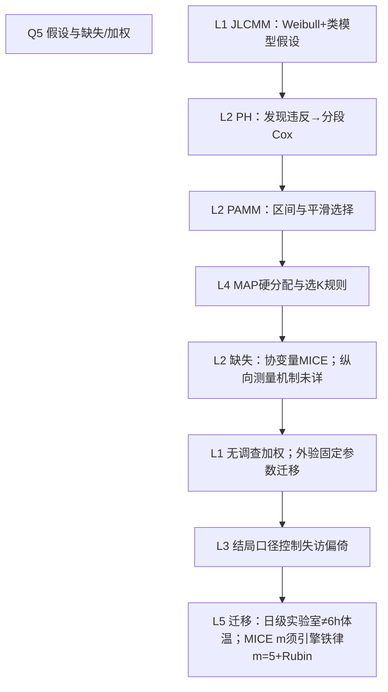

# AI-A Decision Tree Round 1

paper_id: paper_1871653
question_id: Q5
task_type: literature_decision_tree_reasoning
question: Q5 依赖哪些参数假设？是否满足？加权？缺失？
source_file: adversarial_lit_reading/chunks/paper_1871653_fcimb_temperature_jlcm.md

## 1. Evidence Map

| evidence_id | location | evidence_summary | used_by_node |
|---|---|---|---|
| E1 | Methods 2.5.1 | Weibull 基线风险；潜类别局部独立性/类内混合模型假设（标准 JLCMM） | N1 |
| E2 | Methods 2.5.1 / Results | KM 交叉 → 怀疑 PH → 分段 Cox；非全程依赖单一 PH Cox | N2 |
| E3 | Methods 2.5.3 | PAMM：区间离散化 + 惩罚样条；依赖平滑参数/区间切分选择 | N3 |
| E4 | Methods 2.5.1 | 选 K：BIC/entropy/AvePP/≥5%；MAP 硬分配忽略分配不确定性 | N4 |
| E5 | Methods 缺失段 | 协变量 MICE；纵向体温「所有可用测量」——测量过程缺失机制原文未深入 | N5 |
| E6 | Methods 设计 | 非 NHANES 加权；多中心回顾队列；外验套用发现集参数 | N6 |
| E7 | Methods 2.4 | 院内死亡口径规避出院后失访；出院存活作竞争语境 | N7 |

## 2. Decision Tree - Mermaid

## 3. Node Table

| node_id | node_type | claim | evidence_location | evidence_summary | confidence | risk_tag |
|---|---|---|---|---|---|---|
| N1 | method | Weibull JLCMM | Methods 2.5.1 | 参数假设 | high | |
| N2 | method | PH 违反→分段 | Methods/Results | 有应对 | high | |
| N3 | method | PAMM 平滑假设 | Methods 2.5.3 | 细节有限 | medium | 证据不足 |
| N4 | limitation | MAP 忽略不确定性 | Methods | 常见局限 | medium | |
| N5 | method | MICE；纵向缺失未详 | Methods | 机制不明 | medium | 证据不足 |
| N6 | claim | 无 survey 权重 | Methods | 不适用 NHANES | high | |
| N7 | method | 院内终点控失访 | Methods 2.4 | 设计选择 | high | |
| N8 | transfer | 分辨率与 Rubin 铁律 | 迁移 | 日级+m=5 | high | |

## 4. Provisional Answer

关键假设：JLCMM（Weibull、类模型）、PH（发现违反后改分段 Cox）、PAMM 平滑/区间化、MAP 分类、MICE 的 MAR 隐含。无复杂抽样加权。外验依赖「发现集参数可迁移」。纵向体温测量不规则的选择偏倚原文讨论有限。迁移：复合指标用日级实验室；插补遵循引擎 m=5 + Rubin（操作层 complete#1）。

## 5. Uncertainty List

- U1: PAMM 具体区间长度、平滑参数选择标准原文未给数值细节。
- U2: MICE 的 m、maxit、seed、是否入结局——原文未明确说明。

## 6. Follow-up Questions

1. COPD 是否同样把「出院存活」作竞争风险敏感性？
