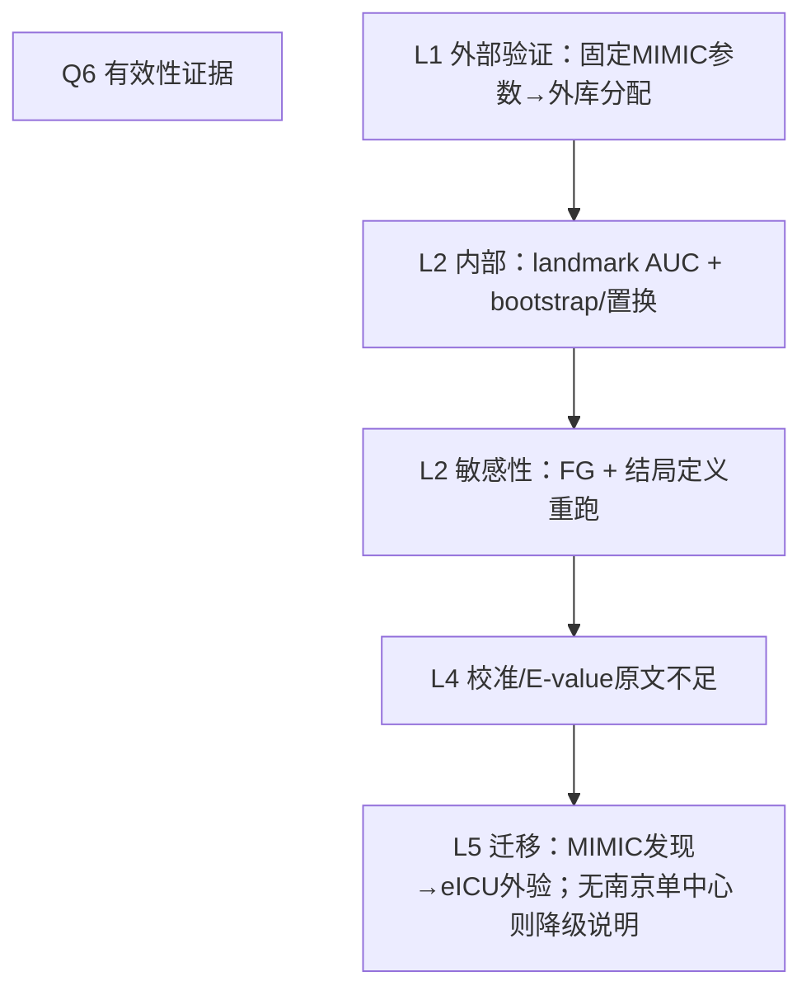

# AI-A Decision Tree Round 1

paper_id: paper_1871653
question_id: Q6
task_type: literature_decision_tree_reasoning
question: Q6 如何证明分析有效？内/外验、敏感性、证据强度？
source_file: adversarial_lit_reading/chunks/paper_1871653_fcimb_temperature_jlcm.md

## 1. Evidence Map

| evidence_id | location | evidence_summary | used_by_node |
|---|---|---|---|
| E1 | Methods 2.5.4 / Results | 外验：eICU-CRD + 南京鼓楼；用 MIMIC 参数估计后验类概率；比较类分布与死亡风险；重估时变关联 | N1 |
| E2 | Methods 2.5.2 | 内部分辨：landmark 时依 AUC；bootstrap 2000；动态 vs 静态 permutation 2000 | N2 |
| E3 | Methods 2.5.5 | 敏感性：Fine-Gray；完整随访下 28 天死亡重跑 JLCMM+PAMM | N3 |
| E4 | Results | 外验轨迹形态大体可复现；类特异风险方向大致一致 | N1 |
| E5 | Methods/Results | 原文**未强调**校准曲线/Hosmer；E-value/阴性对照未报 | N4 |

## 2. Decision Tree - Mermaid

## 3. Node Table

| node_id | node_type | claim | evidence_location | evidence_summary | confidence | risk_tag |
|---|---|---|---|---|---|---|
| N1 | evidence | 外验套参 | Methods 2.5.4 | 多中心 | high | |
| N2 | evidence | 时依 AUC | Methods 2.5.2 | 动态>静态总体 | high | |
| N3 | method | FG/结局敏感性 | Methods 2.5.5 | 稳健性 | high | |
| N4 | limitation | 校准/E-value缺 | — | 原文未明确说明 | medium | 证据不足 |
| N5 | transfer | COPD: MIMIC→eICU | 用户确认 A | 对齐原文 | high | |

## 4. Provisional Answer

有效性主要靠：**外验固定参数迁移**、landmark 时依 AUC（含 bootstrap/置换）、竞争风险与结局敏感性。校准与未测混杂量化较弱。COPD 复现按用户确认走 MIMIC 发现 → eICU 外验；缺南京队列须在 Limitations 写明验证集降级。

## 5. Uncertainty List

- U1: 外验 PAMM 是否完全同超参重估——原文写「same modeling framework」。
- U2: 多指标批跑时外验成功标准如何定义。

## 6. Follow-up Questions

1. 外验失败的指标是否仍导出发现集主文图？
