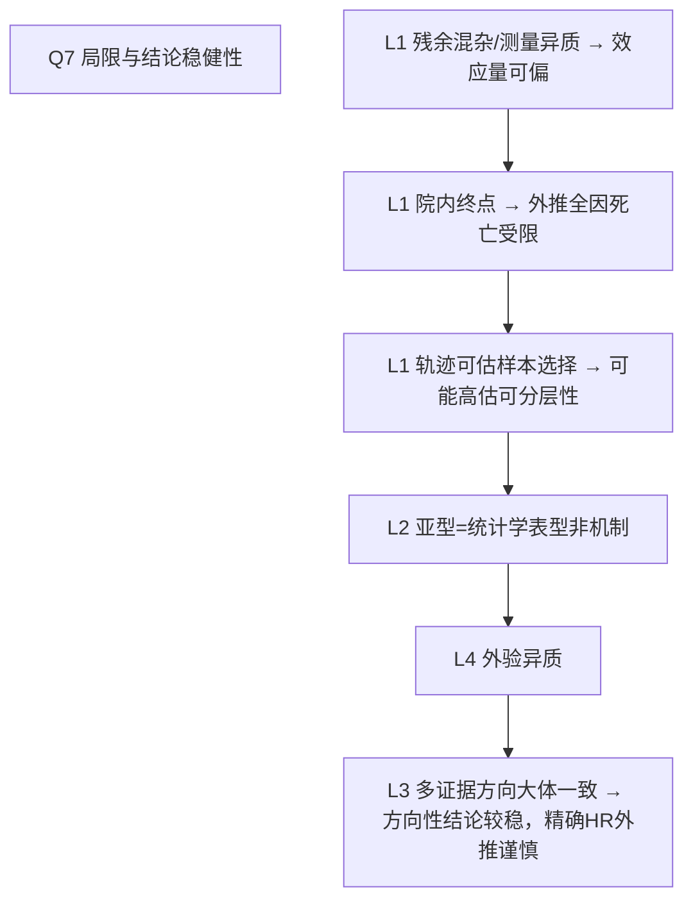

# AI-A Decision Tree Round 1

paper_id: paper_1871653
question_id: Q7
task_type: literature_decision_tree_reasoning
question: Q7 局限有哪些？是否动摇主结论方向？
source_file: adversarial_lit_reading/chunks/paper_1871653_fcimb_temperature_jlcm.md

## 1. Evidence Map

| evidence_id | location | evidence_summary | used_by_node |
|---|---|---|---|
| E1 | Discussion/局限（及设计段） | 观察性残余混杂；体温测量设备/部位/频率异质 | N1 |
| E2 | Methods 2.4 | 仅院内死亡，出院后死亡不可靠（尤其 eICU） | N2 |
| E3 | Methods 选入 | 需足够纵向测量才能估轨迹 → 选择偏倚（排除者死亡更高、LOS 更短，Supp） | N3 |
| E4 | Methods | MAP 硬分类；潜类别解释非机制证明 | N4 |
| E5 | 外验设计 | 验证集合并异质来源；单中心占比小 | N5 |

## 2. Decision Tree - Mermaid

## 3. Node Table

| node_id | node_type | claim | evidence_location | evidence_summary | confidence | risk_tag |
|---|---|---|---|---|---|---|
| N1 | limitation | 混杂与测量 | Discussion | 观察性 | high | 因果过度 |
| N2 | limitation | 院内终点 | Methods 2.4 | 失访控制代价 | high | |
| N3 | limitation | 入选偏倚 | Supp 排除比较 | 死亡更高 | high | |
| N4 | limitation | 亚型非机制 | Discussion | 解释边界 | high | |
| N5 | limitation | 外验异质 | Methods | 合并队列 | medium | |
| N6 | claim | 方向结论相对稳健 | Results 多证据 | 外验大致同向 | medium | |

## 4. Provisional Answer

主要局限：观察性混杂、测量异质、院内终点外推受限、轨迹样本选择偏倚、亚型非机制、外验队列异质。多重分析与外验使**方向性**结论较稳，但精确效应量与临床阈值迁移需谨慎。复合指标复现另增：日级分辨率、指标阈值不可照抄体温切点、多指标多重比较。

## 5. Uncertainty List

- U1: Discussion 全文在 chunk 后部，个别局限措辞可能截断。

## 6. Follow-up Questions

1. COPD Limitations 是否强制写「无南京单中心外验」？
