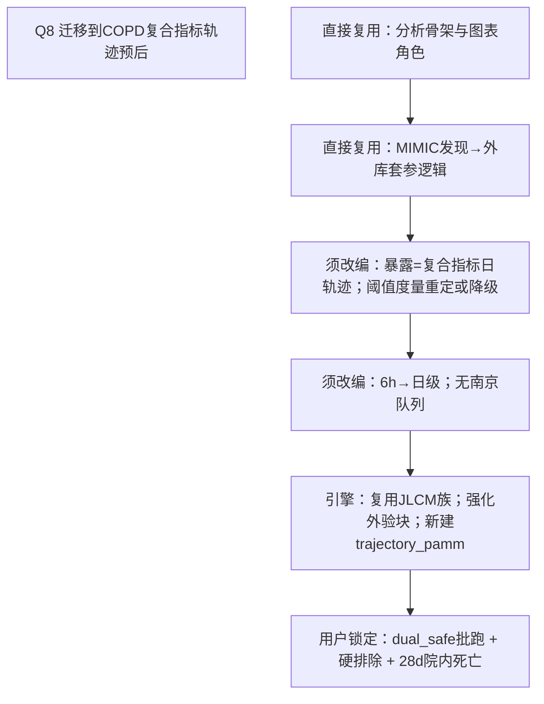

# AI-A Decision Tree Round 1

paper_id: paper_1871653
question_id: Q8
task_type: literature_decision_tree_reasoning
question: Q8 可迁移到「我的研究」？我的研究=COPD，MIMIC 发现→eICU 外验套参；暴露=双库 dual_safe 可算全部复合指标（疾病成分硬排除后）日级轨迹；结局=death_within_hosp_28days；方法对齐 JLCMM+分段Cox+landmark动态预测+PAMM；要完整图表深度。
source_file: adversarial_lit_reading/chunks/paper_1871653_fcimb_temperature_jlcm.md

## 1. Evidence Map

| evidence_id | location | evidence_summary | used_by_node |
|---|---|---|---|
| E1 | Methods 全套 2.5 | 可迁移骨架：纳排→纵向暴露窗→JLCMM 选K→轨迹图→landmark KM→分段Cox→dynpred AUC→PAMM→外验套参→FG敏感性 | N1 |
| E2 | Methods 2.5.4 | 外验=发现集参数估计后验类成员概率 | N2 |
| E3 | Methods 2.5.3 | PAMM + 四套暴露度量；阈值依赖体温 ℃ | N3 |
| E4 | Methods 数据 | 体温 6h 汇总；COPD 数据为日级实验室 | N4 |
| E5 | 引擎盘点 | 已有 26/53 轨迹 JLCM/KM/分段Cox/dynpred/weibull；13 外验块偏 smoke；无 PAMM 块 | N5 |
| E6 | 用户确认 | 结局 28d 院内死亡；验证设计 A；要 PAMM 新块；dual_safe 指标池 | N6 |

## 2. Decision Tree - Mermaid

## 3. Node Table

| node_id | node_type | claim | evidence_location | evidence_summary | confidence | risk_tag |
|---|---|---|---|---|---|---|
| N1 | transfer | 方法骨架可原样套 | Methods 2.5 | 图表一一对应 | high | |
| N2 | transfer | 外验套参可原样套 | Methods 2.5.4 | 用户选 A | high | |
| N3 | transfer | 阈值℃不可照抄 | Methods 2.5.3 | 复合指标 | high | 可迁移性不足 |
| N4 | transfer | 时间粒度改编 | 数据现实 | 日级 lab | high | |
| N5 | transfer | Block：强化13+新建30 | 引擎 | PAMM=pammtools | high | |
| N6 | claim | 研究方向已确认 | 用户 | 四点锁定 | high | |

## 4. Provisional Answer

**(A) 原样套用**：预后地基 + JLCMM 轨迹亚型、轨迹图、landmark KM、分段 Cox、landmark 动态预测与静态对照 AUC、MIMIC→eICU 参数迁移外验、Fine-Gray 敏感性、MICE。  
**(B) 必须改编**：暴露由体温改为 dual_safe 复合指标日轨迹；PAMM 主分析保留连续时变；≤36/≥39 阈值改为指标特异规则或仅连续；无南京单中心；时间窗 6h→日。  
**(C) 引擎动作**：复用 `Blocks/26_trajectory`/`53_*`；**强化** `trajectory_lcmm_external_validate`（去掉 smoke）；**新建** `30block_trajectory_pamm.R`（`pammtools`）；batch 并行按指标 worker。

## 5. Uncertainty List

- U1: PAMM 阈值三套是否强制对齐 Supp 深度。
- U2: 每指标独立选 K=？还是统一网格。

## 6. Follow-up Questions

1. PAMM 阈值/占比/累积负担：做满还是只做连续主面板？
2. 类数：每指标 2–6 自选，还是优先尝试对齐文献展示 5 类？
