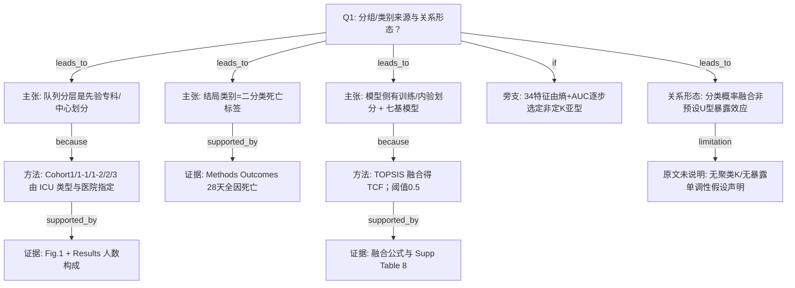

# AI-A Decision Tree Round 1

paper_id: paper_40295871
question_id: Q1
task_type: literature_decision_tree_reasoning
question: 本研究预设了几个分组/亚型/类别？该数量是数据驱动的还是研究者主观指定？是否假设了暴露-结局关系的方向？
source_file: adversarial_lit_reading/chunks/paper_40295871_tcf_septic_shock.md

## 1. Evidence Map

| evidence_id | location | evidence_summary | used_by_node |
|---|---|---|---|
| E1 | Results「Study population…」+ Fig.1 | 队列按中心/专科先验划分：Cohort1 综合ICU（训练+内验）、Cohort1-1 儿科ICU、Cohort1-2 呼吸ICU、Cohort2/3 外验；非聚类定 K | N1,N2,N3 |
| E2 | Methods「Outcomes」 | 结局为 ICU 入院后 28 天内全因死亡 vs 未死亡（二分类阳性/阴性）；由病历确认 | N4,N5 |
| E3 | Methods「Prediction modeling」 | 未处理 ICU 队列分为训练集与内验集（文中同时出现约 80%/20% 与 Results 中 2760/691≈80/20）；七个基分类器 + TOPSIS 融合得到 TCF | N6,N7 |
| E4 | Results 特征筛选段 + Fig.2 | 特征子集由缺失/方差/相关/熵排序+逐步加特征至 AUC 最优（34 个）选出，属特征选择而非亚型 K | N8 |
| E5 | Abstract / Methods TOPSIS | 融合权重由六项性能指标等权 TOPSIS 综合得分归一化得到；分类阈值固定 0.5 | N7,N9 |
| E6 | 全文 | 原文未做无监督亚型/LCA 定类数；亦未声明暴露-结局为 U 型等非线性形状假设（主线是分类预测） | N10,N11 |

## 2. Decision Tree - Mermaid

## 3. Node Table

| node_id | node_type | claim | evidence_location | evidence_summary | confidence | risk_tag |
|---|---|---|---|---|---|---|
| N0 | question | Q1 分组来源与关系形态 | — | 根问题 | high | |
| N1 | claim | 主「分组」是先验队列/专科划分 | Results Fig.1 | 非数据驱动定类数 | high | |
| N2 | method | Cohort 按综合/儿科/呼吸ICU与外院指定 | Methods Study design | 多中心回顾性 | high | |
| N3 | evidence | 各队列 n 与阳性率列表 | Results + Fig.1 | 3451/357/381/422/261 | high | |
| N4 | claim | 分析类别为 28 天死亡二分类 | Methods Outcomes | 阳=28天内死亡 | high | |
| N5 | evidence | 结局定义与计时从 ICU 入院起 | Methods Outcomes | 出院存活=阴性 | high | |
| N6 | claim | 另有训练/验证与七模型结构类别 | Methods Prediction modeling | 非患者亚型 | high | |
| N7 | method | TOPSIS 等权六指标得子模型权重 | Methods + Eq | 融合概率 | high | |
| N8 | method | 特征数 34 由逐步 AUC 选定 | Results Fig.2 | 不是亚型 K | high | |
| N9 | evidence | 内验性能与融合权重 | Table2 / Supp T8 | TCF 权重示例 | high | |
| N10 | claim | 未预设暴露-结局 U 型等形状 | 全文 Methods/Results | 主线分类预测 | medium | 方法误读 |
| N11 | uncertainty | 无聚类定 K；形状假设原文未写 | 全文 | 原文未明确说明 | high | 证据不足 |

## 4. Provisional Answer

本研究**没有**用聚类/LCA 等数据驱动方式预设患者亚型个数。文中的「分组」主要是研究者**先验指定**的队列分层（综合 ICU 开发、儿科/呼吸专科验证、外院验证）以及结局的**二分类**（ICU 入院后 28 天全因死亡 vs 否）。模型侧还有训练/内验划分与七个基分类器经 TOPSIS 融合；特征维度 34 来自熵排序+AUC 逐步筛选，**不是**亚型 K。原文**未明确说明**暴露-结局关系的线性/U 型等形状假设——分析目标是分类风险预测而非剂量反应曲线。

## 5. Uncertainty List

- U1: Methods 写训练/内验约 80%/20%，与部分叙述中的比例表述需与 Fig.1 数字交叉核对（2760/691）。
- U2: 「关系方向」在预测文中通常不写；若强行套用关联研究 Q1 的 U 型分支，易过度解读。
- U3: 儿科队列纳入意味着原文未以成人 Age≥18 为硬门控；迁移到成人 SA-AKI 时须改写纳排。

## 6. Follow-up Questions

1. 迁移到「脓毒症∩AKI、Age≥18、MIMIC+eICU」时，专科验证轴（儿科/呼吸）应改成什么外验设计？
2. 结局对齐文献的「ICU 入院后 28 天全因死亡」时，本 dabiao 应用 `death_within_hosp_28days` 还是 `death_within_icu_28days` / eICU `Expired`？
